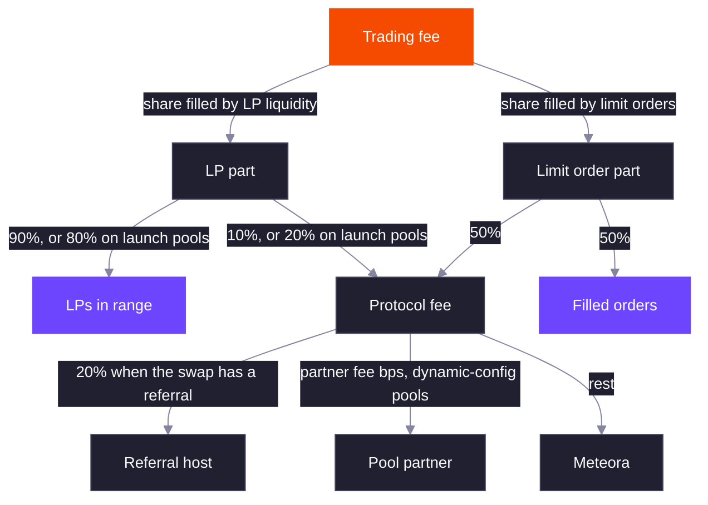

Every DLMM Pro swap pays one trading fee. The fee rate is the pool's base fee plus its dynamic fee, if enabled, and never exceeds 99%.

```text
trading fee rate = min(base fee + dynamic fee, 99%)
```

The rate is set at the start of each swap and applies to the whole swap. The fee schedule is fixed when the pool is created, from its static config or from the parameters of a dynamic-config or launch pool.

## Base Fee

The base fee follows one of five modes. Fee numerators are over `1,000,000,000`, so a numerator of `1,000,000` is 0.1%. Every fee a schedule can reach must be between 0.01% and 99%.

| Mode | Behavior |
| --- | --- |
| `Fixed` | One fee for the life of the pool. |
| `TimeSchedulerLinear` | Starts at the cliff fee at activation and drops by a fixed amount each period until it settles. |
| `TimeSchedulerExponential` | Starts at the cliff fee and drops by a fixed percentage each period. |
| `MarketCapSchedulerLinear` | Starts at the cliff fee and drops by a fixed amount each time the price rises another step above the initial price. |
| `MarketCapSchedulerExponential` | Same as linear, but each step drops the fee by a percentage. |

Schedulers exist for launches. A new pool can open with a high fee that taxes the first buyers and snipers, then falls to a normal fee as time passes or as the price climbs.

- A **time scheduler** counts periods (in slots or seconds, per the pool's activation type) from the activation point. After the last period the fee stays at its settled value.
- A **market cap scheduler** counts how many steps the square-root price has risen above its initial value, so the fee only falls if buyers push the price up. It also has an expiration: after that much time from activation, the fee settles regardless of price.

Before the activation point, schedulers charge their settled fee. See the [formulas](/core-products/dlmm-pro/formulas#base-fee-schedules) for the exact curves.

## Dynamic Fee

The dynamic fee adds a surcharge that rises when the price moves and decays when it stops. It measures how far the price has moved from a reference price, in 1 bp ticks, and charges more the further it has gone.

- Swaps close together in time (within the **filter period**) keep the same reference, so a burst of trades in one direction keeps raising the fee.
- After a quieter gap (between the filter and **decay period**), the reference moves to the current price and part of the accumulated volatility carries over, set by the **reduction factor**.
- After the decay period with no significant swap, the volatility resets to zero.

A swap counts as significant when it moves the price by at least the pool's minimum tick change. The surcharge grows with the square of the measured volatility, up to a cap.

The TypeScript SDK's `getDynamicFeeParams` builds these settings from a base fee: the surcharge is capped at 20% of the base fee, reached at a 15% price move, with a 10 second filter period, 120 second decay period and 50% reduction factor.

## Fee Token

The collect fee mode decides which token the fee is taken in.

| Mode | Selling X for Y | Buying X with Y |
| --- | --- | --- |
| `OutputToken` | Fee in Y, taken from the output | Fee in X, taken from the output |
| `OnlyY` | Fee in Y, taken from the output | Fee in Y, taken from the input |

`OnlyY` means LPs and the protocol only ever earn token Y. Pools that use it must have SOL, USDC or a token with a token badge as token Y.

## Where the Fee Goes



In each step of a swap, the fee is first split between LP liquidity and limit orders in proportion to how much of that step each one filled.

| Recipient | Share | How it is paid |
| --- | --- | --- |
| LPs | 90% of the LP part (80% on launch pools) | Accrues to ranges that were in range during the swap; claimed per position |
| Limit order makers | 50% of the limit-order part | Paid when the order is canceled |
| Referral host | 20% of the protocol fee | Sent in the swap to the referral token account the swapper passes |
| Pool partner | The pool's partner fee bps of what remains, up to 50% | Accrues on the pool; the partner claims it |
| Protocol | The rest | Claimed by Meteora |

Notes on the split:

- **Referral host.** Any token account that holds the fee token can be passed as the referral, including the swapper's own. For the limit-order part, the host's 20% is worked out as if the protocol took the LP rate, not 50%.
- **Partner.** Only pools created from a dynamic config have a partner: the config's pool creator authority. The partner fee bps comes from the config, and an operator can change it on a pool later.
- **Rounding.** Shares are rounded so the pool never pays out more than it collected.

Passing a referral does not change what the swapper receives, only who gets paid: a quote with or without a referral returns the same output.

## Related

<CardGroup cols={2}>
  <Card title="Pool Creation and Activation" href="/core-products/dlmm-pro/pool-creation-and-activation" icon="rocket">
    Which configs fix the fee schedule, and when schedulers start counting.
  </Card>
  <Card title="Formulas" href="/core-products/dlmm-pro/formulas" icon="calculator">
    Fee schedules, the dynamic fee and the fee split as equations.
  </Card>
</CardGroup>
