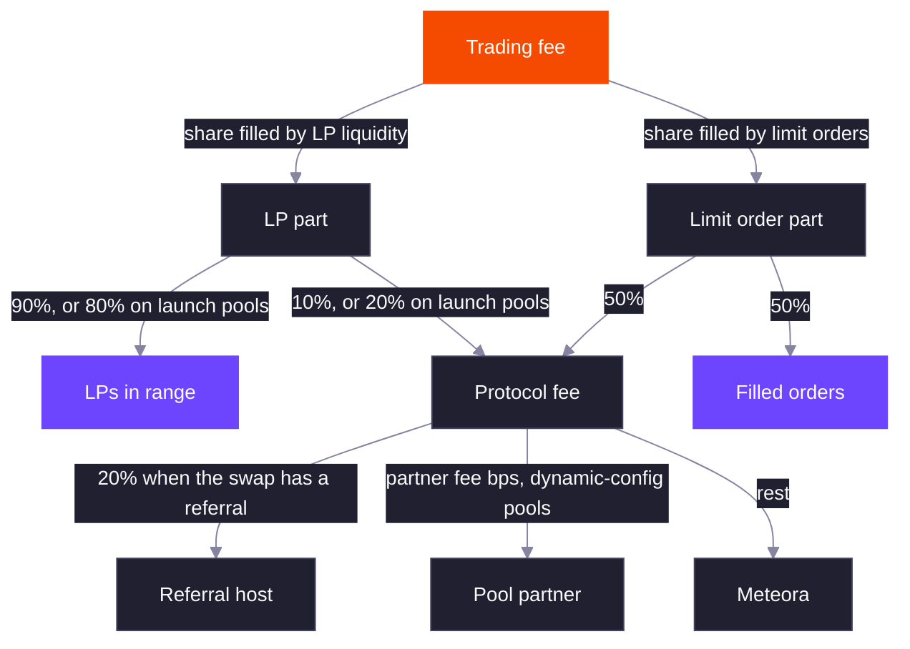

Every DLMM Pro swap pays one trading fee. The fee rate is the pool's base fee plus its dynamic fee, if enabled, and never exceeds 99%.

```text
trading fee rate = min(base fee + dynamic fee, 99%)
```

The rate is set at the start of each swap and applies to the whole swap. The fee schedule is fixed when the pool is created, from its static config or from the parameters of a dynamic-config or launch pool.

## Base Fee

The base fee follows one of five modes. Fee numerators are over `1,000,000,000`, so a numerator of `1,000,000` is 0.1%. Every fee a schedule can reach must be between 0.01% and 99%.

| Mode | Behavior |
| --- | --- |
| `Fixed` | One fee for the life of the pool. |
| `TimeSchedulerLinear` | Starts at the cliff fee at activation and drops by a fixed amount each period until it settles. |
| `TimeSchedulerExponential` | Starts at the cliff fee and drops by a fixed percentage each period. |
| `MarketCapSchedulerLinear` | Starts at the cliff fee and drops by a fixed amount each time the square-root price rises another step above its initial value. |
| `MarketCapSchedulerExponential` | Same as linear, but each step drops the fee by a percentage. |

Schedulers exist for launches. A new pool can open with a high fee that taxes the first buyers and snipers, then falls to a normal fee as time passes or as the price climbs.

- A **time scheduler** counts periods (in slots or seconds, per the pool's activation type) from the activation point. After the last period the fee stays at its settled value.
- A **market cap scheduler** counts how many steps the square-root price has risen above its initial value, so the fee only falls if buyers push the price up. The step count is recomputed from the current price on every swap, so the fee rises again if the price falls back. It also has an expiration, in slots or seconds per the activation type: after that much time from activation, the fee settles regardless of price.

Before the activation point, schedulers charge their settled fee. See the [formulas](/core-products/dlmm-pro/formulas#base-fee-schedules) for the exact curves.

### Base Fee Parameters and Limits

All numerators are over `1,000,000,000`, so 1 bp is `100,000`. Every mode needs its highest fee at or below `990,000,000` (99%) and its lowest fee at or above `100,000` (0.01%), or creating the config or pool fails with `InvalidParameters`.

| Mode | Parameters | Limits |
| --- | --- | --- |
| `Fixed` | `cliff_fee_numerator` | `100,000` to `990,000,000` |
| `TimeSchedulerLinear`, `TimeSchedulerExponential` | `cliff_fee_numerator`, `period_frequency` in slots or seconds, `reduction_factor`, `number_of_period` | `period_frequency`, `reduction_factor` and `number_of_period` above zero. `number_of_period` fits 16 bits. The fee after the last period is at least `100,000`. |
| `MarketCapSchedulerLinear`, `MarketCapSchedulerExponential` | `cliff_fee_numerator`, `reduction_factor`, `sqrt_price_step_bps`, `scheduler_expiration_duration` in slots or seconds, `number_of_period` | `reduction_factor`, `sqrt_price_step_bps`, `scheduler_expiration_duration` and `number_of_period` above zero. The step and the duration fit 32 bits. The fee after the last period is at least `100,000`. |

For a linear mode `reduction_factor` is a fee numerator taken off each period, and the cliff fee must be large enough that `cliff_fee_numerator - reduction_factor × number_of_period` stays at or above `100,000`. For an exponential mode it is in basis points, and each period multiplies the fee by `1 - reduction_factor / 10,000`. A factor of 10,000 or more fails with `MathOverflow`.

### Worked Schedules

A time scheduler that starts at 20% and ends at 1% over 10 periods of 60 seconds, activated at time 1000. The SDK's `baseFeeParameters` with `startingBaseFeeBps` 2000, `endingBaseFeeBps` 100, `numberOfPeriod` 10 and `totalDuration` 600 gives a cliff of `200,000,000`, a period frequency of 60, and a linear reduction of `19,000,000` or an exponential reduction of `2,588` bps:

| Time | Periods passed | Linear fee | Exponential fee |
| --- | --- | --- | --- |
| Before activation | Settled | 1.0000% | 1.0009% |
| 1000 to 1059 | 0 | 20.0000% | 20.0000% |
| 1060 | 1 | 18.1000% | 14.8240% |
| 1300 | 5 | 10.5000% | 4.4741% |
| 1599 | 9 | 2.9000% | 1.3504% |
| 1600 or later | 10 | 1.0000% | 1.0009% |

The exponential fee by period is `200,000,000`, `148,240,000`, `109,875,487`, `81,439,711`, `60,363,114`, `44,741,140`, `33,162,133`, `24,579,773`, `18,218,527`, `13,503,572` and `10,008,848`. The last is above 1% because the SDK picks the largest factor whose settled fee does not fall below the ending fee.

A market cap scheduler with the same fees, `priceMultiple` 4 and `schedulerExpirationDuration` 86,400 seconds. The SDK gives `sqrt_price_step_bps` of `⌊(√4 - 1) × 10,000 / 10⌋ = 1,000`, so one period passes for every 10% the square-root price rises above its initial value. The linear reduction is `19,000,000` per period and the exponential reduction is `2,588` bps:

| Square-root price against the initial value | Periods | Linear fee | Exponential fee |
| --- | --- | --- | --- |
| Before activation | Settled | 1.0000% | 1.0009% |
| At or below 1.00 | 0 | 20.0000% | 20.0000% |
| 1.05 | 0 | 20.0000% | 20.0000% |
| 1.15 | 1 | 18.1000% | 14.8240% |
| 1.414 (price 2x) | 4 | 12.4000% | 6.0363% |
| 1.5 | 5 | 10.5000% | 4.4741% |
| 2.0 (price 4x) or more | 10 | 1.0000% | 1.0009% |
| Any price, after expiration | Settled | 1.0000% | 1.0009% |

The expiration check is strict. At exactly activation time plus 86,400 the fee still follows the price, and one unit later it settles.


## Dynamic Fee

The dynamic fee adds a surcharge that rises when the price moves and decays when it stops. It measures how far the price has moved from a reference price, in 1 bp ticks, and charges more the further it has gone.

- Swaps close together in time (within the **filter period**) keep the same reference, so a burst of trades in one direction keeps raising the fee.
- After a quieter gap (between the filter and **decay period**), the reference moves to the current price and part of the accumulated volatility carries over, set by the **reduction factor**.
- After the decay period with no significant swap, the volatility resets to zero.

A swap counts as significant when it moves the price by at least the pool's minimum tick change. The surcharge grows with the square of the measured volatility, up to a cap.

The filter and decay periods are in seconds on every pool, including pools whose activation type is slot. The filter period must be shorter than the decay period, the decay period can be at most one hour, and the reduction factor is between 1 and 10,000 bps.

The TypeScript SDK's `getDynamicFeeParams` builds these settings from a base fee: the surcharge is capped at 20% of the base fee, reached at a 15% price move, with a 10 second filter period, 120 second decay period and 50% reduction factor.

### Dynamic Fee Parameters

| Parameter | Unit | Rule |
| --- | --- | --- |
| `max_volatility_accumulator` | Volatility units, 1 tick is 10,000 | At most `16,777,215` |
| `variable_fee_control` | Fee scale | At most `16,777,215` |
| `filter_period` | Seconds | Above zero and below `decay_period` |
| `decay_period` | Seconds | At most 3,600 |
| `reduction_factor` | Basis points | 1 to 10,000 |
| `min_delta_tick_for_significant_swap` | 1 bp ticks | Above zero |

The surcharge at the cap, `⌈variable_fee_control × max_volatility_accumulator² / 10^11⌉`, must be at most `990,000,000`. Any failed rule fails with `InvalidParameters`. The dynamic fee is optional and is set only when the pool or its config is created.

The fee is `⌈variable_fee_control × volatility_accumulator² / 10^11⌉`, with the accumulator equal to the tick distance from the reference price times 10,000, plus the carried volatility, capped at the maximum. A swap pays the fee for the volatility at the price when it starts, so the swap that moves the price is not charged for its own move. On a new pool the stored reference time is zero, so the first swap resets the reference to the current price.

With a 0.25% base fee, `getDynamicFeeParams(25, 10)` gives `max_volatility_accumulator` 14,470,000, `variable_fee_control` 238, filter 10, decay 120 and reduction 5,000. The surcharge by price move from the reference:

| Price move | Distance in ticks | Accumulator | Surcharge | Total fee |
| --- | --- | --- | --- | --- |
| 0.1% | 9 | 90,000 | 20 | 0.2500% |
| 1% | 99 | 990,000 | 2,333 | 0.2502% |
| 5% | 493 | 4,930,000 | 57,846 | 0.2558% |
| 10% | 976 | 9,760,000 | 226,714 | 0.2727% |
| 15% | 1,447 | 14,470,000 | 498,327 | 0.2998% |
| 25% | 2,360 | 14,470,000, capped | 498,327 | 0.2998% |

Walk-through with those parameters, a 0.25% base fee, the reference set at time 1000 at the pool's price, and the square-root price after each swap at 1.004, 1.012, 1.030, 1.035 and 1.036 times the starting value. Square-root prices are stored as integers and round down, so each of the first three moves measures one tick less than the exact ratio (79, 239 and 599 ticks):

| Time | Seconds since the later of the reference and the last significant swap | Regime | Accumulator at fee time | Total fee numerator | Accumulator after the swap |
| --- | --- | --- | --- | --- | --- |
| 1000 | 0 | Same reference | 0 | 2,500,000 | 790,000 |
| 1003 | 3 | Same reference | 790,000 | 2,501,486 | 2,390,000 |
| 1006 | 3 | Same reference | 2,390,000 | 2,513,595 | 5,990,000 |
| 1030 | 24 | Reference moves to the current price, volatility carries 50% | 2,995,000 | 2,521,349 | 3,965,000 |
| 1200 | 170 | Reference moves and volatility resets | 0 | 2,500,000 | 190,000 |

Every swap here moves the price by at least 10 ticks, so each counts as significant and restarts the timer. At time 1030 the 24 seconds fall between the filter and decay periods, so the reference moves to the current price and `5,990,000 × 5,000 / 10,000 = 2,995,000` carries over, and the fee is `⌈238 × 2,995,000² / 10^11⌉ = 21,349` on top of the base. At time 1200 the 170 seconds pass the decay period, so nothing carries over. The SDK's `quoteExactIn` reproduces the fee numerators of the swaps at times 1003, 1006, 1030 and 1200.


## Fee Token

The collect fee mode decides which token the fee is taken in.

| Mode | Selling X for Y | Buying X with Y |
| --- | --- | --- |
| `OutputToken` | Fee in Y, taken from the output | Fee in X, taken from the output |
| `OnlyY` | Fee in Y, taken from the output | Fee in Y, taken from the input |

`OnlyY` means LPs and the protocol only ever earn token Y. Pools that use it must have SOL, USDC or a token with a token badge as token Y.

A pool with the `OnlyY` mode that is created with a token Y that is not SOL, USDC or badged fails with `InvalidTokenBadge`.

With a 0.30% fee, a pool holding `1,000,000,000,000` liquidity at price 1 and a swap of `1,000,000,000` atoms:

| Mode | Swap | Fee token | Fee | Taken from | The swapper receives |
| --- | --- | --- | --- | --- | --- |
| `OutputToken` | Buy X with Y | X | 2,997,003 | Output of 999,000,999 X | 996,003,996 X |
| `OutputToken` | Sell X for Y | Y | 2,997,003 | Output of 999,000,999 Y | 996,003,996 Y |
| `OnlyY` | Buy X with Y | Y | 3,000,000 | Input of 1,000,000,000 Y | 996,006,981 X |
| `OnlyY` | Sell X for Y | Y | 2,997,003 | Output of 999,000,999 Y | 996,003,996 Y |

The fee in each row is split 90% to LPs and 10% to the protocol, for example 2,697,303 and 299,700 in the first row. In the `OnlyY` buy row, the fee comes off the input first, so only `997,000,000` Y trades. The fee is always rounded up, so the swapper pays the extra atom.


## Where the Fee Goes



In each step of a swap, the fee is first split between LP liquidity and limit orders in proportion to how much of that step each one filled.

| Recipient | Share | How it is paid |
| --- | --- | --- |
| LPs | 90% of the LP part (80% on launch pools) | Accrues to ranges that were in range during the swap; claimed per position |
| Limit order makers | 50% of the limit-order part | Paid when the order is canceled |
| Referral host | 20% of the protocol fee | Sent in the swap to the referral token account the swapper passes |
| Pool partner | The pool's partner fee bps of what remains, up to 50% | Accrues on the pool; the partner claims it |
| Protocol | The rest | Claimed by Meteora |

Notes on the split:

- **Referral host.** Any token account that holds the fee token can be passed as the referral, including the swapper's own. For the limit-order part, the host's 20% is worked out as if the protocol took the LP rate, not 50%.
- **Partner.** Only pools created from a dynamic config have a partner: the config's pool creator authority. The partner fee bps comes from the config, and an operator can change it on a pool later.
- **Rounding.** Shares are rounded so the pool never pays out more than it collected.

Passing a referral does not change what the swapper receives, only who gets paid: a quote with or without a referral returns the same output.

Every share of the fee is rounded so the pool never pays out more than it collected:

- The total fee is rounded up, and the swapper pays the difference.
- The LP part of the fee is rounded up and the limit-order part is the remainder.
- The protocol's cut of the LP part and of the limit-order part is rounded down, and LPs or makers keep the remainder.
- The host fee and the partner fee are rounded down, and the protocol keeps the remainder.
- Each position's fee, each maker's fee share and each reward is rounded down when it is credited.

Two edge cases: when a step fills nothing on the side the fee is taken from, the protocol takes the whole step fee, and when a limit-order fill rounds down to zero output, the protocol takes that step's limit-order fee.

The swap from [Worked Swap](/core-products/dlmm-pro/ticks-and-liquidity#worked-swap), a 0.30% fee, 5,200,000,000 Y in, an ask for 5,000,000 X filled in step 1, split for a normal pool and a launch pool. The swapper receives 5,157,598,797 X and the fees total 15,519,356 X in every row. A partner fee bps of 2,000 is 20% and 5,000 is 50%:

| Pool | Referral | Partner fee bps | LPs | Makers | Host | Partner | Protocol |
| --- | --- | --- | --- | --- | --- | --- | --- |
| Normal | No | None | 13,953,922 | 7,500 | 0 | 0 | 1,557,934 |
| Normal | Yes | None | 13,953,922 | 7,500 | 310,386 | 0 | 1,247,548 |
| Normal | No | 2,000 | 13,953,922 | 7,500 | 0 | 311,586 | 1,246,348 |
| Normal | Yes | 2,000 | 13,953,922 | 7,500 | 310,386 | 249,509 | 998,039 |
| Launch | No | None | 12,403,486 | 7,500 | 0 | 0 | 3,108,370 |
| Launch | Yes | None | 12,403,486 | 7,500 | 620,774 | 0 | 2,487,596 |
| Normal | Yes | 5,000 | 13,953,922 | 7,500 | 310,386 | 623,774 | 623,774 |

Rows with a partner fee apply to dynamic-config pools, the only pools that have a partner. A launch pool never has one.

The protocol's gross share in the first normal row is `1,496,181 + 54,253` from the two LP parts and `7,500` from the order. With a referral, the host's 20% applies to `1,496,181 + 54,253 + 1,500`, where 1,500 is 10% of the 15,000 limit-order fee, not the 7,500 the protocol actually took. That gives `⌊1,551,934 × 0.2⌋ = 310,386`. The partner's share then applies to what is left after the host: `⌊1,247,548 × 0.2⌋ = 249,509`.

Who collects each part: LPs with `claim_fee` on their position, makers when the order is canceled, the host in the swap itself, the pool partner with `claim_partner_fee` and Meteora with its protocol fee claim. `claim_partner_fee` takes `max_amount_x` and `max_amount_y`, caps on the accrued fee before any transfer fee, and `min_amount_x` and `min_amount_y`, minimums after it that fail with `ExceededSlippage`. It sends nothing and returns when both amounts are zero. An operator can set the partner fee bps to any value from 0 to 5,000 on a pool that has a partner.


## Related

<CardGroup cols={2}>
  <Card title="Pool Creation and Activation" href="/core-products/dlmm-pro/pool-creation-and-activation" icon="rocket">
    Which configs fix the fee schedule, and when schedulers start counting.
  </Card>
  <Card title="Formulas" href="/core-products/dlmm-pro/formulas" icon="calculator">
    Fee schedules, the dynamic fee and the fee split as equations.
  </Card>
</CardGroup>
