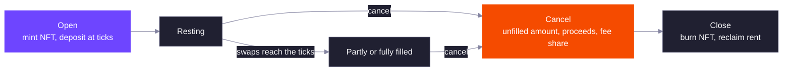

A DLMM Pro limit order is an amount of one token placed at one or more ticks inside the pool. When a swap moves the price to one of those ticks, it fills the order at that tick's exact price. Limit orders work on every DLMM Pro pool, alongside LP liquidity.

Each order is a Token 2022 NFT plus a limit order account derived from the NFT's mint. Whoever holds the NFT can cancel the order and collect what it holds.

## Asks and Bids

An order holds up to 25 ticks, all on the same side.

| Side | Deposits | Ticks | Fills when |
| --- | --- | --- | --- |
| Ask | Token X | Strictly above the current tick | The price rises to the tick. You receive token Y. |
| Bid | Token Y | At or below the current tick | The price falls to the tick. You receive token X. |

Ticks must be usable ticks of the pool's tick spacing, listed in ascending order, each with a non-zero amount. A tick can hold orders on only one side at a time.

Placing an order on a tick that no one has used yet creates the tick, and the order's payer funds its rent.

### Relative Ticks

The price can move between building a transaction and landing it, and an ask that ends up at or below the price is rejected. Relative orders avoid this. With a relative order, each tick is an offset, in units of tick spacing, from the current tick rounded down to the spacing when the transaction executes. You also give a band for that rounded tick, and the program rejects the order with `ExceededSlippage` if the price has moved outside it.

## How Orders Fill

A swap trades against LP liquidity until the price reaches a tick, then fills the orders resting there before it crosses. An order fills at the tick's price, with no price impact. See [How a Swap Moves](/core-products/dlmm-pro/ticks-and-liquidity#how-a-swap-moves).

Orders at the same tick fill in batches:

1. When a swap starts filling a tick's orders, every order waiting at that tick joins one batch.
2. The batch fills pro rata: each order in it is filled by the same fraction.
3. Orders placed at the tick after the batch started wait for the next batch, which starts only once the current one is fully filled.

If you cancel while your batch is partly filled, you receive your share of what has been filled so far and the rest of your order back.

## Maker Fees

Limit orders earn a share of the trading fee on the volume they fill. In each step of a swap, the fee is split between LP liquidity and limit orders in proportion to how much of the step each one filled. Of the limit-order share:

- 50% goes to the protocol.
- 50% goes to the orders that filled, in proportion to what each order filled.

An order can name a referral wallet when it is opened. When the order is canceled, 20% of its fee share goes to the referral's token account, as long as the referral is not the order's owner. See [Fees](/core-products/dlmm-pro/fees#where-the-fee-goes) for the full split.

## Lifecycle

Filled proceeds are not sent automatically. Canceling is how you collect: you can cancel some ticks or all of them, and each canceled tick pays out its unfilled amount, its filled proceeds and its fee share. Once every tick is canceled, close the order to burn the NFT and get its rent back.

## Delegates

The owner can approve a wallet on the NFT account (a Token 2022 `approve` of amount 0) and grant it the `CancelLimitOrder` permission. A delegate can cancel ticks, and everything it collects goes to the owner's associated token accounts. Only the owner can close the order.

## Related

<CardGroup cols={2}>
  <Card title="Fees" href="/core-products/dlmm-pro/fees" icon="percent">
    How a trading fee is split between LPs, makers, the protocol, referrals and partners.
  </Card>
  <Card title="TypeScript SDK Examples" href="/developer-guides/dlmm-pro/typescript-sdk/examples" icon="code">
    Place a relative bid ladder from a liquidity shape, then cancel and close it.
  </Card>
</CardGroup>
