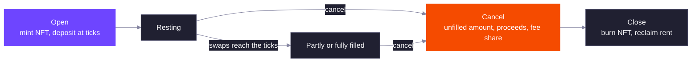

A DLMM Pro limit order is an amount of one token placed at one or more ticks inside the pool. When a swap moves the price to one of those ticks, it fills the order at that tick's exact price. Limit orders work on every DLMM Pro pool, alongside LP liquidity.

Each order is a Token 2022 NFT plus a limit order account derived from the NFT's mint. Whoever holds the NFT can cancel the order and collect what it holds.

## Asks and Bids

An order holds up to 25 ticks, all on the same side.

| Side | Deposits | Ticks | Fills when |
| --- | --- | --- | --- |
| Ask | Token X | Strictly above the current tick | The price rises to the tick. You receive token Y. |
| Bid | Token Y | At or below the current tick | The price falls to the tick. You receive token X. |

Ticks must be usable ticks of the pool's tick spacing, listed in ascending order, each with a non-zero amount. A tick can hold orders on only one side at a time.

Each order tick charges the payer one tick's worth of rent, refunded when the order is closed.

### Placement Rules

`open_limit_order` fails with `InvalidParameters` unless all of these hold:

- The order has 1 to 25 ticks, each with an amount above zero, listed in strictly ascending tick order.
- Every tick is a usable tick of the pool's tick spacing.
- For an ask, the lowest tick is strictly above the current tick. For a bid, the highest tick is at or below the current tick.
- Any tick that still holds an unfilled order of the other side is not used. A tick can switch side once none of its orders is waiting to be filled.

The pool must accept deposits from the owner, or the order fails with `InvalidActivationAccess`. `max_amount` caps the total deposit, transfer fee included, and a larger total fails with `ExceededSlippage`. An ask deposits token X and a bid deposits token Y, from the owner's token account. The payer of rent and the owner who signs and pays the tokens can be different accounts. The order can name a referral wallet, fixed for the life of the order.

With tick spacing 10, which ticks are accepted:

| Current tick | Order | Result |
| --- | --- | --- |
| 105 | Ask at 110 | Accepted |
| 105 | Ask at 100 | Rejected, not above the current tick |
| 105 | Bid at 100 | Accepted |
| 105 | Bid at 110 | Rejected, above the current tick |
| 100 | Ask at 100 | Rejected, an ask must be strictly above |
| 100 | Bid at 100 | Accepted, a bid can sit on the current tick |
| 100 | Ask at 110 | Accepted |

An order costs the rent of its account, which is 144 bytes plus 24 bytes per tick, plus one tick's rent per tick, any tick array that does not exist yet, and the NFT mint and token account:

| Ticks | Order account size | Order account rent in lamports |
| --- | --- | --- |
| 1 | 168 bytes | 2,060,160 |
| 5 | 264 bytes | 2,728,320 |
| 25 | 744 bytes | 6,069,120 |

A 5 tick order on a pool without `LiquidityMining`, where the tick arrays exist, needs `2,728,320 + 5 × 1,113,600 = 8,296,320` lamports of rent, plus the NFT accounts. See [Tick Array Rent](/core-products/dlmm-pro/ticks-and-liquidity#tick-array-rent) for the tick figures.

### Relative Ticks

The price can move between building a transaction and landing it, and an ask that ends up at or below the price is rejected. Relative orders avoid this. With a relative order, each tick is an offset, in units of tick spacing, from the current tick rounded down to the spacing when the transaction executes. You also give a band for that rounded tick, and the program rejects the order with `ExceededSlippage` if the price has moved outside it.

The offsets must still be in strictly ascending order, and the resulting ticks must pass the placement rules. The band edges must be multiples of the tick spacing with the minimum at or below the maximum, or the order fails with `InvalidParameters`. An offset of 0 on an ask lands on the rounded tick, which is never above the current tick, so it fails with `InvalidParameters`.

A relative bid ladder with offsets `-3, -2, -1, 0` and a band of `[90, 110]` at tick spacing 10:

| Current tick when the order runs | Rounded tick | Ticks used | Result |
| --- | --- | --- | --- |
| 99 | 90 | 60, 70, 80, 90 | Accepted |
| 105 | 100 | 70, 80, 90, 100 | Accepted |
| 112 | 110 | 80, 90, 100, 110 | Accepted |
| 121 | 120 | None | `ExceededSlippage` |
| 85 | 80 | None | `ExceededSlippage` |

An ask ladder with offsets `1, 2, 3` and the same band uses 110, 120, 130 at current tick 105 and 100, 110, 120 at current tick 99.

## How Orders Fill

A swap trades against LP liquidity until the price reaches a tick, then fills the orders resting there before it crosses. An order fills at the tick's price, with no price impact. See [How a Swap Moves](/core-products/dlmm-pro/ticks-and-liquidity#how-a-swap-moves).

Orders at the same tick fill in batches:

1. When a swap starts filling a tick's orders, every order waiting at that tick joins one batch.
2. The batch fills pro rata: each order in it is filled by the same fraction.
3. Orders placed at the tick after the batch started wait for the next batch, which starts only once the current one is fully filled.

If you cancel while your batch is partly filled, you receive your share of what has been filled so far and the rest of your order back.

Each tick keeps the amount still open, the amount of the current batch, how much of that batch is unfilled, a batch counter, the total filled and not yet canceled, and the fee collected for makers. A swap fills the current batch first and only then starts the next one.

Example at a tick with price exactly 1.0 (tick 0), tick spacing 10, a 0.30% fee, no LP liquidity there, and three ask orders:

| Step | Open | Current batch | Batch unfilled | Result |
| --- | --- | --- | --- | --- |
| Orders A (1,000,000 X) and B (3,000,000 X) placed | 4,000,000 | 0 | 0 | Both wait in the open amount |
| Swap 1 pays 2,500,000 Y | 0 | 4,000,000 | 1,500,000 | Starts a batch of A and B and fills 2,500,000 X. The swapper receives 2,492,500 X. |
| Order C (2,000,000 X) placed | 2,000,000 | 4,000,000 | 1,500,000 | C waits for the next batch. |
| Swap 2 pays 2,000,000 Y | 0 | 2,000,000 | 1,500,000 | Finishes the batch of A and B with 1,500,000 X, then starts a batch of C and fills 500,000 X. The swapper receives 1,994,000 X. |

If A cancels right after swap 1, its batch is 1,500,000 of 4,000,000 unfilled. It gets back `⌈1,000,000 × 1,500,000 / 4,000,000⌉ = 375,000` X, which rounds up, and 625,000 filled. After swap 2, A and B are fully filled and C has `⌈2,000,000 × 1,500,000 / 2,000,000⌉ = 1,500,000` X unfilled and 500,000 filled. The swaps in this example, with the same fee and tick state, reproduce in the SDK's `quoteExactIn`.

## Maker Fees

Limit orders earn a share of the trading fee on the volume they fill. In each step of a swap, the fee is split between LP liquidity and limit orders in proportion to how much of the step each one filled. Of the limit-order share:

- 50% goes to the protocol.
- 50% goes to makers. It is pooled per tick and side, and a canceled order takes a share in proportion to its filled amount among the filled orders at that tick that are not canceled yet. A newer order can therefore share in fees from fills that happened before it was placed.

An order can name a referral wallet when it is opened. When the order is canceled, 20% of its fee share goes to the referral, but only if the canceller passes a token account owned by the referral and the referral is not the order's owner. Otherwise the owner keeps the whole fee share. The fee share is paid in the token the fee was taken in: token X for asks and token Y for bids on `OutputToken` pools, and token Y for both on `OnlyY` pools. The referral's token account must be for that token. See [Fees](/core-products/dlmm-pro/fees#where-the-fee-goes) for the full split.

The maker share at a tick is pooled per side. When an order is canceled, it takes `⌊fee pool × order filled / total filled⌋`, and both the fee pool and the total filled shrink by what it took. In the example above, the two swaps charged makers 3,750 X on swap 1 and 3,000 X on swap 2, so the pool holds 6,750 X against 4,500,000 X filled. Each order filled by 1,000,000 (A), 3,000,000 (B) and 500,000 (C) takes in order:

| Cancel order | Order filled | Fee pool before | Total filled before | Share |
| --- | --- | --- | --- | --- |
| A | 1,000,000 | 6,750 | 4,500,000 | 1,500 |
| B | 3,000,000 | 5,250 | 3,500,000 | 4,500 |
| C | 500,000 | 750 | 500,000 | 750 |

Orders placed later share fees from fills that happened before they existed, because the share depends only on the filled amount. If A cancels after swap 1 instead, its 625,000 filled out of 2,500,000 takes `⌊3,750 × 625,000 / 2,500,000⌋ = 937`.

The referral rule: the referral gets 20% of the order owner's fee share only if the order names a referral wallet, that wallet is not the order's owner, and the canceller passes a token account owned by the referral. The referral's 20% rounds down. With B's 4,500 X share, the referral gets `⌊4,500 × 2,000 / 10,000⌋ = 900` X and the owner 3,600 X. If any condition fails, the owner keeps all 4,500. The referral transfer can still fail after the checks pass, for example when the fee mint has a transfer hook and its accounts are missing, and then the whole cancel fails.

## Lifecycle

Filled proceeds are not sent automatically. Canceling is how you collect: you can cancel some ticks or all of them, and each canceled tick pays out its unfilled amount, its filled proceeds and its fee share. Once every tick is canceled, close the order to burn the NFT and get its rent back.

Opening an order counts as a deposit and canceling one counts as a withdrawal. On a pool with [activation rules](/core-products/dlmm-pro/pool-creation-and-activation#activation-rules), an order can be opened only once deposits are open and canceled only once withdrawals are open, unless the order's owner is the whitelisted wallet for that action. A pause on deposits also blocks new orders. Cancels are never paused.

### Cancel and Close Details

`cancel_limit_order` takes `tick_ids` in strictly ascending order with at least one entry, or it fails with `InvalidParameters`. A tick the order does not hold fails with `CannotFindLimitOrderByTickId`, and a tick already canceled fails with `CancelNonEmptyLimitOrder`. Its `min_amount_x` and `min_amount_y` are measured on what the owner receives after any transfer fee, and fail with `ExceededSlippage`. A side with nothing to send does not need a token account.

Each canceled tick pays:

| Order state | Unfilled amount back | Proceeds |
| --- | --- | --- |
| Still in the open amount | The whole amount | None |
| In a partly filled batch | `⌈amount × batch unfilled / batch total⌉`, so an earlier canceller gets slightly more back | `⌊filled × price⌋` Y for an ask, `⌊filled / price⌋` X for a bid |
| In a finished batch | None | The same, for the whole amount |

Swappers pay proceeds rounded up and cancels pay them rounded down, so any remainder of less than one atom per order stays in the pool. The maker fee share is added to the owner's amount in the token the fee was taken in. In the batch example, once both swaps have run at price 1.0, canceling A pays 1,000,000 Y and a fee share of 1,500 X. B pays 3,000,000 Y and 4,500 X. C pays 500,000 Y, gets its unfilled 1,500,000 X back and takes 750 X of fee share.

After the ticks are canceled their rent stays in the tick arrays until the order is closed. `close_limit_order` needs every tick canceled, or it fails with `LimitOrderIsNotEmpty`. Only the owner can close. It burns the NFT, closes the NFT token account, the NFT mint and the order account, and refunds the order account rent and each tick's rent to the account you name as the rent receiver. The tick arrays are not closed.

### Pause and Activation Effects

- A pause on swaps stops fills, so orders stay as they are. A pause on deposits blocks new orders, including from the whitelisted wallet. Neither pause stops a cancel.
- With the `ActivationAccess` extension, a new order needs deposits to be open and a cancel needs withdrawals to be open, unless the order's owner is the whitelisted wallet for that action. Otherwise the call fails with `InvalidActivationAccess`.
- Swaps can fill orders before withdrawals open, for example under a `BondingCurve` or `TimeBased` rule. The proceeds wait in the pool until withdrawals open and the order is canceled.

## Delegates

The owner can approve a wallet on the NFT account (a Token 2022 `approve` of amount 0) and grant it the `CancelLimitOrder` permission. A delegate can cancel ticks, and everything it collects goes to the owner's associated token accounts. Only the owner can close the order.

The permission is a number where `CancelLimitOrder` is 1. Only the owner sets it with `update_limit_order_delegate_permission`, and a value above 1 fails with `InvalidPermission`. A delegate with the bit can cancel ticks and nothing else, and its payouts must go to the owner's associated token accounts, or the cancel fails with `IncorrectATA`. A wallet that is neither the owner nor the approved delegate fails with `InvalidAuthority`, and the delegate approval must have an amount of zero, or the call fails with `DelegatedAmountNonZero`. As with positions, the permission is stored on the order, so the next delegate approved on a transferred NFT inherits it.

## Related

<CardGroup cols={2}>
  <Card title="Fees" href="/core-products/dlmm-pro/fees" icon="percent">
    How a trading fee is split between LPs, makers, the protocol, referrals and partners.
  </Card>
  <Card title="TypeScript SDK Examples" href="/developer-guides/dlmm-pro/typescript-sdk/examples" icon="code">
    Place a relative bid ladder from a liquidity shape, then cancel and close it.
  </Card>
</CardGroup>
