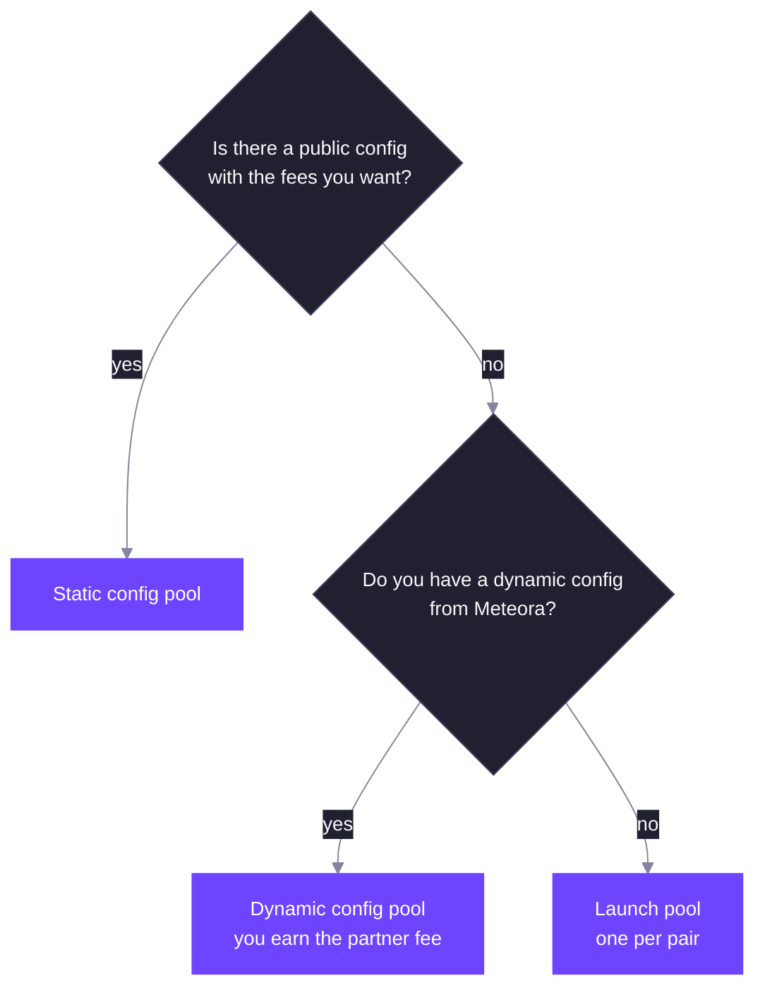

A DLMM Pro pool is created one of three ways. All three set the same things: the token pair, the initial price, the tick spacing, the fee schedule, the fee token, the activation type and the extensions. What differs is who chooses those settings and who can use them.

## Three Ways to Create a Pool

| | Static config | Dynamic config | Launch pool |
| --- | --- | --- | --- |
| Settings come from | The config, created by Meteora | The pool creator, at creation | The pool creator, at creation |
| Who can create | Anyone for a public config; only the config's authority otherwise | Only the config's authority | Anyone holding both tokens |
| Pools per pair | One per config | One per config | One |
| ActivationAccess extension | Not available | Available | Available |
| Pool partner | None | The config's authority | None |
| Protocol share of LP fees | 10% | 10% | 20% |

### Static Configs

A static config fixes the tick spacing, fee schedule, fee token, activation type and extensions. Meteora creates static configs; a config whose pool creator authority is the default key is public, and anyone can create a pool from it. Otherwise only that authority can.

The pool address is derived from the config and the two mints, so each config allows one pool per pair. Two pools for the same pair with different fees use two different configs.

The published static configs, how they are numbered and their addresses are listed in [Pool Fee Configs](/developer-guides/dlmm-pro/pool-fee-configs).

Steps to create a pool from a static config:

1. Pick a config whose tick spacing, fees, fee token, activation type and extensions you want. A config's `pool_creator_authority` must sign if it is not the default key.
2. Choose which mint is token X and which is token Y, and the initial square-root price.
3. Pass the token badge for any mint that needs one, and the tick array bitmap extension account if the initial tick array index is outside `-512` to `511`.
4. Send `initialize_pool_with_static_config`. The payer covers all rent. The `creator` account you pass is recorded on the pool and can be any account.

The activation point is the moment of creation, and the pool is open for every action. A pool for the same two mints and the same config can be created only once, whichever mint is X, because the address does not depend on the order of the two mints. The mint order you pass fixes which one is token X for the life of the pool.

An operator with the right permission creates a static config with an index, and can close it. Closing a config does not change pools already created from it, because each pool keeps its own copy of the settings. A static config cannot enable the `ActivationAccess` extension.

### Dynamic Configs

A dynamic config belongs to one pool creator authority, typically a launchpad or partner. That authority signs every pool created from it and chooses the pool's settings at creation, including activation rules. In return it becomes the pool's partner and earns the config's partner share of the protocol fee, up to 50%. See [Fees](/core-products/dlmm-pro/fees#where-the-fee-goes).

A dynamic config can also carry the `CreatePoolWithoutMintValidation` permission, which skips the token badge and Token 2022 extension checks for its pools. Token Y on an `OnlyY` pool still needs to be SOL, USDC or a badged token.

A dynamic config is created by an operator for one `pool_creator_authority`, which cannot be the default key. It holds a permission number, where `CreatePoolWithoutMintValidation` is 1 and nothing else exists, and a `partner_fee_bps` from 0 to 5,000. The native mint of Token 2022 is rejected even with the permission.

Steps to create a pool from a dynamic config: the authority signs, passes the full set of settings from [Creation Parameters and Validation](#creation-parameters-and-validation), and sends `initialize_pool_with_dynamic_config`. The pool copies `partner_fee_bps` from the config, and records the authority as its partner, even when the bps is 0, because an operator can raise it later. A pool for the same mints and the same config can be created only once.

### Launch Pools

A launch pool needs no config. The pool address comes from the mint pair alone, so there is exactly one launch pool per pair. The creator chooses the same settings as for a dynamic config. To create one, the payer passes a token account for each token with a non-zero balance; nothing is transferred, the program only checks the balances.

Launch pools take 20% of the LP fee as protocol fee instead of 10%, and have no partner.

Steps to create a launch pool: the payer holds a non-zero balance of both mints in token accounts it owns, and passes those accounts as proof. The program only reads the balances and moves nothing, and fails with `InvalidTokenOwnerProof` if either is zero. Both mints are always checked with the normal rules, so a mint that needs a badge needs one here, and nothing can skip the check. The payer then sends `initialize_launch_pool` with the same settings as a dynamic config pool. The address comes from the two mints alone, so the first creator for a pair takes the only launch pool.

## Initial Price and Activation Type

The creator sets the initial price as a square-root price (see [Ticks and Liquidity](/core-products/dlmm-pro/ticks-and-liquidity#tick-price)). If the initial tick is outside the range the pool's inline bitmap covers, pass the tick array bitmap extension account at creation; the program initializes it with the pool.

The price is token Y per token X. `BondingCurve` targets and market cap fee schedulers react to that price rising, so make the launched token X and the quote token Y. With the mints the other way round, the target is reached and the fee falls as the launched token's price drops.

The activation type, slot or timestamp, sets the unit for the activation point, fee scheduler periods, vesting schedules and activation rules.

### Creation Parameters and Validation

A dynamic-config or launch pool takes these settings. A static config pool takes only the initial price, because the config holds the rest. Anything that fails a rule below fails with `InvalidParameters` unless another error is named.

| Parameter | Meaning | Rule |
| --- | --- | --- |
| `pool_fees` | Base fee and optional dynamic fee | See [Fees](/core-products/dlmm-pro/fees#base-fee-parameters-and-limits) |
| `tick_spacing` | Ticks between usable ticks | 1 to 256 |
| `collect_fee_mode` | 0 `OutputToken` or 1 `OnlyY` | `OnlyY` needs token Y to be SOL, USDC or badged, or `InvalidTokenBadge`. Any other value fails with `TypeCastFailed` |
| `initial_sqrt_price` | Q64.64 square root of token Y per token X | From `4295048016` to `79226673515401279992447579055` |
| `activation_type` | 0 slot or 1 timestamp | Any other value fails with `InvalidActivationType` |
| `activation_point` | When fee schedulers start counting | Unset unless the pool has `ActivationAccess` |
| `extensions` | Bitmask, 1 `LiquidityMining` and 2 `ActivationAccess` | At most 3 |
| `pool_activation` | Whitelists and two activation slots | Required with `ActivationAccess`, otherwise unset |

Mints must differ, or creation fails with the Anchor error `ConstraintRaw`. Each mint is checked as described in [Token 2022 Support](/core-products/dlmm-pro/token-2022-support), and a dynamic config with `CreatePoolWithoutMintValidation` skips that check. The initial tick is the highest tick at or below the initial price. The activation point defaults to the current slot or time, and without `ActivationAccess` it must be unset.

### Accounts Created with a Pool

The payer funds these accounts at creation:

| Account | Size | Rent in lamports |
| --- | --- | --- |
| Pool | 648 bytes | 5,400,960 |
| Pool with `LiquidityMining` | 1,000 bytes | 7,850,880 |
| Pool with `ActivationAccess` | 776 bytes | 6,291,840 |
| Pool with both | 1,128 bytes | 8,741,760 |
| Oracle | 72 bytes | 1,392,000 |
| Reserve for token X and for token Y | A token account for each mint, owned by the pool authority | 2,039,280 each for a plain SPL Token account |
| Tick array bitmap extension, when passed | 808 bytes | 6,514,560 |

The pool holds the price, tick, liquidity, fee state, protocol and partner fee balances and the inline tick array bitmap. The oracle starts with one observation. Each reserve holds the pool's tokens of one mint, and only the program can move them. Token accounts for Token 2022 mints can be larger and cost more. A pool of two plain SPL Token mints with no extensions and no bitmap extension needs `5,400,960 + 1,392,000 + 2 × 2,039,280 = 10,871,520` lamports. Tick arrays, positions and orders are created later by whoever uses the pool. Lamport figures are at the current rent rate of 6,960 lamports per byte plus 128 bytes of account overhead.

## Extensions

| Extension | Adds |
| --- | --- |
| `LiquidityMining` | Two reward slots. Ticks and positions on these pools store reward growth. See [Liquidity Mining](/core-products/dlmm-pro/liquidity-mining). |
| `ActivationAccess` | Activation rules and whitelists, described below. Not available on static configs. |

Extensions are chosen at creation and cannot be added later. Limit orders need no extension.

The pool stores one reward block with two slots for `LiquidityMining`, and one block with three wallets and two activation slots for `ActivationAccess`.

## Activation Rules

Without the `ActivationAccess` extension, a pool is open for swaps, deposits and withdrawals as soon as it is created, and its activation point is the moment of creation.

With it, the pool stores two activation slots and three whitelisted wallets: one for swaps, one for deposits and one for withdrawals. An action is allowed only when both activation slots allow it. The whitelisted wallet for an action skips the activation slots for that action, so a team can seed liquidity or make the first trade before the public can.

Opening a position or a limit order counts as a deposit, and canceling a limit order counts as a withdrawal. The swap whitelist is matched against the wallet that signs the swap. The deposit and withdrawal whitelists are matched against the owner of the position or order, so a delegate acting for a whitelisted owner is allowed.

Each activation slot uses one mode:

| Mode | Swaps | Deposits and withdrawals |
| --- | --- | --- |
| `Open` | Open | Open |
| `BondingCurve` | Open | Open once a swap takes the square-root price to a target, set in basis points of the initial square-root price and above 10,000. 20,000 doubles the square-root price, which is 4x the price; a 2x price target is about 14,142. Stay open after that. |
| `TimeBased` | Open at the swap point | Deposits open at their own point, withdrawals at theirs |

The two slots must be, in this order, `[Open, Open]`, `[Open, BondingCurve]`, `[Open, TimeBased]` or `[BondingCurve, TimeBased]`.

- With a `TimeBased` slot, the swap point must equal the pool's activation point. Every point must be at or after the slot or time at which the pool is created, and at most 30 days ahead (2,592,000 seconds, or 10,368,000 slots on slot pools), so leave a margin for the transaction to land. Fee schedulers count from the activation point.
- With a `BondingCurve` slot, the deposit whitelist cannot be the default key, because nobody else can add liquidity before the target is reached.
- Without a `TimeBased` slot, the pool activates at creation. Leave the activation point unset, because an explicit one must equal the on-chain clock exactly.

Combining `BondingCurve` and `TimeBased` gives a launch that opens trading at a set time and only lets the public add or remove liquidity after the price has risen to the target.

### Activation Rules in Detail

Each activation slot is 16 bytes: a mode byte and 15 bytes of data. The data for `Open` must be all zeros. For `BondingCurve` it is a reached flag that must be 0 at creation, six zero bytes and the 64-bit target in basis points. For `TimeBased` it is three 40-bit points, so each is at most `1,099,511,627,775`. The SDK builds them with `openActivationParameters`, `bondingCurveActivationParameters` and `timeBasedActivationParameters`.

Rules checked at creation:

- An unknown mode fails with `InvalidActivationAccess`. Any other failure below fails with `InvalidParameters`.
- `BondingCurve`: the target is above 10,000 bps and the target square-root price is at most the square-root price of the highest usable tick. The deposit whitelist is not the default key.
- `TimeBased`: the swap point equals the activation point. No point is earlier than the current slot or time. No point is more than 30 days ahead.
- The slots form one of the four allowed pairs, and a pair without `TimeBased` needs the activation point to be unset or equal to now.

A `BondingCurve` target stays reached for good. After any swap that takes the square-root price to `initial square-root price × target / 10,000` or higher, the target counts as reached and deposits and withdrawals stay open even if the price later falls back.

With `[Open, TimeBased]` on a timestamp pool created at time `1,000,000`, a swap point of `1,003,600`, an add liquidity point of `1,001,800` and a remove liquidity point of `1,007,200`, with a swap wallet `S` and a deposit and withdrawal wallet `T`:

| Time | Public swaps | Public deposits | Public withdrawals | Whitelisted wallets |
| --- | --- | --- | --- | --- |
| Before `1,001,800` | Closed | Closed | Closed | `S` can swap, `T` can deposit and withdraw |
| `1,001,800` to `1,003,599` | Closed | Open | Closed | The same |
| `1,003,600` to `1,007,199` | Open | Open | Closed | The same |
| `1,007,200` or later | Open | Open | Open | Not needed |

The fee scheduler counts from `1,003,600`. With `[BondingCurve, TimeBased]`, a target of 20,000 bps, a swap, add and remove point of `1,003,600`, and the initial square-root price `S0`:

| Condition | Public swaps | Public deposits and withdrawals |
| --- | --- | --- |
| Before `1,003,600` | Closed | Closed |
| After `1,003,600`, square-root price below `2 × S0` | Open | Closed |
| After a swap takes the square-root price to `2 × S0` or higher | Open | Open |

The deposit wallet can add liquidity at any time in both cases, subject to pool status.

Which actions each whitelist covers:

| Whitelist | Matched against | Covers |
| --- | --- | --- |
| Swap | The wallet that signs the swap | `swap` |
| Add liquidity | The owner of the position or order | `open_position`, `expand_position`, `add_liquidity`, `add_liquidity_by_weight`, `add_liquidity_imbalance`, `open_limit_order` |
| Remove liquidity | The owner of the position or order | `remove_liquidity`, `remove_liquidity_by_bps`, `remove_position`, `cancel_limit_order` |

Claims, locks, closing positions and orders, delegate changes, refreshes and reward actions never check the activation rules. A failed check fails with `InvalidActivationAccess`.

## Pool Status

Meteora operators can pause swaps, deposits or both on a pool. A pause on deposits also stops new positions, new range slots and new limit orders, including for whitelisted wallets. Withdrawals and claims are never paused by pool status, so LPs can always exit (subject to the pool's activation rules).

The status is a number from 0 to 3. Bit 0 set disables swaps and bit 1 set disables adding liquidity, so 1 pauses swaps, 2 pauses deposits and 3 pauses both. The operator needs the `SetPoolStatus` permission, and setting the value the pool already has fails with `InvalidParameters`. A disabled action fails with `InvalidActivationAccess`, including for whitelisted wallets.

### Who Can Change What

| Setting | Who changes it |
| --- | --- |
| Pool status | An operator with `SetPoolStatus` |
| Partner fee bps, from 0 to 5,000 | An operator with `UpdatePartnerFee`, on a pool with a partner |
| Reward slot 0: set the mint once, change the authority | The pool creator, or an operator with `InitializeReward` to set the mint and `UpdateRewardAuthority` to change the authority |
| Reward slot 1: set the mint once, change the authority | An operator with `InitializeReward` to set the mint and `UpdateRewardAuthority` to change the authority |
| Reward emissions | The slot's reward authority |
| Oracle length, tick arrays, tick array bitmap extension | Anyone, paying the rent |

Nothing can change these after creation: the two mints and their order, tick spacing, base fee and dynamic fee settings, fee token, activation type and activation point, extensions, whitelists, activation slots, pool type, the partner address and the initial price. To get different settings, create a new pool.

## Related

<CardGroup cols={2}>
  <Card title="Fees" href="/core-products/dlmm-pro/fees" icon="percent">
    Base fee modes, fee schedules and the partner fee.
  </Card>
  <Card title="Token 2022 Support" href="/core-products/dlmm-pro/token-2022-support" icon="certificate">
    Which mints a pool accepts and when a token badge is needed.
  </Card>
</CardGroup>
