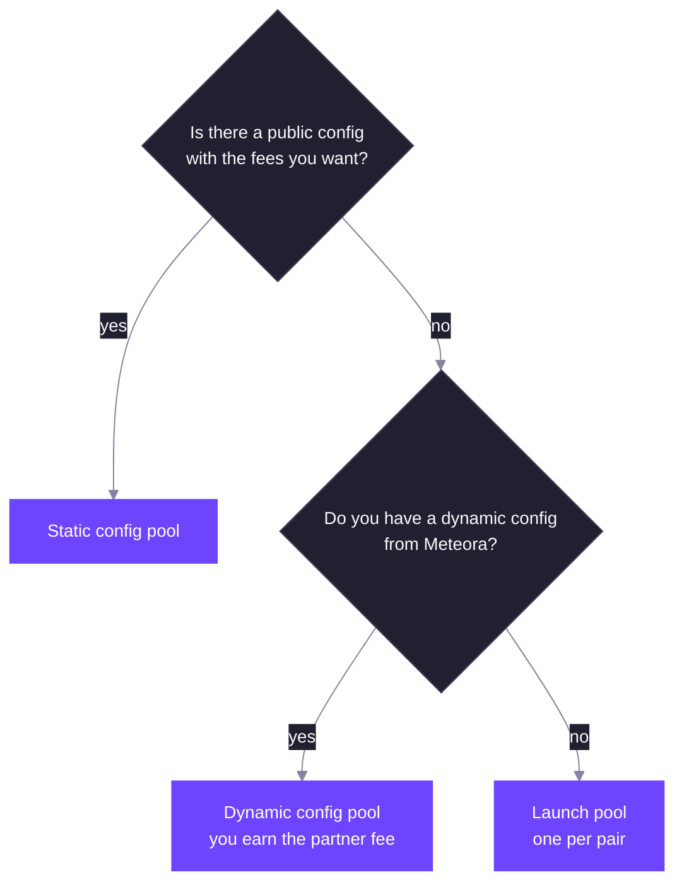

A DLMM Pro pool is created one of three ways. All three set the same things: the token pair, the initial price, the tick spacing, the fee schedule, the fee token, the activation type and the extensions. What differs is who chooses those settings and who can use them.

## Three Ways to Create a Pool

| | Static config | Dynamic config | Launch pool |
| --- | --- | --- | --- |
| Settings come from | The config, created by Meteora | The pool creator, at creation | The pool creator, at creation |
| Who can create | Anyone for a public config; only the config's authority otherwise | Only the config's authority | Anyone holding both tokens |
| Pools per pair | One per config | One per config | One |
| ActivationAccess extension | Not available | Available | Available |
| Pool partner | None | The config's authority | None |
| Protocol share of LP fees | 10% | 10% | 20% |

### Static Configs

A static config fixes the tick spacing, fee schedule, fee token, activation type and extensions. Meteora creates static configs; a config whose pool creator authority is the default key is public, and anyone can create a pool from it. Otherwise only that authority can.

The pool address is derived from the config and the two mints, so each config allows one pool per pair. Two pools for the same pair with different fees use two different configs.

### Dynamic Configs

A dynamic config belongs to one pool creator authority, typically a launchpad or partner. That authority signs every pool created from it and chooses the pool's settings at creation, including activation rules. In return it becomes the pool's partner and earns the config's partner share of the protocol fee, up to 50%. See [Fees](/core-products/dlmm-pro/fees#where-the-fee-goes).

A dynamic config can also carry the `CreatePoolWithoutMintValidation` permission, which skips the token badge and Token 2022 extension checks for its pools. Token Y on an `OnlyY` pool still needs to be SOL, USDC or a badged token.

### Launch Pools

A launch pool needs no config. The pool address comes from the mint pair alone, so there is exactly one launch pool per pair. The creator chooses the same settings as for a dynamic config. To create one, the payer passes a token account for each token with a non-zero balance; nothing is transferred, the program only checks the balances.

Launch pools take 20% of the LP fee as protocol fee instead of 10%, and have no partner.

## Initial Price and Activation Type

The creator sets the initial price as a square-root price (see [Ticks and Liquidity](/core-products/dlmm-pro/ticks-and-liquidity#tick-price)). If the initial tick is outside the range the pool's inline bitmap covers, pass the tick array bitmap extension account at creation; the program initializes it with the pool.

The activation type, slot or timestamp, sets the unit for the activation point, fee scheduler periods, vesting schedules and activation rules.

## Extensions

| Extension | Adds |
| --- | --- |
| `LiquidityMining` | Two reward slots. Ticks and positions on these pools store reward growth. See [Liquidity Mining](/core-products/dlmm-pro/liquidity-mining). |
| `ActivationAccess` | Activation rules and whitelists, described below. Not available on static configs. |

Extensions are chosen at creation and cannot be added later. Limit orders need no extension.

## Activation Rules

Without the `ActivationAccess` extension, a pool is open for swaps, deposits and withdrawals as soon as it is created, and its activation point is the moment of creation.

With it, the pool stores two activation slots and three whitelisted wallets: one for swaps, one for deposits and one for withdrawals. An action is allowed only when both activation slots allow it. The whitelisted wallet for an action skips the activation slots for that action, so a team can seed liquidity or make the first trade before the public can.

Each activation slot uses one mode:

| Mode | Swaps | Deposits and withdrawals |
| --- | --- | --- |
| `Open` | Open | Open |
| `BondingCurve` | Open | Open once a swap takes the price to a target, set in basis points of the initial square-root price (20,000 doubles it). Stay open after that. |
| `TimeBased` | Open at the swap point | Deposits open at their own point, withdrawals at theirs |

The two slots must be, in this order, `[Open, Open]`, `[Open, BondingCurve]`, `[Open, TimeBased]` or `[BondingCurve, TimeBased]`.

- With a `TimeBased` slot, the swap point must equal the pool's activation point, and every point must be within 30 days of creation. Fee schedulers count from that point.
- With a `BondingCurve` slot, the deposit whitelist cannot be the default key, because nobody else can add liquidity before the target is reached.
- Without a `TimeBased` slot, the pool activates at creation.

Combining `BondingCurve` and `TimeBased` gives a launch that opens trading at a set time and only lets the public add or remove liquidity after the price has risen to the target.

## Pool Status

Meteora operators can pause swaps, deposits or both on a pool. Withdrawals and claims are never paused by pool status, so LPs can always exit (subject to the pool's activation rules).

## Related

<CardGroup cols={2}>
  <Card title="Fees" href="/core-products/dlmm-pro/fees" icon="percent">
    Base fee modes, fee schedules and the partner fee.
  </Card>
  <Card title="Token 2022 Support" href="/core-products/dlmm-pro/token-2022-support" icon="certificate">
    Which mints a pool accepts and when a token badge is needed.
  </Card>
</CardGroup>
