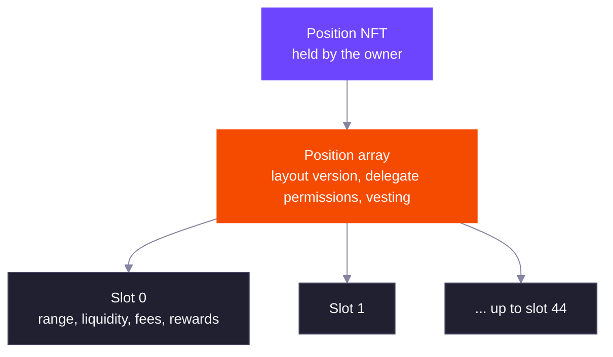
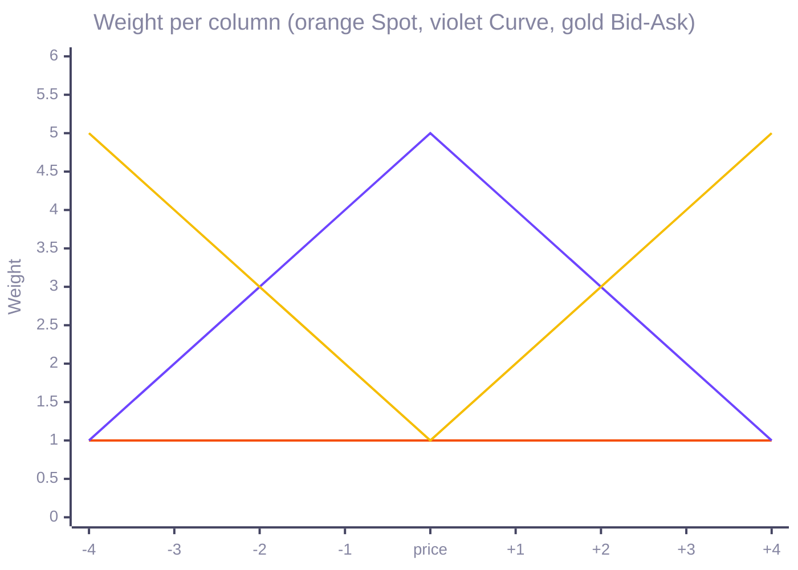

A DLMM Pro position is a Token 2022 NFT plus a position array account derived from the NFT's mint. Whoever holds the NFT owns the position, so transferring the NFT transfers the liquidity, unclaimed fees and unclaimed rewards with it.

## Ranges in One Position

A position array holds up to 45 slots. Each slot is one range `[tick_lower, tick_upper)` with its own liquidity, fees and rewards. Ranges can sit side by side, leave gaps, or overlap.

Instructions that act on some slots take a bitmap of slot indexes and the ranges of those slots, so one transaction can touch many ranges. Adding slots (`expand_position`) and removing slots (`remove_position`) each raise the position's layout version, which starts at 0. Removing a slot also moves every slot after it down one index. Pass the layout version you read as `expected_layout_version` and the program rejects the instruction if someone else changed the layout in the meantime.

### Opening and Expanding

`open_position` takes 1 to 45 ranges, each with usable edges and a lower edge below the upper edge, or it fails with `InvalidParameters`. The owner who receives the NFT and the payer who covers rent can be different accounts. The pool must accept deposits from the owner, or the instruction fails with `InvalidActivationAccess`. The payer covers:

- The NFT mint and the owner's NFT token account.
- The position array account, which is 144 bytes plus 128 bytes per slot, or 192 bytes per slot on pools with the `LiquidityMining` extension.
- One tick's rent for each range edge, and any tick array that does not exist yet. See [Tick Array Rent](/core-products/dlmm-pro/ticks-and-liquidity#tick-array-rent).

| Slots | Position array size | Rent in lamports at the current rent rate | With `LiquidityMining` |
| --- | --- | --- | --- |
| 1 | 272 bytes | 2,784,000 | 336 bytes, 3,229,440 |
| 9 | 1,296 bytes | 9,911,040 | 1,872 bytes, 13,920,000 |
| 45 | 5,904 bytes | 41,982,720 | 8,784 bytes, 62,027,520 |

`expand_position` appends new ranges after the existing slots, so they take the next free indexes. The total cannot pass 45, or it fails with `InvalidParameters`. The payer covers the extra slots, 890,880 lamports per slot (1,336,320 with `LiquidityMining`) at the current rent rate, plus the edges. See [Tick Array Rent](/core-products/dlmm-pro/ticks-and-liquidity#tick-array-rent) for the rate. Both instructions need deposits to be open.

A bitmap selects slots, one bit per slot index with bit 0 for slot 0. A bitmap of `0b10110` selects slots 1, 2 and 4, and the matching `liquidities` list holds three entries in ascending slot order. The bitmap must select at least one slot and none past the end of the position.

Layout version example: a position opened with 3 slots has layout version 0. Expanding it by 2 ranges makes it version 1 with slots 0 to 4. Removing slot 1 makes it version 2, and slots 2, 3 and 4 become slots 1, 2 and 3. An instruction that carries `expected_layout_version` of 0 or 1 now fails with `InvalidLayoutVersion`. Leave it unset to skip the check. The counter is 16 bits and wraps from 65,535 to 0.

Each slot splits its liquidity into three parts, and all three earn fees and rewards.

| Liquidity | Meaning |
| --- | --- |
| Unlocked | Can be withdrawn at any time |
| Permanently locked | Can never be withdrawn |
| Vesting | Locked under the position's vesting schedule, and moved back to unlocked as it vests |

The slot also records how much vesting liquidity it has released so far, which the program uses to work out the next release.

A slot's total liquidity is the sum of the three parts. The vesting part plus the released part stays constant after the lock, and the schedule works from that sum. See [Vesting Schedule](#vesting-schedule).

## Adding Liquidity

You open a position with its first ranges, then deposit. Each range edge charges the payer one tick's worth of rent, refunded when the slot is removed or the position is closed.

| Method | What it does |
| --- | --- |
| Explicit liquidity | You choose the liquidity for each selected slot. Use it when you already computed the amounts. |
| By weight | Each selected slot gets `multiplier × weight` liquidity, with weights from 1 to 255. This is how shaped deposits work. |
| Imbalanced | Deposits into one slot from your wallet balances, capped per token, and takes the largest liquidity both tokens can fund at the current price. Useful for depositing whatever you hold, including fees you just claimed. |

Every deposit sets a cap on each token, transfer fee included, and fails rather than take more.

### Deposit Arguments and Rules

| Instruction | Arguments | Rules |
| --- | --- | --- |
| `add_liquidity` | `max_amount_x`, `max_amount_y`, `expected_layout_version`, `bitmap`, `liquidities` | One liquidity per selected slot. Zero fails with `LiquidityIsZero`. A count that does not match the bitmap fails with `InvalidParameters`. |
| `add_liquidity_by_weight` | The same, with `multiplier` and `liquidities` as weights | Each selected slot gets `multiplier × weight`. Weights are 1 to 255, so zero fails with `LiquidityIsZero`. A product above `2^127 - 1` fails with `LiquidityIsTooHigh`, and one that does not fit in 128 bits fails with `MathOverflow`. |
| `add_liquidity_imbalance` | `max_amount_x`, `max_amount_y` (either can be unset), `slippage`, `expected_layout_version`, `index` | One slot. At least one cap is required, and a cap of zero fails with `AmountIsZero`. |

The program works out the amounts from the liquidity at the price when the transaction runs, rounds them up, adds any Token 2022 transfer fee and compares the result with the cap. If either token needs more than its cap, the deposit fails with `ExceededSlippage`. A cap that is unset or zero for a token the range needs fails the same way, except that `add_liquidity_imbalance` rejects a zero cap with `AmountIsZero`. Tokens are pulled from the signer's token accounts, so a delegate pays from accounts it can spend from. The pool must accept deposits from the position's owner, otherwise the deposit fails with `InvalidActivationAccess`.

An imbalanced deposit finds the liquidity each token can fund at the current price, from the smaller of its cap and the wallet balance after any transfer fee, and deposits the smaller of the two. Its `slippage` argument has two parts, and each can be left unset. `sqrt_price_slippage` gives a minimum and maximum square-root price, and the deposit fails with `ExceededSlippage` if the price is outside it. `min_liquidity` fails with `ExceededSlippage` if less liquidity would be minted.

With tick spacing 10, the price on tick 5 and the range `[0, 10)`:

| Wallet budget | Token that limits | Liquidity | Deposit X | Deposit Y |
| --- | --- | --- | --- | --- |
| 1,000,000 X and 1,000,000 Y | Y | 3,999,700,017 | 999,501 | 1,000,000 |
| 1,000,000 X and 5,000,000 Y | X | 4,001,700,267 | 1,000,000 | 1,000,501 |
| 5,000,000 X and 1,000,000 Y | Y | 3,999,700,017 | 999,501 | 1,000,000 |

In the second row 3,999,499 Y stays in the wallet. For a range entirely above the price, such as `[20, 30)`, give only a cap for X: 1,000,000 X funds liquidity 2,002,601,540 and needs no Y.

## Liquidity Shapes

A shape splits the price range into columns one tick spacing wide and gives each column a weight. The SDK turns the weights into ranges, and a by-weight deposit funds them in one transaction.

| Strategy | Weights |
| --- | --- |
| Spot | Equal in every column |
| Curve | Heaviest at the column holding the price, falling off away from it |
| Bid-Ask | Lightest at the price, rising toward the edges |
| Custom | Any weight per column, including zero for a gap |

The weights the SDK builds for nine columns around the current price:

Columns below the price hold token Y, columns above it hold token X, and the column holding the price takes both.

The layout decides how columns become ranges, and both give every column the same total weight:

- **Vertical** merges neighbouring columns of equal weight into side-by-side ranges. The Curve above needs 9 ranges.
- **Horizontal** stacks overlapping ranges, one per weight level. The same Curve needs 5 ranges, which leaves more of the 45 slots free.

When a shape needs more ranges than you allow, the SDK coarsens the weights until it fits.

For nine columns of spacing 10 from tick `-40` to `50`, with the price on tick 5, the SDK builds these ranges:

| Strategy | Vertical | Horizontal |
| --- | --- | --- |
| Spot | 1 range, `[-40, 50)` | 1 range, `[-40, 50)` |
| Curve, weights 1 2 3 4 5 4 3 2 1 | 9 ranges | 5 ranges, `[-40, 50)`, `[-30, 40)`, `[-20, 30)`, `[-10, 20)`, `[0, 10)` |
| Bid-Ask, weights 5 4 3 2 1 2 3 4 5 | 9 ranges | 9 ranges |

For the Curve, with a multiplier of `1,000,000,000`, the liquidity of each range is the multiplier times its weight:

| Layout | Range | Weight | Liquidity | Deposit X | Deposit Y |
| --- | --- | --- | --- | --- | --- |
| Vertical | `[-40, -30)` | 1 | 1,000,000,000 | 0 | 499,101 |
| Vertical | `[-30, -20)` | 2 | 2,000,000,000 | 0 | 998,701 |
| Vertical | `[-20, -10)` | 3 | 3,000,000,000 | 0 | 1,498,801 |
| Vertical | `[-10, 0)` | 4 | 4,000,000,000 | 0 | 1,999,401 |
| Vertical | `[0, 10)` | 5 | 5,000,000,000 | 1,249,469 | 1,250,094 |
| Vertical | `[10, 20)` | 4 | 4,000,000,000 | 1,998,401 | 0 |
| Vertical | `[20, 30)` | 3 | 3,000,000,000 | 1,498,052 | 0 |
| Vertical | `[30, 40)` | 2 | 2,000,000,000 | 998,202 | 0 |
| Vertical | `[40, 50)` | 1 | 1,000,000,000 | 498,852 | 0 |
| Horizontal | `[-40, 50)` | 1 | 1,000,000,000 | 2,246,797 | 2,247,921 |
| Horizontal | `[-30, 40)` | 1 | 1,000,000,000 | 1,747,946 | 1,748,820 |
| Horizontal | `[-20, 30)` | 1 | 1,000,000,000 | 1,248,845 | 1,249,469 |
| Horizontal | `[-10, 20)` | 1 | 1,000,000,000 | 749,494 | 749,869 |
| Horizontal | `[0, 10)` | 1 | 1,000,000,000 | 249,894 | 250,019 |

Both layouts deposit 6,242,976 X and 6,246,098 Y in total. The horizontal layout uses 5 slots instead of 9, and pays the rent of 10 edges instead of 18.

To fund the horizontal Curve from a budget of 1,000,000,000 X and 1,000,000,000 Y, the SDK's `multiplierFromAmounts` returns a multiplier of `160,099,998,960`. The deposit then needs 999,500,150 X and 1,000,000,000 Y. The by-weight arguments are `bitmap` 31 (slots 0 to 4) and weights `1,1,1,1,1`.

A Curve over 101 columns needs 101 vertical ranges, or 51 horizontal ones, and the SDK rejects both because a position holds 45. With `maxRanges` of 45 it scales the weights down until the ranges fit. The 101-column vertical Curve then needs 45 ranges and a top weight of 23.

## Fees and Rewards

Fees and rewards are credited to a slot when it is refreshed or when its liquidity changes. The claim instructions pay out what is already credited across every slot. The SDK's claim builders refresh the slots you select first, so select every slot whose latest earnings you want included. A refresh on its own is also available, and any delegate the owner approved can run it.

The SDK can also compound: one transaction claims fees and deposits them back into a chosen slot as an imbalanced deposit.

### How Fees Accrue

Each swap step adds the fee that LPs keep to a running total per unit of liquidity. It adds `⌊lp_fee × 2^64 / active_liquidity⌋`, where `active_liquidity` is the liquidity in range during that step. Each tick keeps the total from the far side of its price, so the pool can work out the growth inside any range. A slot's pending fee grows by `⌊slot_liquidity × growth_inside_change / 2^64⌋`, where `slot_liquidity` is the unlocked, permanently locked and vesting parts together. Both divisions round down, so the pool never owes more than it collected.

Example with a slot `S0` of `[-100, 100)` holding `1,000,000,000,000` liquidity, and a slot `S1` of `[100, 200)` holding `3,000,000,000,000`:

| Event | Active liquidity | LP fee in X | Growth added | Slot that earns |
| --- | --- | --- | --- | --- |
| Swap 1, price inside `S0` | 1,000,000,000,000 | 5,000,000 | 92,233,720,368,547 | `S0` |
| Swap 2, price inside `S0` | 1,000,000,000,000 | 2,500,000 | 46,116,860,184,273 | `S0` |
| Swap 3, price moved into `S1` | 3,000,000,000,000 | 6,000,000 | 36,893,488,147,419 | `S1` |

A refresh of `S0` after swaps 1 and 2 credits `⌊1,000,000,000,000 × (92,233,720,368,547 + 46,116,860,184,273) / 2^64⌋ = 7,499,999`, one atom below the 7,500,000 collected. A refresh of `S1` credits `5,999,999`. `S0` earns nothing from swap 3 because the price is outside its range. A slot whose total liquidity is `2,000,000,000,000` earns `999,999` from a step that adds `9,223,372,036,854` of growth, whatever mix of unlocked, locked and vesting liquidity it holds.

### Refresh Semantics

`refresh_fees_and_rewards` takes a bitmap of slots and the tick arrays holding their edges. For each selected slot with liquidity it credits fees and rewards earned since the last checkpoint and releases any vested liquidity that is due. It skips slots with no liquidity, and fails with `InvalidParameters` if the bitmap is empty or selects a slot past the end. The owner or any wallet approved on the NFT can run it, with no permission bit needed.

Claims do not refresh, so they only pay what is already credited. A slot is also credited when you add or remove liquidity in it, using the old liquidity first. Pending fees are stored as 64-bit amounts. A fee total that would pass the 64-bit limit makes the instruction fail, and a reward total stops at the limit instead.

`claim_fee` adds up the pending fees of every slot, zeroes them, and sends them to your token accounts. Its `min_amount_x` and `min_amount_y` are measured after any transfer fee, and fail with `ExceededSlippage`. A token with nothing pending is not transferred, so its token account does not need to exist.

## Withdrawing and Closing

You withdraw unlocked liquidity either as an explicit liquidity per slot or as a share (in basis points) of each selected slot. A share withdrawal first releases any vested liquidity.

To shrink a position, remove empty slots; at least one slot must stay. A slot is empty when it has no liquidity, no unclaimed fees and no unclaimed rewards. To finish, withdraw everything, claim, and close the position: the program burns the NFT and returns the rent. Only the owner can close a position.

Permanently locked liquidity counts as liquidity, so a slot that holds any can never be removed, and its position can never be closed.

### Withdrawal Arguments and Rules

| Instruction | Arguments | Rules |
| --- | --- | --- |
| `remove_liquidity` | `min_amount_x`, `min_amount_y`, `expected_layout_version`, `bitmap`, `liquidities` | One liquidity per selected slot, above zero. A slot, tick or pool that holds less than you ask for fails with `MathOverflow`. |
| `remove_liquidity_by_bps` | `min_amount_x`, `min_amount_y`, `expected_layout_version`, `bps`, optional `bitmap` | `bps` is 1 to 10,000, or it fails with `InvalidParameters`. Without a bitmap it covers every slot with liquidity. |

Both round the token amounts down and measure the minimums after any transfer fee, failing with `ExceededSlippage`. The program works out the share per slot as `⌊unlocked × bps / 10,000⌋` after releasing any vested liquidity. A slot whose share is zero is skipped, and if every slot rounds to zero the call fails with `InvalidParameters`. For example, 2,500 bps of `1,000,003` unlocked liquidity is `250,000`. Any liquidity change releases vested liquidity first, so a withdrawal can use liquidity that vested since the last refresh.

A withdrawal needs the pool's withdrawals to be open for the owner, or it fails with `InvalidActivationAccess`. A pool pause never blocks it. Tokens go to your token accounts. A delegate's tokens must go to the owner's associated token accounts, or the call fails with `IncorrectATA`. A token with nothing to send does not need a token account.

### Closing a Position

1. Withdraw all unlocked liquidity, for example with `remove_liquidity_by_bps` at 10,000. Vesting liquidity that has not released yet cannot be withdrawn, and permanently locked liquidity never can.
2. Claim fees. Withdrawing credits the slot's pending fees, so claim after you withdraw.
3. On a `LiquidityMining` pool, claim each reward slot.
4. Optionally call `remove_position` on empty slots to shrink the position, keeping at least one slot.
5. Call `close_position` as the owner. It fails with `PositionIsNotEmpty` unless every slot is empty.

Closing burns the NFT, closes the NFT token account and mint, closes the position array and refunds every edge's tick rent. The rent goes to the account you name as the rent receiver. `remove_position` refunds the slot's rent (128 bytes, or 192 on `LiquidityMining` pools) and its edges, and a delegate must name the owner as the receiver, or it fails with `InvalidPermission`.

## Locks

| Lock | Behavior |
| --- | --- |
| Permanent | Moves a share of unlocked liquidity, in basis points, into permanently locked liquidity. It cannot be withdrawn but keeps earning. |
| Vesting | Moves a share of unlocked liquidity into a schedule: a share released at the cliff, then an equal share each period. The shares must add up to 100%. |

Both locks apply their share to every slot of the position. To lock only some ranges, keep them in a separate position.

Vesting schedules start at a cliff point in the future (or now) and follow the pool's activation type, so periods are in slots or seconds. From the lock to the last release, a schedule can span at most 10 years, counted as 1,261,440,000 slots on slot pools. A position can have one vesting schedule in its lifetime: a second lock fails with `PositionAlreadyHadVesting`, even after the first has fully released. Only the owner can lock.

### Permanent Lock Details

`bps` is 1 to 10,000. The program first releases any vesting that is due, then moves `⌊unlocked × bps / 10,000⌋` of each slot from unlocked to permanently locked. At least one slot must move some liquidity, or it fails with `LiquidityIsZero`. Locking 2,500 bps of `1,000,003` unlocked liquidity moves `250,000` and leaves `750,003` unlocked.

### Vesting Schedule

The schedule has a cliff point, `cliff_unlock_bps` released at the cliff, `bps_per_period` released every `period_frequency` after it, and `number_of_period` periods. A separate `bps` says how much of each slot's unlocked liquidity enters the schedule, 1 to 10,000. The rules:

- `cliff_unlock_bps + bps_per_period × number_of_period` must equal 10,000.
- Either `cliff_unlock_bps` is above zero, or all three period values are above zero. If any period value is set, all three must be.
- The cliff point is now or later. Leave it unset to start now. The time until the cliff plus `period_frequency × number_of_period` can be at most 10 years, which is 315,360,000 seconds or 1,261,440,000 slots.
- A failed check fails with `InvalidParameters`, except that a `bps_per_period × number_of_period` too large for 16 bits fails with `MathOverflow`. A second schedule fails with `PositionAlreadyHadVesting`. A lock that moves nothing fails with `LiquidityIsZero`.

Released liquidity at a time `t` is `⌊(cliff_unlock_bps + completed_periods × bps_per_period) × total / 10,000⌋`, where `total` is the slot's vesting plus released liquidity and `completed_periods` is capped at `number_of_period`. Nothing is released before the cliff. It moves from vesting to unlocked when the slot is refreshed, deposited into, withdrawn from, or locked permanently, and during a withdrawal by bps. It is not released on its own.

A slot with `1,000,000,007` liquidity locked at 10,000 bps, with a 20% cliff, 20% each week for 4 weeks:

| Time since the cliff | Released | Still vesting |
| --- | --- | --- |
| Before the cliff | 0 | 1,000,000,007 |
| At the cliff | 200,000,001 | 800,000,006 |
| 6 days | 200,000,001 | 800,000,006 |
| 1 week | 400,000,002 | 600,000,005 |
| 10 days | 400,000,002 | 600,000,005 |
| 2 weeks | 600,000,004 | 400,000,003 |
| 3 weeks | 800,000,005 | 200,000,002 |
| 4 weeks or more | 1,000,000,007 | 0 |

With `1,000,000,000` instead the releases are exactly `200,000,000` per step.

## Delegates

The owner can let another wallet manage the position without handing over the NFT. The owner approves the wallet on the NFT account (a Token 2022 `approve` of amount 0), then grants permissions:

| Permission | Allows |
| --- | --- |
| `AddLiquidity` | Deposits, paid from token accounts the delegate can spend from: its own, or the owner's once the owner approves the delegate on them |
| `RemoveLiquidity` | Withdrawals |
| `ClaimFee` | Fee claims |
| `ClaimReward` | Reward claims |
| `UpdatePositionRange` | Adding and removing slots |

Anything a delegate withdraws or claims must go to the owner's associated token account. Revoking the Token 2022 approval removes the delegate.

Permissions are stored on the position, not on the delegate. They survive a revoke and a transfer of the NFT, and the next wallet approved on the NFT account inherits them. Set them to 0 when you revoke a delegate, and check them on a position you receive before approving anyone.

### Delegate Permission Matrix

Permissions are bits in a number up to 31: `AddLiquidity` is 1, `RemoveLiquidity` is 2, `ClaimFee` is 4, `ClaimReward` is 8 and `UpdatePositionRange` is 16. A larger value fails with `InvalidPermission`. Only the owner sets them with `update_position_delegate_permission`.

| Instruction | Owner | Delegate |
| --- | --- | --- |
| `add_liquidity`, `add_liquidity_by_weight`, `add_liquidity_imbalance` | Yes | `AddLiquidity` |
| `remove_liquidity`, `remove_liquidity_by_bps` | Yes | `RemoveLiquidity`, tokens to the owner's associated token accounts |
| `claim_fee` | Yes | `ClaimFee`, tokens to the owner's associated token accounts |
| `claim_reward` | Yes | `ClaimReward`, tokens to the owner's associated token account |
| `expand_position` | Yes | `UpdatePositionRange` |
| `remove_position` | Yes | `UpdatePositionRange`, rent to the owner |
| `refresh_fees_and_rewards` | Yes | Any approved delegate |
| `lock_permanent_position`, `lock_vesting_position`, `close_position`, `update_position_delegate_permission` | Yes | Never |

A wallet that is neither the owner nor the approved delegate fails with `InvalidAuthority`, and a delegate without the bit fails with `InvalidPermission`. The delegate approval must have an amount of zero, or the call fails with `DelegatedAmountNonZero`. An NFT account has one delegate at a time.

## Related

<CardGroup cols={2}>
  <Card title="Ticks and Liquidity" href="/core-products/dlmm-pro/ticks-and-liquidity" icon="ruler-horizontal">
    Tick spacing, ranges and which token a range holds.
  </Card>
  <Card title="TypeScript SDK Examples" href="/developer-guides/dlmm-pro/typescript-sdk/examples" icon="code">
    Open a position, deposit a shape, claim and compound fees.
  </Card>
</CardGroup>
