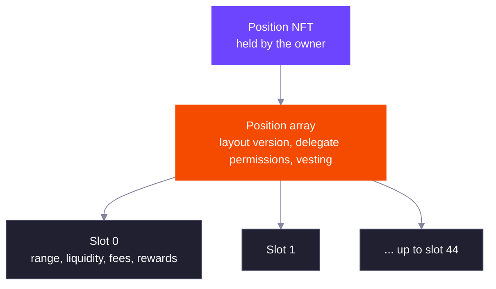
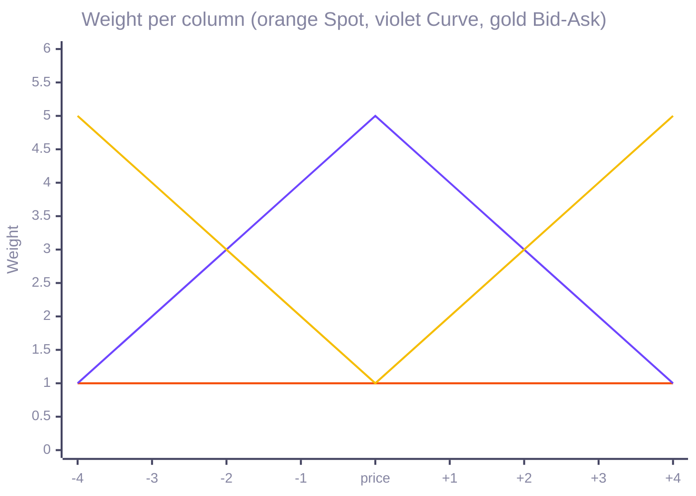

A DLMM Pro position is a Token 2022 NFT plus a position array account derived from the NFT's mint. Whoever holds the NFT owns the position, so transferring the NFT transfers the liquidity, unclaimed fees and unclaimed rewards with it.

## Ranges in One Position

A position array holds up to 45 slots. Each slot is one range `[tick_lower, tick_upper)` with its own liquidity, fees and rewards. Ranges can sit side by side, leave gaps, or overlap.

Instructions that act on some slots take a bitmap of slot indexes and the ranges of those slots, so one transaction can touch many ranges. Opening, expanding and removing slots changes the position's layout version. Pass the layout version you read as `expected_layout_version` and the program rejects the instruction if someone else changed the layout in the meantime.

Each slot splits its liquidity into three parts, and all three earn fees and rewards.

| Liquidity | Meaning |
| --- | --- |
| Unlocked | Can be withdrawn at any time |
| Permanently locked | Can never be withdrawn |
| Vesting | Locked under the position's vesting schedule, and moved back to unlocked as it vests |

The slot also records how much vesting liquidity it has released so far, which the program uses to work out the next release.

## Adding Liquidity

You open a position with its first ranges, then deposit. Opening a range on ticks no one has used yet creates those ticks, and the payer funds their rent.

| Method | What it does |
| --- | --- |
| Explicit liquidity | You choose the liquidity for each selected slot. Use it when you already computed the amounts. |
| By weight | Each selected slot gets `multiplier × weight` liquidity, with weights from 1 to 255. This is how shaped deposits work. |
| Imbalanced | Deposits into one slot from your wallet balances, capped per token, and takes the largest liquidity both tokens can fund at the current price. Useful for depositing whatever you hold, including fees you just claimed. |

Every deposit sets a cap on each token, transfer fee included, and fails rather than take more.

## Liquidity Shapes

A shape splits the price range into columns one tick spacing wide and gives each column a weight. The SDK turns the weights into ranges, and a by-weight deposit funds them in one transaction.

| Strategy | Weights |
| --- | --- |
| Spot | Equal in every column |
| Curve | Heaviest at the column holding the price, falling off away from it |
| Bid-Ask | Lightest at the price, rising toward the edges |
| Custom | Any weight per column, including zero for a gap |

The weights the SDK builds for nine columns around the current price:

Columns below the price hold token Y, columns above it hold token X, and the column holding the price takes both.

The layout decides how columns become ranges, and both give every column the same total weight:

- **Vertical** merges neighbouring columns of equal weight into side-by-side ranges. The Curve above needs 9 ranges.
- **Horizontal** stacks overlapping ranges, one per weight level. The same Curve needs 5 ranges, which leaves more of the 45 slots free.

When a shape needs more ranges than you allow, the SDK coarsens the weights until it fits.

## Fees and Rewards

Fees accrue to a slot when it is refreshed. Claiming fees or rewards refreshes the slots you select first, so select every slot you want paid out. A refresh without a claim is also available, and anyone the owner approved as a delegate can run it.

The SDK can also compound: one transaction claims fees and deposits them back into a chosen slot as an imbalanced deposit.

## Withdrawing and Closing

You withdraw unlocked liquidity either as explicit amounts per slot or as a share (in basis points) of each selected slot. A share withdrawal first releases any vested liquidity.

To shrink a position, remove empty slots. A slot is empty when it has no liquidity, no unclaimed fees and no unclaimed rewards. To finish, withdraw everything, claim, and close the position: the program burns the NFT and returns the rent.

## Locks

| Lock | Behavior |
| --- | --- |
| Permanent | Moves a share of unlocked liquidity, in basis points, into permanently locked liquidity. It cannot be withdrawn but keeps earning. |
| Vesting | Moves a share of unlocked liquidity into a schedule: a share released at the cliff, then an equal share each period. The shares must add up to 100%. |

Vesting schedules start at a cliff point in the future (or now), last at most 10 years, and follow the pool's activation type, so periods are in slots or seconds. A position can have one vesting schedule. Only the owner can lock.

## Delegates

The owner can let another wallet manage the position without handing over the NFT. The owner approves the wallet on the NFT account (a Token 2022 `approve` of amount 0), then grants permissions:

| Permission | Allows |
| --- | --- |
| `AddLiquidity` | Deposits, paid from the delegate's own token accounts |
| `RemoveLiquidity` | Withdrawals |
| `ClaimFee` | Fee claims |
| `ClaimReward` | Reward claims |
| `UpdatePositionRange` | Adding and removing slots |

Anything a delegate withdraws or claims must go to the owner's associated token account. Revoking the Token 2022 approval removes the delegate.

## Related

<CardGroup cols={2}>
  <Card title="Ticks and Liquidity" href="/core-products/dlmm-pro/ticks-and-liquidity" icon="ruler-horizontal">
    Tick spacing, ranges and which token a range holds.
  </Card>
  <Card title="TypeScript SDK Examples" href="/developer-guides/dlmm-pro/typescript-sdk/examples" icon="code">
    Open a position, deposit a shape, claim and compound fees.
  </Card>
</CardGroup>
