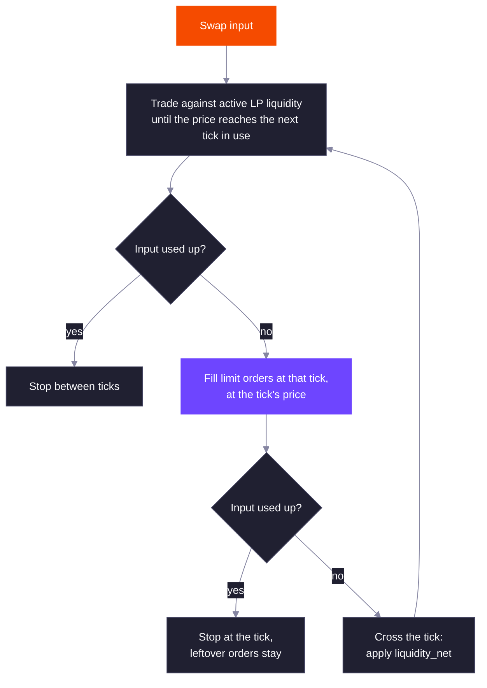

DLMM Pro measures price in ticks. A pool's state is a price, the tick that price falls in, and the LP liquidity that is active at that tick. Everything else, from ranges to limit orders to fee schedules, is expressed in ticks.

## Tick Price

Tick `i` has price `1.0001^i`, so each tick is a 0.01% (1 bp) step. Prices are in atoms of token Y per atom of token X, before adjusting for decimals. The program stores the square root of the price as a Q64.64 fixed-point number, and the current tick is the highest tick whose price is at or below the pool price. When the price sits exactly on a tick that a swap has just crossed downward, or a swap buying X stops on a tick that still has asks, the pool records the tick below.

Ticks run from `-443636` to `443636`, which covers prices from about `2^-64` to `2^64`.

To show a price in whole tokens, multiply by `10^(decimals_x - decimals_y)`. For SOL (9 decimals) against USDC (6 decimals), tick `-50000` is `1.0001^-50000 × 10^3`, about 6.74 USDC per SOL. The TypeScript SDK does this with `tickUiPrice`.

## Tick Spacing

A pool only uses ticks that are multiples of its tick spacing. Range edges and limit orders must sit on these usable ticks. The spacing is fixed when the pool is created and can be 1 to 256.

| Tick spacing | Price step between usable ticks | Typical pairs |
| --- | --- | --- |
| 1 | 0.01% | Stablecoins, LSTs against SOL |
| 4 | 0.04% | Major pairs such as SOL-USDC |
| 10 | 0.10% | Large caps |
| 20 | 0.20% | Established tokens |
| 80 | 0.80% | Volatile tokens |
| 100 | 1.005% | Memecoins |
| 256 | 2.59% | The widest allowed spacing |

A smaller spacing lets LPs and makers place liquidity closer to the price. A larger spacing means fewer ticks to cross, so swaps that move the price far cost less compute.

## Ranges

LP liquidity is placed in ranges `[tick_lower, tick_upper)`. Both edges are usable ticks and the lower edge is below the upper edge. A range is active, and earns fees, while the current tick is inside it.

What a range holds depends on where it sits relative to the current tick:

| Range position | Holds |
| --- | --- |
| Starts above the current tick | Token X only. It sells X as the price rises into it. |
| Contains the current tick | Both tokens |
| Ends at or below the current tick | Token Y only. It buys X as the price falls into it. |

This is why you can deposit a single token: a range entirely above the price needs only token X, and a range entirely below it needs only token Y. Inside a range the pool behaves like a constant-product curve, so the price moves continuously as a swap trades against it. The [formulas page](/core-products/dlmm-pro/formulas#liquidity-and-token-amounts) gives the amounts for a given liquidity.

## Ticks and Tick Arrays

A tick only exists on-chain once a range edge or a limit order uses it. Each tick records:

- `liquidity_net`: the LP liquidity added when the price crosses the tick upward (and removed when it crosses downward).
- Fee growth and, on liquidity mining pools, reward growth on the far side of the tick, used to work out what each range earned.
- The limit orders resting at the tick, all on one side (asks or bids), and what has been filled.

Ticks are stored in tick arrays. Tick array `n` covers the 128 usable ticks starting at tick `n × 128 × tick_spacing`, and a tick array account only stores the ticks in use. Each range edge and each order tick charges the payer one tick's worth of rent, whether or not the tick already exists, and creates the tick (and its tick array) if needed. Removing a slot, closing a position or closing an order refunds that rent to the instruction's rent receiver, and a tick is dropped once nothing references it.

The pool keeps a bitmap of which tick arrays hold liquidity or orders. The bitmap inside the pool account covers tick array indexes `-512` to `511`. A pool with liquidity outside that window needs the tick array bitmap extension account; when the initial price is already outside the window, the creator passes it at pool creation and the program initializes it with the pool. Anyone can create it later.

## How a Swap Moves

Swaps are exact-in. A swap fills against the pool step by step until the input is used up. The fee rate is set at the start of the swap, and each step takes its fee from that step's output, or from its input when an `OnlyY` pool is buying X (see [Fee Token](/core-products/dlmm-pro/fees#fee-token)).

Only orders on the opposite side of the trade fill. A swap selling X for Y fills bids (buy orders for X) at ticks at or below the price; a swap buying X fills asks at ticks above it.

The transaction lists the tick arrays the swap may touch. If those arrays run out of liquidity before the input is used, the swap fails with `NotConsumingFullAmountIn`. The SDK's quote returns the tick arrays to pass, and reports the input it could not fill as `amountLeft`.

## Oracle

Each pool has an oracle account that accumulates the pool's tick over time. Every swap adds `tick × seconds elapsed` to the latest observation, using the tick before the swap, and starts a new observation when at least 15 seconds have passed since the previous one was created.

To get a time-weighted average price, read two observations and divide the change in `tick_cumulative` by the change in timestamp. The result is an average tick; `1.0001^average_tick` is the geometric mean price over that window.

An oracle starts with one observation. Anyone can extend it, up to 500 observations, with `increase_oracle_length`, paying the extra rent. Integrators that need history should store observations off-chain rather than rely on the ring buffer.

## Related

<CardGroup cols={2}>
  <Card title="Positions" href="/core-products/dlmm-pro/positions" icon="layer-group">
    How ranges are grouped into one NFT position and shaped with weights.
  </Card>
  <Card title="Formulas" href="/core-products/dlmm-pro/formulas" icon="calculator">
    Price, liquidity and swap math in full.
  </Card>
</CardGroup>
