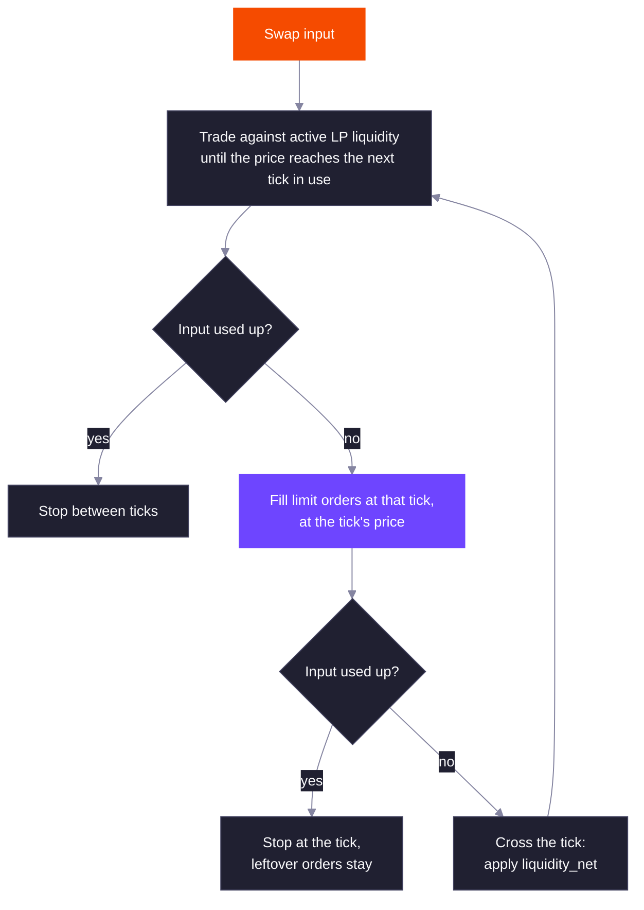

DLMM Pro measures price in ticks. A pool's state is a price, the tick that price falls in, and the LP liquidity that is active at that tick. Everything else, from ranges to limit orders to fee schedules, is expressed in ticks.

## Tick Price

Tick `i` has price `1.0001^i`, so each tick is a 0.01% (1 bp) step. Prices are in atoms of token Y per atom of token X, before adjusting for decimals. The program stores the square root of the price as a Q64.64 fixed-point number, and the current tick is the highest tick whose price is at or below the pool price. When the price sits exactly on a tick that a swap has just crossed downward, or a swap buying X stops on a tick that still has asks, the pool records the tick below.

Ticks run from `-443636` to `443636`, which covers prices from about `2^-64` to `2^64`.

To show a price in whole tokens, multiply by `10^(decimals_x - decimals_y)`. For SOL (9 decimals) against USDC (6 decimals), tick `-50000` is `1.0001^-50000 × 10^3`, about 6.74 USDC per SOL. The TypeScript SDK does this with `tickUiPrice`.

### Converting Between Price and Tick

To turn a price you read on a screen into a tick:

1. Multiply the price by `10^(decimals_y - decimals_x)` to get atoms of token Y per atom of token X.
2. Take the square root and scale it by `2^64` to get the Q64.64 square-root price.
3. Find the tick with `tickIdFromSqrtPrice`, which returns the highest tick whose price is at or below the input.
4. To place a range edge or an order, round that tick down to a multiple of the pool's tick spacing.

The pool's price can be any square-root price from `MIN_SQRT_PRICE` (`4295048016`) to `MAX_SQRT_PRICE` (`79226673515401279992447579055`). These are the square-root prices of the lowest and highest tick. The current tick can be any integer in the tick range, not only a multiple of the tick spacing.

Both directions with SOL (9 decimals) and USDC (6 decimals), at a price of 150 USDC per SOL:

| | SOL is X, USDC is Y | USDC is X, SOL is Y |
| --- | --- | --- |
| Price in atoms | `150 × 10^(6 - 9) = 0.15` | `(1 / 150) × 10^(9 - 6) = 6.6667` |
| Tick at or below the price | `-18973` | `18972` |
| Price of that tick in whole tokens | 149.987 USDC per SOL | 0.00666657 SOL per USDC |
| Usable tick at spacing 4, rounded down | `-18976`, 149.942 USDC per SOL | `18972`, 0.00666657 SOL per USDC |
| Next usable tick up at spacing 4 | `-18972`, 150.002 USDC per SOL | `18976`, 0.00666923 SOL per USDC |

Swapping which token is X negates the exact tick. Because the result is rounded down, the two ticks differ by one: `-18973` and `18972`, not `-18973` and `18973`.

## Tick Spacing

A pool only uses ticks that are multiples of its tick spacing. Range edges and limit orders must sit on these usable ticks. The spacing is fixed when the pool is created and can be 1 to 256.

| Tick spacing | Price step between usable ticks | Typical pairs |
| --- | --- | --- |
| 1 | 0.01% | Stablecoins, LSTs against SOL |
| 4 | 0.04% | Major pairs such as SOL-USDC |
| 10 | 0.10% | Large caps |
| 20 | 0.20% | Established tokens |
| 80 | 0.80% | Volatile tokens |
| 100 | 1.005% | Memecoins |
| 256 | 2.59% | The widest allowed spacing |

A smaller spacing lets LPs and makers place liquidity closer to the price. A larger spacing means fewer ticks to cross, so swaps that move the price far cost less compute.

### Usable Ticks

A tick is usable when it is a multiple of the tick spacing and inside `-443636` to `443636`. Anything else is rejected with `InvalidParameters`. The highest usable tick is `⌊443636 / spacing⌋ × spacing`, and the lowest is its negative.

| Tick spacing | Highest usable tick | Usable ticks in the pool |
| --- | --- | --- |
| 1 | 443636 | 887,273 |
| 4 | 443636 | 221,819 |
| 10 | 443630 | 88,727 |
| 20 | 443620 | 44,363 |
| 80 | 443600 | 11,091 |
| 100 | 443600 | 8,873 |
| 256 | 443392 | 3,465 |

The usable tick count also sets a cap on liquidity. The total liquidity of all range edges on one tick cannot exceed `2^128 - 1` divided by the usable tick count, for example `383514844834609487117690504987493` at spacing 1. A deposit that would pass the cap fails with `LiquidityIsTooHigh`.

## Ranges

LP liquidity is placed in ranges `[tick_lower, tick_upper)`. Both edges are usable ticks and the lower edge is below the upper edge. A range is active, and earns fees, while the current tick is inside it.

What a range holds depends on where it sits relative to the current tick:

| Range position | Holds |
| --- | --- |
| Starts above the current tick | Token X only. It sells X as the price rises into it. |
| Contains the current tick | Both tokens |
| Ends at or below the current tick | Token Y only. It buys X as the price falls into it. |

This is why you can deposit a single token: a range entirely above the price needs only token X, and a range entirely below it needs only token Y. Inside a range the pool behaves like a constant-product curve, so the price moves continuously as a swap trades against it. The [formulas page](/core-products/dlmm-pro/formulas#liquidity-and-token-amounts) gives the amounts for a given liquidity.

### Range Rules and Example

- Both edges must be usable ticks and the lower edge must be below the upper edge, or the instruction fails with `InvalidParameters`.
- A range has no maximum width, and ranges of one position can overlap. A position holds 1 to 45 ranges.
- Liquidity in a range is a positive integer. Zero fails with `LiquidityIsZero`, and a value above `2^127 - 1` fails with `LiquidityIsTooHigh`.
- The pool's active liquidity changes only when the current tick is inside the range, from the lower edge up to but not including the upper edge.

With tick spacing 10 and the pool price exactly on tick 105, three ranges that each hold liquidity `1,000,000,000,000` need these amounts:

| Range | Position relative to tick 105 | Deposit X | Deposit Y | Withdraw X | Withdraw Y |
| --- | --- | --- | --- | --- | --- |
| `[90, 100)` | Ends below | 0 | 502,355,419 | 0 | 502,355,418 |
| `[100, 110)` | Contains it | 248,647,491 | 251,271,912 | 248,647,490 | 251,271,911 |
| `[110, 120)` | Starts above | 497,108,543 | 0 | 497,108,542 | 0 |

A deposit rounds each amount up and a withdrawal rounds down, so the pool keeps the difference.

## Ticks and Tick Arrays

A tick only exists on-chain once a range edge or a limit order uses it. Each tick records:

- `liquidity_net`: the LP liquidity added when the price crosses the tick upward (and removed when it crosses downward).
- Fee growth and, on liquidity mining pools, reward growth on the far side of the tick, used to work out what each range earned.
- The limit orders resting at the tick, all on one side (asks or bids), and what has been filled.

Ticks are stored in tick arrays. Tick array `n` covers the 128 usable ticks starting at tick `n × 128 × tick_spacing`, and a tick array account only stores the ticks in use. Each range edge and each order tick charges the payer one tick's worth of rent, whether or not the tick already exists, and creates the tick (and its tick array) if needed. Removing a slot, closing a position or closing an order refunds that rent to the instruction's rent receiver, and a tick is dropped once nothing references it. Whoever creates a tick array also pays the rent of its empty account, which is not refunded because tick arrays are never closed.

The pool keeps a bitmap of which tick arrays hold liquidity or orders. The bitmap inside the pool account covers tick array indexes `-512` to `511`. A pool with liquidity outside that window needs the tick array bitmap extension account; when the initial price is already outside the window, the creator passes it at pool creation and the program initializes it with the pool. Anyone can create it later.

Each tick also stores its own square-root price, its `liquidity_gross` (the sum of the liquidity of every range edge sitting on it) and a count of the range edges and order ticks that reference it. A range `[a, b)` with liquidity `L` adds `L` to `liquidity_gross` at both edges, adds `+L` to `liquidity_net` at `a` and `-L` at `b`. A tick is dropped when its reference count reaches zero. A tick is 160 bytes, or 192 bytes on pools with the `LiquidityMining` extension.

### Tick Array Index

The array that holds a tick is `⌊tick_id / tick_spacing⌋` divided by 128, rounded toward negative infinity. Array `n` covers tick ids `n × 128 × tick_spacing` to `(n × 128 + 127) × tick_spacing`. Array `-1` always holds the 128 usable ticks just below zero.

| Tick | Spacing | Array index | Array covers |
| --- | --- | --- | --- |
| 1000 | 4 | 1 | 512 to 1020 |
| 0 | 4 | 0 | 0 to 508 |
| -4 | 4 | -1 | -512 to -4 |
| -516 | 4 | -2 | -1024 to -516 |
| 127 | 1 | 0 | 0 to 127 |
| 128 | 1 | 1 | 128 to 255 |
| -128 | 1 | -1 | -128 to -1 |
| -129 | 1 | -2 | -256 to -129 |
| 443636 | 1 | 3465 | 443520 to 443647 |
| -443636 | 1 | -3466 | -443648 to -443521 |

The array account lives at the address derived from the pool and the index. Anyone can create an empty array with `initialize_tick_array`, and the index must cover at least one tick inside the tick range. The position and limit order instructions create the arrays they need and the payer covers the rent. If the array already exists, creating it again does nothing.

### Tick Array Bitmap Arithmetic

The bitmap has one bit per tick array index. A bit is set while any tick in the array has liquidity or a resting order, and cleared when the array holds neither.

The inline bitmap in the pool account has 1,024 bits for indexes `-512` to `511`. The bit for an index is `index + 512`:

| Index | Inline bit |
| --- | --- |
| -512 | 0 |
| -1 | 511 |
| 0 | 512 |
| 511 | 1023 |

In tick ids the inline window is `-65536 × spacing` to `65535 × spacing`. At spacing 1 that is `-65536` to `65535`. At spacing 7 and above it is `-458752` to `458745` or wider, which covers every possible tick, so those pools never need the extension.

The extension account adds six chunks of 512 bits on each side, covering indexes `512` to `3583` and `-513` to `-3584`. Every pool can hold any tick with it, because spacing 1 needs indexes `-3466` to `3465`. The chunk and bit for an index outside the inline window:

- For a positive index, the chunk is `⌊index / 512⌋ - 1` and the bit is `index mod 512`.
- For a negative index, let `m = -(index + 1)`. The chunk is `⌊m / 512⌋ - 1` and the bit is `m mod 512`.

| Index | Side | Chunk | Bit |
| --- | --- | --- | --- |
| 512 | Positive | 0 | 0 |
| 1000 | Positive | 0 | 488 |
| 1024 | Positive | 1 | 0 |
| 3583 | Positive | 5 | 511 |
| -513 | Negative | 0 | 0 |
| -1025 | Negative | 1 | 0 |
| -3584 | Negative | 5 | 511 |

To find the next array to swap through, the program scans the bitmap from the current array index in the swap direction for the nearest set bit, first in the inline bitmap and then in the extension if it is initialized. A swap that has to look outside the inline window, on a pool whose extension is initialized, fails with `BitmapExtensionAccountIsNotProvided` when the account is not passed. A deposit, order or cancel that has to flip a bit outside the window without it fails with `TickArrayBitmapExtensionAccountIsNotProvided`. Anyone can create the extension with `initialize_tick_bitmap_extension`, and creating it again does nothing.

### Tick Array Rent

Rent figures use the Solana rent-exempt minimum of 6,960 lamports per byte plus 128 bytes of account overhead.

| Account or item | Size | Rent in lamports | Who pays |
| --- | --- | --- | --- |
| Empty tick array | 64 bytes | 1,336,320 | Whoever creates it. Never refunded. |
| One tick, per range edge or order tick | 160 bytes | 1,113,600 | The payer of the instruction. Refunded to the rent receiver. |
| One tick on a `LiquidityMining` pool | 192 bytes | 1,336,320 | Same |
| One range (two edges) | 320 bytes | 2,227,200 | Same |
| One range on a `LiquidityMining` pool | 384 bytes | 2,672,640 | Same |
| Full array of 128 ticks | 20,544 bytes | 143,877,120 | Same |
| Tick array bitmap extension | 808 bytes | 6,514,560 | Whoever creates it |

Each edge pays the rent of one tick even when the tick already exists, and gets it back when that edge is removed. A single instruction can grow an account by at most 10,240 bytes, so it can add at most 64 new ticks (53 on `LiquidityMining` pools) to one tick array. More fails with `ReallocExceedMaxLengthPerInstruction`.

## How a Swap Moves

Swaps are exact-in. A swap fills against the pool step by step until the input is used up. The fee rate is set at the start of the swap, and each step takes its fee from that step's output, or from its input when an `OnlyY` pool is buying X (see [Fee Token](/core-products/dlmm-pro/fees#fee-token)).

Only orders on the opposite side of the trade fill. A swap selling X for Y fills bids (buy orders for X) at ticks at or below the current tick; a swap buying X fills asks at ticks above the current tick.

The transaction lists the tick arrays the swap may touch. If those arrays run out of liquidity before the input is used, the swap fails with `NotConsumingFullAmountIn`. The SDK's quote returns the tick arrays to pass, and reports the input it could not fill as `amountLeft`.

The swap fails in these cases:

| Error | When |
| --- | --- |
| `AmountIsZero` | The input is zero. |
| `LiquidityIsZero` | The bitmap has no array with liquidity or orders in the swap direction. |
| `NotConsumingFullAmountIn` | The tick arrays passed run out before the input is used up. |
| `ExceededSlippage` | The output after any Token 2022 transfer fee is below `minimum_output_amount`. |

Pass the tick arrays in the order the swap visits them: descending index when selling X for Y, ascending when buying X. The program skips accounts that are not the next array it expects.

### Worked Swap

Pool with tick spacing 10, price exactly on tick 0, a fixed fee of 0.30% (`3,000,000` over `1,000,000,000`), the `OutputToken` fee mode, no referral and no partner. LPs hold liquidity `1,000,000,000,000` in `[-100, 100)` and `2,000,000,000,000` in `[100, 200)`. A maker has an ask of 5,000,000 X at tick 100. A swapper buys X with 5,200,000,000 Y.

| Step | What happens | Y paid | X out before fee | Fee in X | LPs | Makers | Protocol |
| --- | --- | --- | --- | --- | --- | --- | --- |
| 1 | LP liquidity from tick 0 up to tick 100 | 5,012,269,624 | 4,987,272,070 | 14,961,817 | 13,465,636 | 0 | 1,496,181 |
| 1 | The ask at tick 100, at the tick price | 5,050,249 | 5,000,000 | 15,000 | 0 | 7,500 | 7,500 |
| 1 | Cross tick 100, liquidity goes from `1,000,000,000,000` to `2,000,000,000,000` | 0 | 0 | 0 | 0 | 0 | 0 |
| 2 | LP liquidity in `[100, 200)` until the input runs out | 182,680,127 | 180,846,083 | 542,539 | 488,286 | 0 | 54,253 |

The fee on step 1 is `⌈4,992,272,070 × 0.003⌉ = 14,976,817`. It is split by output, so LP liquidity gets `⌈14,976,817 × 4,987,272,070 / 4,992,272,070⌉ = 14,961,817` and the ask gets the remaining 15,000. The protocol takes 10% of the LP part and 50% of the order part, both rounded down.

Totals: the swapper pays 5,200,000,000 Y and receives 5,157,598,797 X. The pool ends at square-root price `18540889055449466691`, tick 101, with liquidity `2,000,000,000,000`. The SDK's `quoteExactIn` returns the same figures. When the maker cancels, the ask pays out `⌊5,000,000 × 1.0001^100⌋ = 5,050,248` Y plus a fee share of 7,500 X. The swapper paid one Y more than the maker receives, and that remainder stays in the pool.

## Oracle

Each pool has an oracle account that accumulates the pool's tick over time. Every swap adds `tick × seconds elapsed` to the latest observation, using the tick before the swap, and starts a new observation when at least 15 seconds have passed since the previous one was created.

To get a time-weighted average price, read two observations and divide the change in `tick_cumulative` by the change in timestamp. The result is an average tick; `1.0001^average_tick` is the geometric mean price over that window. The oracle only moves on swaps, so to average up to the present, extend the latest observation yourself by adding `current tick × seconds since its last_updated_timestamp`.

An oracle starts with one observation. Anyone can extend it, up to 500 observations, with `increase_oracle_length`, paying the extra rent. Integrators that need history should store observations off-chain rather than rely on the ring buffer.

### Oracle Walk-Through

The oracle account holds a ring buffer of observations, each a pair of `last_updated_timestamp` and `tick_cumulative`. Until the first swap it holds one empty observation with timestamp 0. The first swap stamps it with the swap time and a cumulative of 0, so there is no history from before the first swap. After that, every swap works out the seconds since the latest observation was last updated, multiplies by the tick before the swap, and adds the result to the cumulative. If at least 15 seconds have passed since the latest observation was created, the result is written to the next slot of the ring. Otherwise it overwrites the latest observation.

With a ring of 3 observations:

| Time | Tick before swap | Cumulative added | Write | Observations after |
| --- | --- | --- | --- | --- |
| 1000 | 100 | 0, first swap | Stamp slot 0 | `[0: (1000, 0)]` |
| 1007 | 100 | `7 × 100 = 700` | 7 seconds since creation, update slot 0 | `[0: (1007, 700)]` |
| 1020 | 130 | `13 × 130 = 1,690` | 20 seconds since creation, new slot 1 | `[0: (1007, 700), 1: (1020, 2390)]` |
| 1031 | 140 | `11 × 140 = 1,540` | 11 seconds since creation, update slot 1 | `[0: (1007, 700), 1: (1031, 3930)]` |
| 1040 | 150 | `9 × 150 = 1,350` | 20 seconds since creation, new slot 2 | `[0: (1007, 700), 1: (1031, 3930), 2: (1040, 5280)]` |

The next new observation wraps around and overwrites slot 0.

To read an average between slot 0 and slot 1 after the swap at time 1031, divide the change in cumulative by the change in time: `(3930 - 700) / (1031 - 1007) = 134.58`. The geometric mean price over that window is `1.0001^134.58 = 1.01355`. To average up to time 1036 with the current tick at 145, extend slot 1 yourself: `3930 + 5 × 145 = 4655`, then `(4655 - 700) / (1036 - 1007) = 136.38`, a mean price of `1.0001^136.38 = 1.01373`.

Extending the oracle costs 16 bytes per observation, 111,360 lamports each, and the new account size is topped up to the rent-exempt minimum from the payer. The oracle starts at 72 bytes (1,392,000 lamports). At the 500 observation maximum it is 8,056 bytes and 56,960,640 lamports, so growing it from 1 to 500 costs 55,568,640. Adding zero observations, or growing past 500, fails with `InvalidParameters`. If the ring has already wrapped around when it is extended, the program first rotates it so the newest observation is last and the new empty slots follow it, which keeps existing observations.

## Related

<CardGroup cols={2}>
  <Card title="Positions" href="/core-products/dlmm-pro/positions" icon="layer-group">
    How ranges are grouped into one NFT position and shaped with weights.
  </Card>
  <Card title="Formulas" href="/core-products/dlmm-pro/formulas" icon="calculator">
    Price, liquidity and swap math in full.
  </Card>
</CardGroup>
