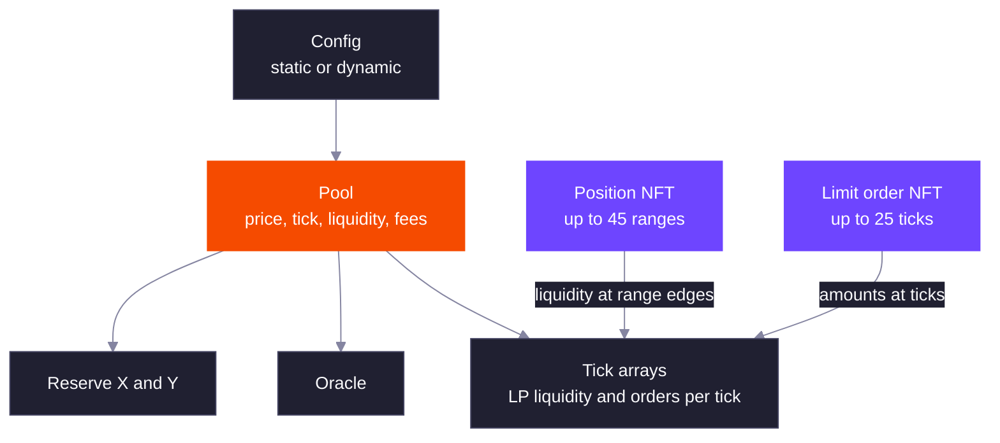

<Warning>
  DLMM Pro is in beta and is subject to breaking changes.
</Warning>

DLMM Pro is Meteora's concentrated liquidity AMM built on ticks. LPs place liquidity in price ranges, makers place limit orders at single prices, and both live in the same tick state, so one swap fills LP liquidity and limit orders together.

A pool's tick spacing, fee schedule, fee token and optional extensions are fixed when it is created, either by a static config or by the creator of a dynamic-config or launch pool. Positions and limit orders are Token 2022 NFTs, so they can be transferred, delegated and tracked like any other token.

<Info>
  DLMM Pro runs on the program `dPro1D5wiqnGMH8vMDG23jh35btTHoWdyqXjqkqxe8n` on mainnet and devnet.
</Info>

<CardGroup cols={2}>
  <Card title="Ticks, Not Bins" icon="ruler-horizontal" iconType="solid">
    Every tick is a 0.01% price step. A pool's tick spacing (1 to 256) sets how far apart LP range edges and orders can be.
  </Card>
  <Card title="Multi-Range Positions" icon="layer-group" iconType="solid">
    One position NFT holds up to 45 ranges, each with its own liquidity, fees and rewards. Spot, Curve and Bid-Ask shapes are built from these ranges.
  </Card>
  <Card title="Limit Orders in the Pool" icon="list-check" iconType="solid">
    Orders of up to 25 ticks sit beside LP liquidity, fill at the exact tick price and earn a share of the trading fee.
  </Card>
  <Card title="Scheduled and Dynamic Fees" icon="percent" iconType="solid">
    Fixed, time-scheduled or market-cap-scheduled base fees, plus an optional fee that rises with volatility. Fees range from 0.01% to 99%.
  </Card>
  <Card title="Launch Controls" icon="rocket" iconType="solid">
    Activation rules open swaps at a set time, and deposits and withdrawals at a set time or once the price reaches a target, with a whitelisted wallet for each action.
  </Card>
  <Card title="Liquidity Mining" icon="seedling" iconType="solid">
    Pools with the liquidity mining extension stream up to two reward tokens to in-range liquidity.
  </Card>
</CardGroup>

## How DLMM Pro Works

A pool stores the current price as a square-root price and the tick it falls in. Liquidity is recorded at ticks: each tick holds the change in LP liquidity at that price (`liquidity_net`) and the limit orders resting there. Ticks live in tick arrays, and the pool keeps a bitmap of which tick arrays hold anything, so swaps skip empty stretches of the price curve.

A swap starts at the current price and walks toward the next tick that holds liquidity. Between ticks it trades against LP liquidity, and the price moves along the curve. When it reaches a tick with resting limit orders on the other side of the trade, it fills those orders at that tick's price, then crosses the tick, applies its liquidity change and keeps going. A swap is always exact-in: it consumes the whole input or fails.

The pool account stores the two token mints and their reserve accounts, the creator, the fee settings and the dynamic fee state, the partner and protocol fee balances, the active liquidity, the initial and current square-root price, the current tick, the fee growth per unit of liquidity for each token, the inline tick array bitmap, the activation point, the pool status and the extension data. Everything else sits in separate accounts:

| Account | Holds | Created by |
| --- | --- | --- |
| Config | Settings a static or dynamic config pool copies at creation | An operator |
| Pool | The state above | The payer of the pool creation transaction |
| Reserve X and Reserve Y | The pool's tokens, one account per mint | The payer of the pool creation transaction |
| Oracle | The tick-cumulative observations | The payer of the pool creation transaction |
| Tick array | Up to 128 usable ticks, grown and shrunk as ticks come and go | Whoever first needs it |
| Tick array bitmap extension | Bitmap bits beyond the inline window | At pool creation if needed, or by anyone later |
| Position array and NFT | Up to 45 ranges and their liquidity, fees and rewards | The position owner or payer |
| Limit order and NFT | Up to 25 order ticks | The order owner or payer |

A typical life of a pool:

1. A pool is created with a token pair, an initial price, a tick spacing, a fee schedule, a fee token and an activation type. Nothing about these can be changed afterwards.
2. LPs open positions and deposit. Each range edge creates or updates a tick, and the pool's active liquidity changes if the range contains the current tick.
3. Makers open limit orders. Each order tick stores the deposited amount on the tick.
4. A swap works out one fee rate from the pool's fee settings, then walks ticks in the direction of the trade. At each tick it fills LP liquidity, then orders, takes the fee on the step and splits it, then crosses the tick and moves on until the input is used up.
5. LPs and makers collect: LPs claim fees and rewards from a position, makers cancel an order to get their proceeds, referrals are paid inside the swap or cancel, and partners and Meteora claim their balances from the pool.
6. Positions and orders are closed, which burns the NFT and returns the rent.

A swap also needs the tick arrays it will pass through in its transaction. If they run out before the input is used up, it fails with `NotConsumingFullAmountIn`. The caller sets a minimum output, and the swap fails with `ExceededSlippage` if the output after any transfer fee is lower.

Read [Ticks and Liquidity](/core-products/dlmm-pro/ticks-and-liquidity) for the price grid and [Limit Orders](/core-products/dlmm-pro/limit-orders) for how orders at one tick are filled.

## DLMM Pro and DLMM

DLMM Pro is a separate program from [DLMM](/core-products/dlmm/what-is-dlmm), and pools on one cannot be used from the other. The main differences:

| | DLMM | DLMM Pro |
| --- | --- | --- |
| Price grid | Bins, spaced by the pool's bin step | Ticks of 0.01%, with usable ticks set by the tick spacing |
| Liquidity inside a step | Constant sum: one price per bin | Concentrated constant product between ticks; limit orders fill at the tick price |
| Position | One account, one contiguous bin range | One NFT, up to 45 ranges that can overlap |
| Limit orders | Only on pools in limit-order mode | On every pool |
| Liquidity mining | Only on pools in liquidity-mining mode | Optional extension; limit orders still work |
| Base fee | Bin step and base factor | Fixed, time scheduler or market cap scheduler |
| Fee token | `InputOnly` or `OnlyY` | `OutputToken` or `OnlyY` |
| Price step | Set per pool, with a bin step of up to 400 basis points | Fixed at 0.01% per tick, with the tick spacing choosing how many ticks apart usable ticks are |
| Storage unit | Bin arrays of 70 bins | Tick arrays of 128 usable ticks that grow and shrink |
| Position size | A 70 bin default layout, and up to 1,400 bins with a dynamic position | 1 to 45 ranges of any width |

The DLMM column comes from the [DLMM overview](/core-products/dlmm/what-is-dlmm) and its [collect fee mode](/core-products/dlmm/collect-fee-mode) page. Limit orders on DLMM Pro are not a pool mode, so they work together with liquidity mining, and a position can overlap its own ranges to build a shape with fewer slots.

### Limits at a Glance

| Item | Value |
| --- | --- |
| Tick range | `-443636` to `443636`, prices from about `2^-64` to `2^64` |
| Tick spacing | 1 to 256 |
| Tick array | 128 usable ticks |
| Inline tick array bitmap | Indexes `-512` to `511`, with the extension to `-3584` and `3583` |
| Ranges per position | 1 to 45 |
| Liquidity weight in a shaped deposit | 1 to 255 |
| Ticks per limit order | 1 to 25, all on one side |
| Trading fee | 0.01% to 99% |
| Protocol share of the LP fee | 10%, or 20% on launch pools |
| Protocol share of the limit-order fee | 50% |
| Host fee, as a share of the protocol fee | 20% |
| Limit order referral, as a share of the maker's fee | 20% |
| Partner fee, as a share of the protocol fee after the host fee | 0% to 50% |
| Oracle observations | 1 to 500, one new sample every 15 seconds at most |
| Dynamic fee periods | Filter below decay, decay at most 1 hour |
| Reward slots | 2, each emission from 1 day to 1 year, starting at most 30 days ahead |
| Vesting schedule | At most 10 years from the lock |
| Activation points | At most 30 days ahead of creation |

## Who DLMM Pro Is For

<AccordionGroup>
  <Accordion title="Liquidity providers">
    Build a position from several ranges instead of one, shape it with Spot, Curve or Bid-Ask weights, and adjust it without closing it. Locked and vesting liquidity keeps earning fees and rewards.
  </Accordion>
  <Accordion title="Traders and market makers">
    Place bids and asks at exact prices inside the pool. Filled orders earn half of the fee charged on the volume they fill, and relative orders protect you if the price moves before the transaction lands.
  </Accordion>
  <Accordion title="Token teams and launchpads">
    Start a pool with a high fee that falls over time or as the price rises, open trading at a set time, keep deposits and withdrawals closed to the public until a set time or a price milestone, and run a reward campaign from the pool itself.
  </Accordion>
  <Accordion title="Aggregators and integrators">
    The TypeScript SDK and the Rust commons crate quote exact-in swaps with the same math as the program, including limit-order fills and Token 2022 transfer fees.
  </Accordion>
</AccordionGroup>

## Explore DLMM Pro

<CardGroup cols={2}>
  <Card title="Ticks and Liquidity" href="/core-products/dlmm-pro/ticks-and-liquidity" icon="ruler-horizontal">
    Tick prices, tick spacing, ranges, tick arrays and how a swap moves through them.
  </Card>
  <Card title="Positions" href="/core-products/dlmm-pro/positions" icon="layer-group">
    Multi-range NFT positions, liquidity shapes, fees, locks and delegates.
  </Card>
  <Card title="Limit Orders" href="/core-products/dlmm-pro/limit-orders" icon="list-check">
    Asks and bids at single ticks, fill order, maker fees and the order lifecycle.
  </Card>
  <Card title="Fees" href="/core-products/dlmm-pro/fees" icon="percent">
    Base fee modes, the dynamic fee, the fee token, and where each part of a fee goes.
  </Card>
  <Card title="Pool Creation and Activation" href="/core-products/dlmm-pro/pool-creation-and-activation" icon="rocket">
    Static configs, dynamic configs, launch pools and activation rules.
  </Card>
  <Card title="Liquidity Mining" href="/core-products/dlmm-pro/liquidity-mining" icon="seedling">
    Reward slots, emission schedules and rewards emitted while no liquidity is in range.
  </Card>
  <Card title="Token 2022 Support" href="/core-products/dlmm-pro/token-2022-support" icon="certificate">
    Which mints work without review, token badges, transfer fees and transfer hooks.
  </Card>
  <Card title="Formulas" href="/core-products/dlmm-pro/formulas" icon="calculator">
    The math behind prices, liquidity amounts, fees, fee schedules and rewards.
  </Card>
</CardGroup>

<Warning>
  Concentrated liquidity earns fees only while the price is inside your ranges. If the price leaves every range of a position, that position stops earning trading fees until the price returns or you move the liquidity.
</Warning>
