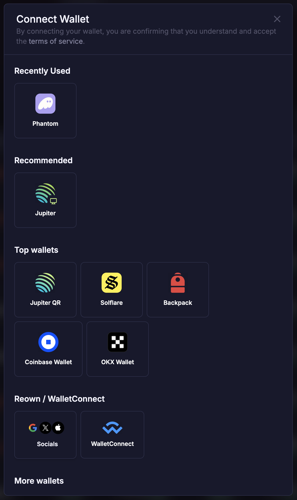
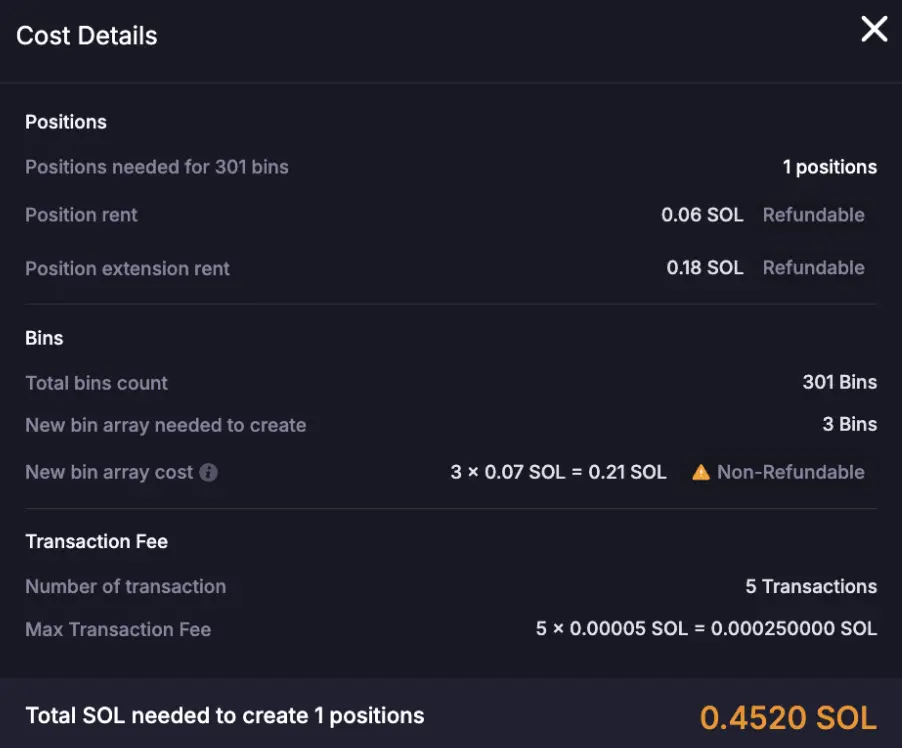
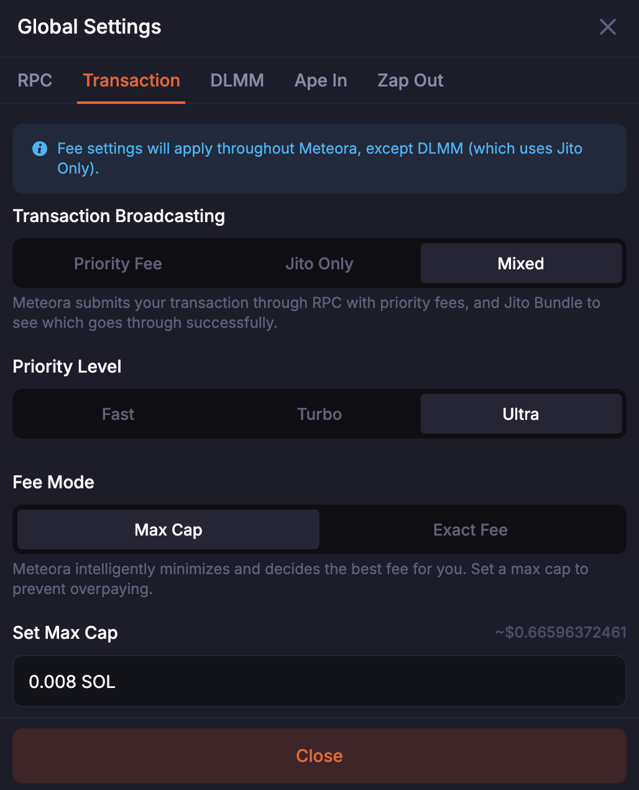
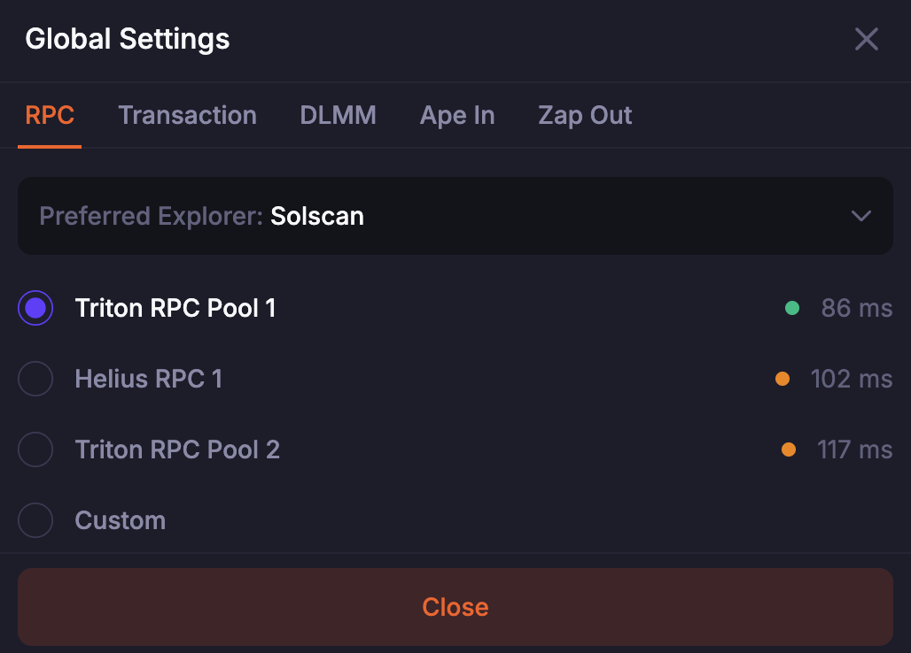
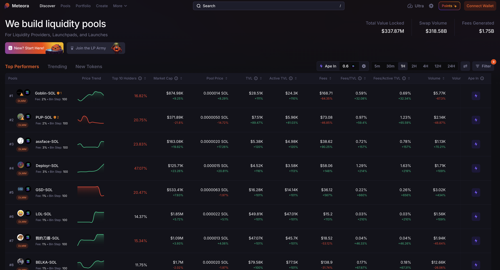
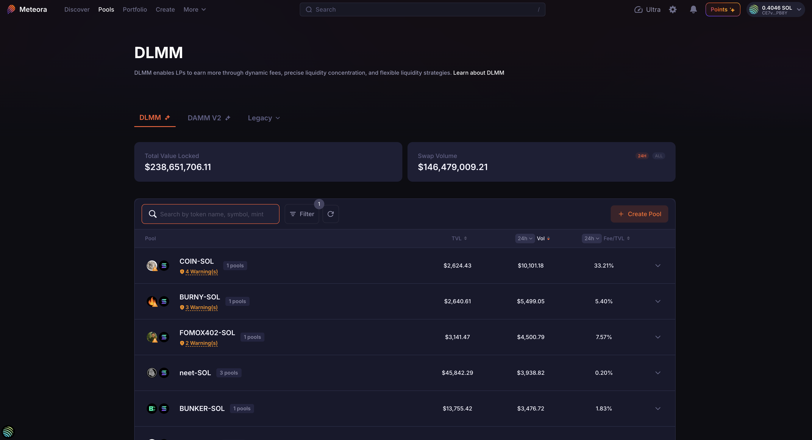
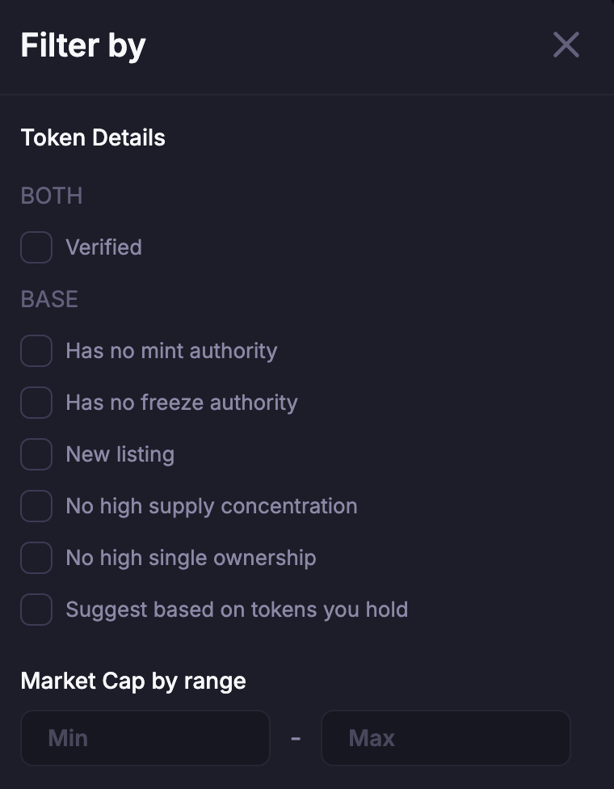
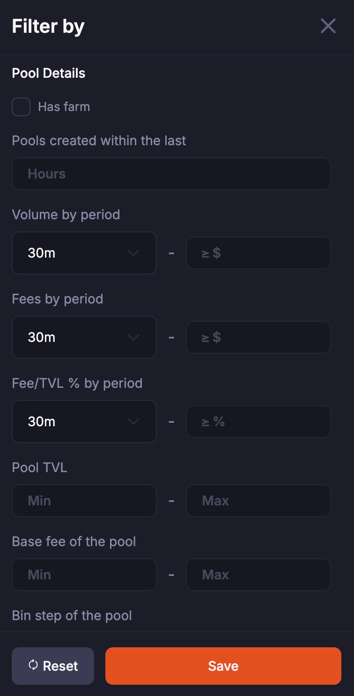
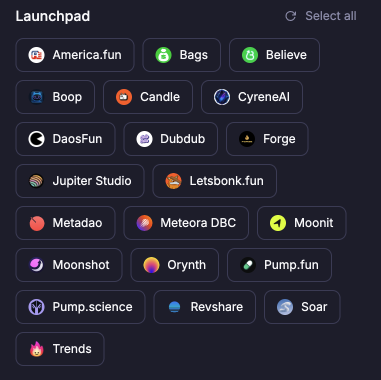
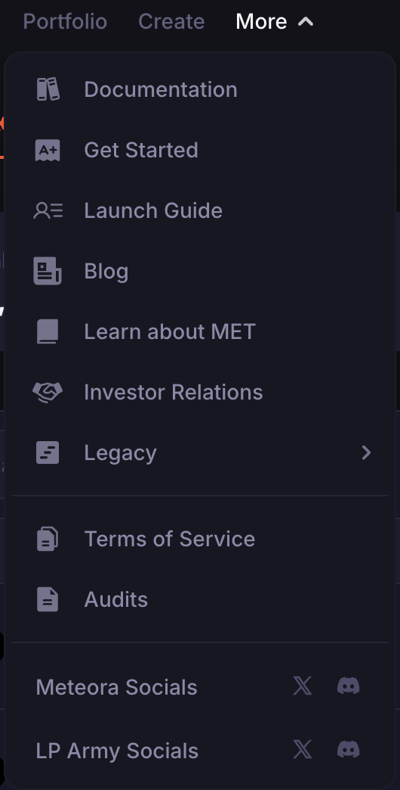

## Connecting Your Wallet

### Supported Wallets on Meteora

A Solana-compatible wallet lets you receive, send, store, and manage cryptocurrencies and non-fungible tokens (NFTs) on the Solana blockchain. As with any decentralized application (Dapp) on Solana, you connect your wallet on Meteora before you add liquidity to a pool or execute other transactions.

Meteora supports wallets that follow the Solana [Wallet Standard](https://github.com/wallet-standard/wallet-standard), a chain-agnostic set of interfaces and conventions for how applications interact with injected wallets.

Popular wallets supported on Meteora include:

#### Hot Wallets

- Jupiter Wallet
- Phantom
- Solflare
- Backpack
- Coinbase
- OKX Wallet
- Coin98
- Frontier
- MetaMask (via Snaps with Solflare)
- WalletConnect

#### Hardware Wallets

- Ledger
- Trezor

  

## Prepare SOL for Transactions and Rent

### Transactions

#### What is SOL?

SOL is the Solana blockchain’s native cryptocurrency. It pays transaction fees and is also used to secure the network through staking.

#### What is Wrapped SOL (wSOL)?

Wrapped SOL (wSOL) is native SOL that is wrapped using the Solana Token Program, which allows it to be treated like any other SPL (Solana Program Library) token type.

Native SOL is not an SPL token (e.g. JUP), so Dapps have to wrap and unwrap SOL when trading in SOL or using it in DeFi.

If there is unused wSOL from adding liquidity or if you're withdrawing wSOL from a pool, you can unwrap it to get it back to native SOL.

#### How do you unwrap wSOL?

If you use the Phantom wallet, you can follow the instructions [here](https://help.phantom.app/hc/en-us/articles/4406389768339-How-do-I-unwrap-Wrapped-SOL-).

#### Transaction Fees on Solana

Solana transaction fees are paid in SOL, so you need SOL in your wallet for any on-chain action.

Adding or removing liquidity on Meteora, in DLMM, DAMM v1, DAMM v2, Dynamic Vaults, or Multi-token pools, requires SOL for transaction fees.

<Note>0.000000001 SOL = 1 lamport (one-billionth of a SOL)</Note>

### Rent

Solana stores data in accounts, such as those that record token transfers, ownership, and other program state. Each account pays a rent fee in SOL to be created and maintained, and the amount depends on the account's data size.

For example, when you receive a new token in your wallet for the first time, an associated token account (ATA) owned by your wallet is created automatically and SOL rent is charged.

In some cases the rent is **refundable**. When an account is closed, its data is freed and the rent is returned to the account owner.

### SOL Required on Meteora

#### DAMM v1 or DAMM v2

When you create a DAMM v1 or v2 pool, you may need to pay some rent to open [ATAs (Associated Token Accounts)](https://spl.solana.com/associated-token-account) on Solana. This is roughly ~0.02-0.03+ SOL (may change over time).

#### DLMM

Creating a DLMM position also requires rent.

<Card title="Refundable" icon="money-bill">
    <CardGroup cols={2}>
        <Card title="Position rent" icon="location-pin">
            Rent of ~0.059 SOL per position is required to open the program account and store data related to your liquidity position. This is refundable; you get it back when you withdraw your liquidity and close the position.
        </Card>
        <Card title="Position extension rent" icon="puzzle-piece">
            Additional rent is also required if your position range covers more than 69 bins. This is refundable.
        </Card>
    </CardGroup>
</Card>

<Card title="Non-refundable" icon="not-equal">
    <CardGroup cols={1}>
        <Card title="binArray creation rent" icon="bin">
            If you are the first to use specific price bins in the pool, you pay rent to create the binArray program account that stores them. This rent is non-refundable (~0.075 SOL per binArray). Once created, no one else pays it again. Meteora can't close that account because other LPs may have liquidity in those bins.
        </Card>
    </CardGroup>
</Card>

When you close your own position, you still get back the standard rent for your position (~0.059 SOL per position).

Before you add liquidity, you can view the total SOL required to open your positions. Position rent has the "Refundable" label, and SOL for creating new bin arrays has the "Non-Refundable" label.

  

## Transaction Fee Settings

Every on-chain transaction on Solana (e.g. sending tokens, adding liquidity, buying an NFT, or interacting with a program) requires a transaction fee. The fee:

- Incentivizes validators to process and prioritize your transaction.
- Prevents spam by making it expensive to flood the network with useless transactions.
- Sets priority: when the network is busy, transactions that pay more are processed faster.

Solana fees are low, but during high traffic (like memecoin launches), paying more can speed up your transaction.

  

### Transaction Broadcast Modes

The broadcast mode sets how your transaction is sent.

<CardGroup cols={1}>
    <Card title="Priority Fee" icon="chess-queen">
        <li>Your transaction is broadcast directly on-chain on Solana with an extra priority fee.</li>
        <li>Validators are financially incentivized to pick it up faster.</li>
        <li>Faster execution without going through additional channels.</li>
    </Card>
    <Card title="Jito" icon="shield-check">
        <li>Your transactions (whether a single transaction or multiple transactions) get included in a Jito “bundle”, which is sent directly to validators via the Jito relayer, and you pay a Jito “tip”.</li>
        <li>Better transaction ordering protection.</li>
        <li>Only works with validators that support Jito. If those validators or Jito itself are down, transactions may not go through.</li>
    </Card>
    <Card title="Mixed" icon="bolt">
        <li>Your transaction is sent through both standard Solana and the Jito relayer. Meteora picks the fee for you and keeps it as low as it can.</li>
        <li>This increases the chance of success and balances speed, cost, and protection.</li>
    </Card>
</CardGroup>

<Note>Your fee settings apply throughout Meteora, except for DLMM pools, which currently always use Jito only.</Note>

### Priority Level

The priority level sets how much priority fee is added to your transaction.

  <table className="w-full border-collapse">
    <thead>
      <tr className="border-b border-gray-300 dark:border-gray-600">
        <th className="text-left py-3 px-4 font-semibold text-gray-900 dark:text-gray-100">Level</th>
        <th className="text-left py-3 px-4 font-semibold text-gray-900 dark:text-gray-100">Description</th>
        <th className="text-left py-3 px-4 font-semibold text-gray-900 dark:text-gray-100">When to use</th>
      </tr>
    </thead>
    <tbody>
      <tr className="border-b border-gray-200 dark:border-gray-700 hover:bg-gray-50 dark:hover:bg-gray-800">
        <td className="py-3 px-4"><strong className="text-gray-900 dark:text-gray-100">Fast</strong></td>
        <td className="py-3 px-4">Normal speed, lowest priority fee</td>
        <td className="py-3 px-4">Everyday transfers and adding/withdrawing liquidity; no urgency.</td>
      </tr>
      <tr className="border-b border-gray-200 dark:border-gray-700 hover:bg-gray-50 dark:hover:bg-gray-800">
        <td className="py-3 px-4"><strong className="text-gray-900 dark:text-gray-100">Turbo</strong></td>
        <td className="py-3 px-4">Faster than normal, moderate priority fee</td>
        <td className="py-3 px-4">Moderate urgency, like sniping tokens or adding/withdrawing liquidity quickly, while you’re on the go.</td>
      </tr>
      <tr className="border-b border-gray-200 dark:border-gray-700 hover:bg-gray-50 dark:hover:bg-gray-800">
        <td className="py-3 px-4"><strong className="text-gray-900 dark:text-gray-100">Ultra</strong></td>
        <td className="py-3 px-4">Highest speed on Meteora, highest priority fee</td>
        <td className="py-3 px-4">Highest urgency, such as during Solana network congestion, if the cost is acceptable.</td>
      </tr>
    </tbody>
  </table>

### Fee Mode

Fee Mode sets how the fee (in SOL) is defined.

<CardGroup cols={1}>
    <Card title="Max Cap" icon="chess-queen">
        <li>Specify a maximum amount of SOL you're willing to pay to execute your transaction.</li>
        <li>Meteora sets the fee within your cap based on current network conditions.</li>
        <li>Flexibility without overspending.</li>
    </Card>
    <Card title="Exact Fee" icon="shield-check">
        <li>Define the exact amount of SOL to use as a transaction fee, nothing more, nothing less.</li>
        <li>Full control over cost, but if you underpay, your transaction might fail.</li>
        <li>For advanced users who know how much SOL their transaction needs.</li>
    </Card>
</CardGroup>

## Viewing Transactions

Use a Solana block explorer to view your transaction history. Transactions sometimes do not show up in your wallet's history, so verify them on an explorer.

Popular explorers include:
- [Solscan](https://solscan.io/)
- [Solana Beach](https://solanabeach.io/)
- [Solana Explorer](https://explorer.solana.com/)
- [XRAY](https://xray.helius.xyz/)
- [OKLink](https://www.oklink.com/)

For SOL transfers to your wallet account, sometimes these are reflected in the "SOL Balance Change” tab in the associated tx link.

For SPL token transfers to your wallet account, sometimes these are reflected in the “Token Balance Change” tab in the associated tx link.

## RPC Settings

RPC (Remote Procedure Call) is the protocol a Dapp uses to interact with the Solana blockchain, for example to send transactions, fetch account data, or query block info, without running a Solana node.

Click the Settings icon to choose an RPC:
- **Reliability**: If one RPC provider goes down or is slow, switch to another.
- **Performance**: Different RPCs may respond faster depending on region, usage, or load.
- **Customization**: Use your own RPC for privacy, rate limits, or analytics.

#### Custom RPC
- Enter your own RPC endpoint.
- Useful if you have a private or paid Solana node and want control over data and performance.

<Tip>If site data looks stale or is lagging, switch your RPC.</Tip>

  

## Searching for Pools

### Universal Search Bar

On the https://meteora.ag home page, use the "Universal Search Bar" to find a pool by token ticker or pool address.

  

### Pool Search Bar

On the https://meteora.ag/pools tab, you can also search by token ticker, token name, token contract address, or pool address.

  

### Pool Filters

On the Pool List page, use Pool Filter to find pools that match your parameters.

Click “Save” to keep your filters for your next visit. Click the reset icon to remove all filters and return to the default pool list.

The filter parameters fall into 3 categories:
- Token details
- Pool details
- Launchpad details

#### Token Details

Filter to show pools where:
- Both tokens are verified
- The Base token has no mint authority
- The Base token has no freeze authority
- The Base token is a New Listing according
- The Base token has no high supply concentration
- The Base token has no high single ownership
- The Base token’s market cap is within a specific min-max range

  

#### Pool Details

Filter to show pools which:
- Were created within a specified number of hours
- Had a minimum amount of trading volume within a specified period
- Had a minimum amount of fees within a specified period 
- Had a minimum Fee / TVL % within a specified period
- Were within a specified TVL min-max range
- Had a Base Fee which was within a specified min-max range
- Had a Bin Step which was within a specified min-max range

  

#### Launchpad Details

Select launchpads from the launchpad filter list. Meteora then shows only pools whose Base token graduated from those launchpads.

For example, if you select only Jupiter Studio, you see pools with a Base token that graduated from Jupiter Studio (e.g. URANUS, VIBE), and none that graduated from Pump.fun or Letsbonk.fun.

  

## Need More Help?

Follow Meteora or LP Army on social media to get help from the community and team.

  

