## Navigating DAMM v2 Pools

[DAMM v2](https://meteoraag.medium.com/dynamic-amm-v2-helping-lps-and-launches-win-c56128c883ad) (Dynamic Automated Market Maker v2) builds on the original DAMM. You deposit tokens into a pool, traders, bots, and aggregators swap against them, and you earn fees on every trade. It is more configurable than a typical AMM, with features for liquidity providers, token launches, and launchpads.

**Features for LPs include:**

<CardGroup cols={1}>
  <Card title="Broad Token Support" icon="coin" iconType="solid">
    Supports SPL tokens and selected Token 2022 extensions.
  </Card>
</CardGroup>
<CardGroup cols={2}>
  <Card title="Dynamic Fees" icon="chart-simple" iconType="solid">
    Dynamic fees rise during periods of high market volatility, increasing the fees LPs earn.
  </Card>
  <Card title="Anti-Sniper Tools" icon="shield-check" iconType="solid">
    Time Scheduler and Market Cap Scheduler adjust fees around launch. Rate Limiter still runs on existing pools and cannot be selected for a new pool.
  </Card>
</CardGroup>

**LPs also have:**

<CardGroup cols={1}>
  <Card title="Receive Fees in Quote Token" icon="coins" iconType="solid">
    Receive LP fees in a quote token like USDC or SOL instead of in both tokens of the pair.
  </Card>
</CardGroup>
<CardGroup cols={2}>
  <Card title="Flexible Liquidity Locking & Vesting" icon="lock" iconType="solid">
    Lock liquidity with a vesting period or permanently. You can still claim earned fees.
  </Card>
  <Card title="Transfer LP Position via NFT" icon="arrow-right-arrow-left" iconType="solid">
    Transfer your liquidity position by sending the NFT that represents it.
  </Card>
</CardGroup>

**Token creators can even:**

<CardGroup cols={1}>
  <Card title="Launch With a Single Token" icon="arrow-up-right-dots" iconType="solid">
    Launch a pool with only your token, without USDC or another stablecoin.
  </Card>
</CardGroup>
<CardGroup cols={2}>
  <Card title="Custom Trading Start Time" icon="clock" iconType="solid">
    Set a future time when pool trading is enabled.
  </Card>
  <Card title="Concentrated Liquidity Ranges" icon="sliders" iconType="solid">
    Open a pool with a fixed price range for higher capital efficiency, similar to Uniswap v3 concentrated liquidity.
  </Card>
</CardGroup>

On the Pool List page, click a DAMM v2 pool to open its detail page.

<div className="flex justify-center">
  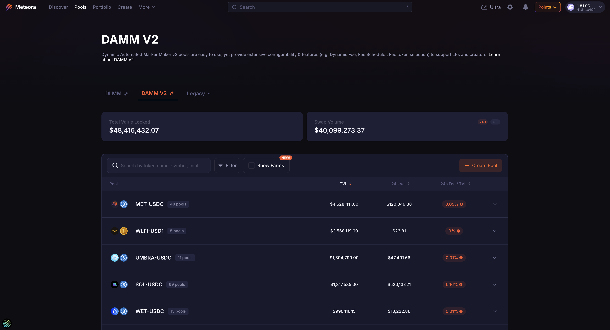
</div>


This guide uses a few example pools: [SOL-USDC](https://app.meteora.ag/dammv2/8Pm2kZpnxD3hoMmt4bjStX2Pw2Z9abpbHzZxMPqxPmie), [URANUS-USDC](https://app.meteora.ag/dammv2/7ccKzmrXBpFHwyZGPqPuKL6bEyWAETSnHwnWe3jEneVc), [WLFI-USD1](https://app.meteora.ag/dammv2/F6L1RKAKwNuWwyCwweja6uxAkRv41XFTRWmg8tKGkn83), and [ICM-SOL](https://app.meteora.ag/dammv2/FLuXAxxqMbLkKHWHHCAiX2ub8qZuoC9bb35bSRDNDMo2).

<div className="flex justify-center">
  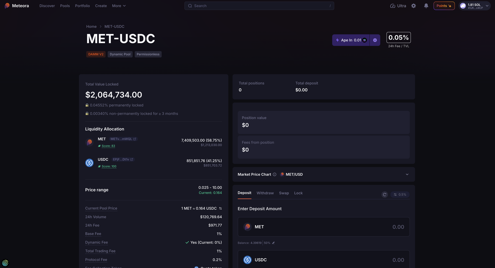
</div>


### Total Value Locked

The pool's TVL (Total Value Locked) is at the top left of the pool detail page. It is the USD value of all tokens currently in the pool. DAMM v2 allows both permanent and non-permanent locking of liquidity, and the TVL section shows:
- Vested Liquidity: % of liquidity non-permanently locked for at least 3 months (at this point in time)
- Permanently Locked Liquidity: % of liquidity permanently locked in the pool

Example pool: [URANUS-USDC](https://app.meteora.ag/dammv2/7ccKzmrXBpFHwyZGPqPuKL6bEyWAETSnHwnWe3jEneVc)

<div className="flex justify-center">
  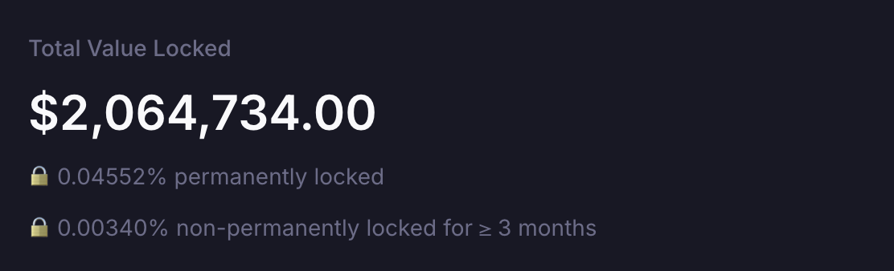
</div>

### Price Range

Most DAMM v2 pools created through the Meteora website cover a price range of 0 to infinity. Pools created programmatically can have a concentrated range with a specific min and max price for higher capital efficiency. A pool's price range is fixed at creation and cannot be changed.

<Note>Compounding fee pools use DAMM v2's compounding liquidity mode and do not use a custom min-max price range.</Note>

Example pool: [SOL-USDC](https://app.meteora.ag/dammv2/8Pm2kZpnxD3hoMmt4bjStX2Pw2Z9abpbHzZxMPqxPmie), where the price range is concentrated at 70 - 440 USDC/SOL.

<div className="flex justify-center">
  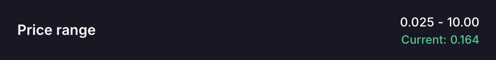
</div>

### Liquidity Allocation

The TVL is broken down into the amount of each token in the pool. In the example pool [ICM-SOL](https://app.meteora.ag/dammv2/FLuXAxxqMbLkKHWHHCAiX2ub8qZuoC9bb35bSRDNDMo2), $820,815.85 in TVL is actually made up of 24,451,511 ICM and 2,064.47 SOL.

<div className="flex justify-center">
  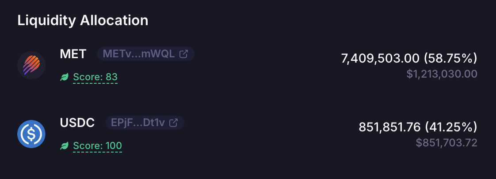
</div>

<Note>
  DAMM v2 supports common Token 2022 extensions permissionlessly, including transfer fees and metadata. Tokens with other extensions need a Meteora token badge before pool creation. See [DAMM v2 Token 2022 Support](/core-products/damm-v2/token-2022-support) for the full rules.
</Note>

The Liquidity Allocation section shows a snippet of the token’s contract address. Click the icon next to it for quick links to copy the address, view it on Solscan, check token risks on Rugcheck.xyz, or analyze token behavior on Bubblemaps.

<div className="flex justify-center">
  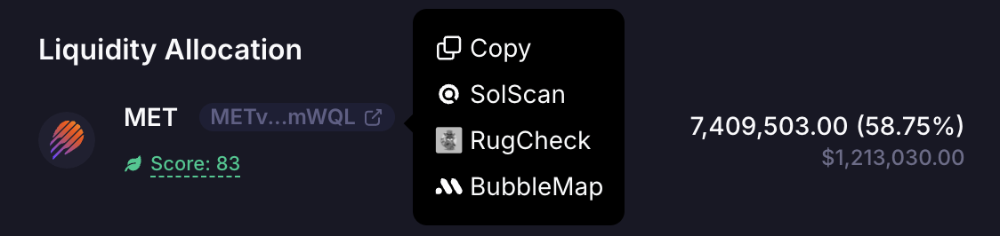
</div>

<Tip>You can also view the token's Jupiter Organic Score and any risks.</Tip>

### Pool Details

#### Current Pool Price

The Current Pool Price may not match the market price, especially for a new pool created with a wrong initial price and low liquidity. Check that the pool price is in sync with the market price before adding liquidity, to avoid losses from arbitrage trades.

#### 24h Volume

Volume generated by the pool in 24h.

#### 24h Fee

Total fees collected by the pool in 24h.

#### Base Fee

Minimum fee charged when swaps occur through the pool, before any Dynamic Fee component is added and before fees are split by the program.

#### Dynamic Fee

Additional fee charged on each trade based on real-time price volatility.

#### Total Trading Fee

```math
Base Fee + Dynamic Fee
```

The total trading fee is split by the program into protocol fee, referral fee when applicable, claimable LP fee, and, for compounding pools, compounding fee.

#### Protocol Fee

Amount of fees charged on each trade which goes to the protocol or integrations. DAMM v2 currently sets the protocol fee to 20% of the total trading fee amount.

#### Fee Collection Mode

- Pool creators can choose how LP fees are collected: **Base + Quote**, **Quote**, or **Quote + Compounding**.
- In **Base + Quote** mode, fees are collected from the output token of each swap.
- In **Quote** mode, fees are always collected in Token B, which is commonly the quote token. For example, in a URANUS-SOL pool, pool creators can set it so LP fees are collected only in SOL.
- In **Quote + Compounding** mode, fees are collected in Token B. A configured portion is compounded back into pool liquidity, while the remaining portion is claimable. A compounding fee of `0` leaves the whole LP fee claimable.
- Once the pool is created, the selected Fee Collection Mode cannot be changed.
- As an LP, you can choose the specific DAMM v2 pool that has the Fee Collection Mode that fits your requirements.

#### Base Fee Mode

- DAMM v2 supports Fixed, Time Scheduler, and Market Cap Scheduler for new pools. Rate Limiter remains on existing pools and cannot be selected for a new pool.
- **Fixed** mode keeps the base fee constant.
- **Time Scheduler** starts from a configurable fee and reduces it over a configured number of periods after the pool activation point. The schedule can be Linear or Exponential.
- **Market Cap Scheduler** reduces fees as the pool price moves upward from the initial price toward configured price steps. The schedule can be Linear or Exponential, and can also expire after a configured duration.
- **Rate Limiter** increases fees based on trade size during a configured launch window. It applies to quote-token fee collection on existing pools. New configs and new pools cannot use it.
- As an LP, you can choose the specific DAMM v2 pool that has the Base Fee mode and parameters that fit your requirements.

**Exponential Fee Time Scheduler**

In this [ICM-SOL](https://app.meteora.ag/dammv2/FLuXAxxqMbLkKHWHHCAiX2ub8qZuoC9bb35bSRDNDMo2) pool example, Exponential mode is used. Fees started at 50% before dropping exponentially over time until it reached 1% after 60 seconds.

<div className="flex justify-center">
  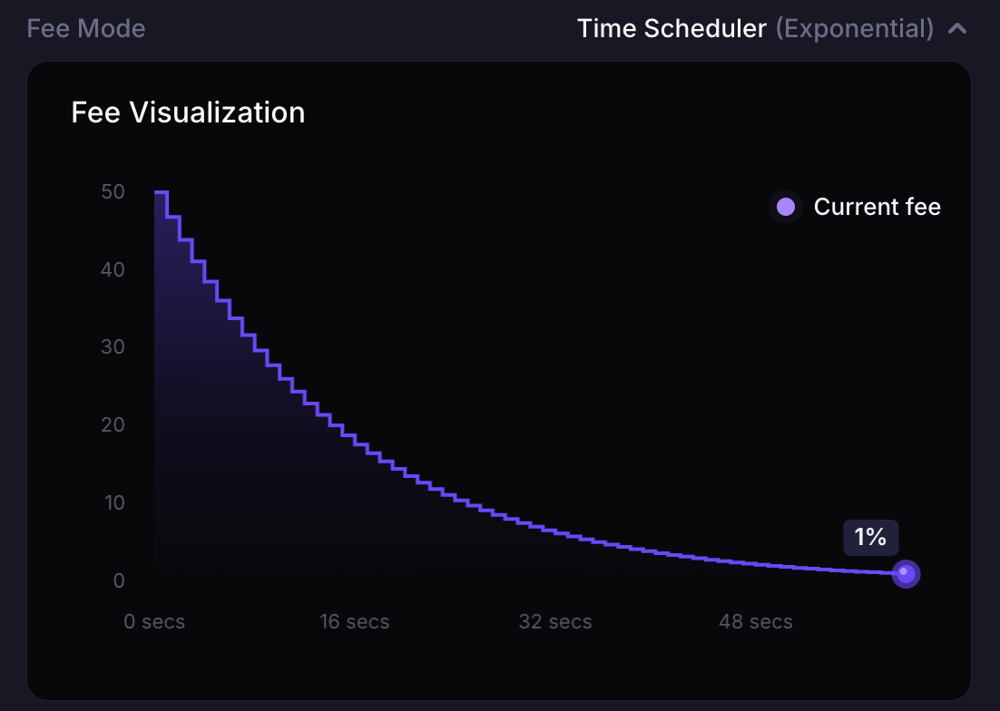
</div>


**Linear Fee Time Scheduler**

In this [WLFI-USD1](https://app.meteora.ag/dammv2/F6L1RKAKwNuWwyCwweja6uxAkRv41XFTRWmg8tKGkn83) pool example, Linear mode is used, and fees started at 10% before dropping linearly over time until it reached 0.25% after 3 minutes.

<div className="flex justify-center">
  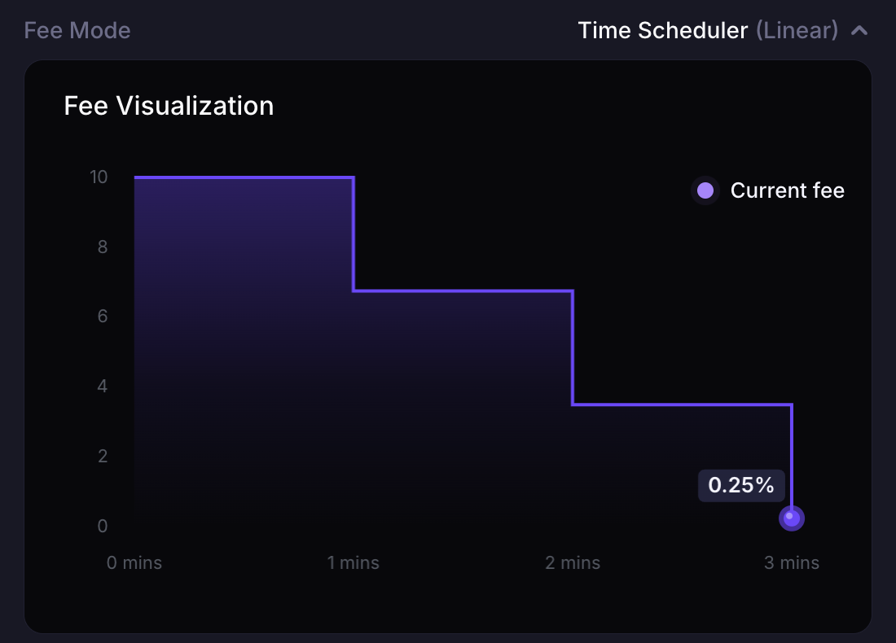
</div>

**Rate Limiter**

In this [ASTEROID-SOL](https://app.meteora.ag/dammv2/5xLdp92fwbcrqXKG24G9SM4C4ha5h1wouxm8RCPyhXxW) pool example, Rate Limiter mode is used, and fees started at 1% before increasing exponentially based on trade size until it reached 99% after 12 hours.

<div className="flex justify-center">
  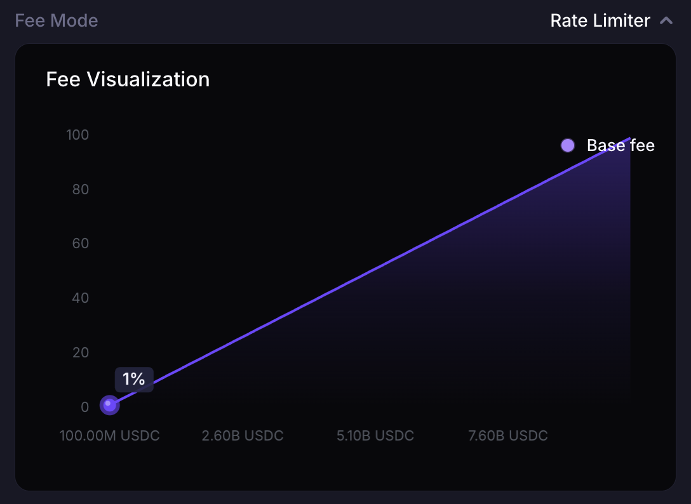
</div>

**Exponential Fee MarketCap Scheduler**

In this [MET-SOL](https://app.meteora.ag/dammv2/9XjqpG4FidkXrePLoXAAVi8916YV1hjd12MiysDhGQ8K) pool example, Exponential mode is used. Fees started at 1% before dropping exponentially as the marketcap grows until it reached 0.3%.

<div className="flex justify-center">
  
</div>


**Linear Fee MarketCap Scheduler**

In this [ASTEROID-USD1](https://app.meteora.ag/dammv2/6p3oRMqHtAnjsKBUsmu9Smcy5bZP3UYJcF9eB8tZYub) pool example, Linear mode is used, and fees started at 1% before dropping linearly as the marketcap grows until it reached 0.3%.

<div className="flex justify-center">
  
</div>

#### Pool Address

Each DAMM v2 pool detail page links to the pool address on Solscan.

<div className="flex justify-center">
  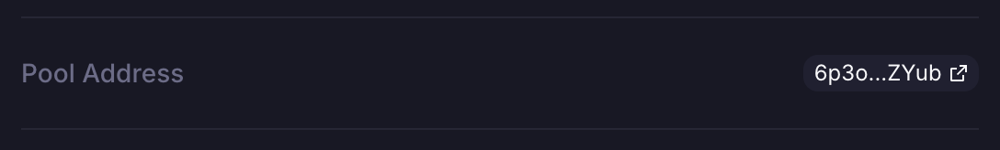
</div>

#### Community Built-in Tools

LP Army developers have built tools for LPing. See the [full list of tools](https://www.lparmy.com/community-tools).

#### Pool Chart

Data and charting tools including Birdeye, GeckoTerminal, DEXScreener, DEXTools, and GMGN have integrated Meteora’s liquidity pools. Buttons link to the pool page on each tool.

<div className="flex justify-center">
  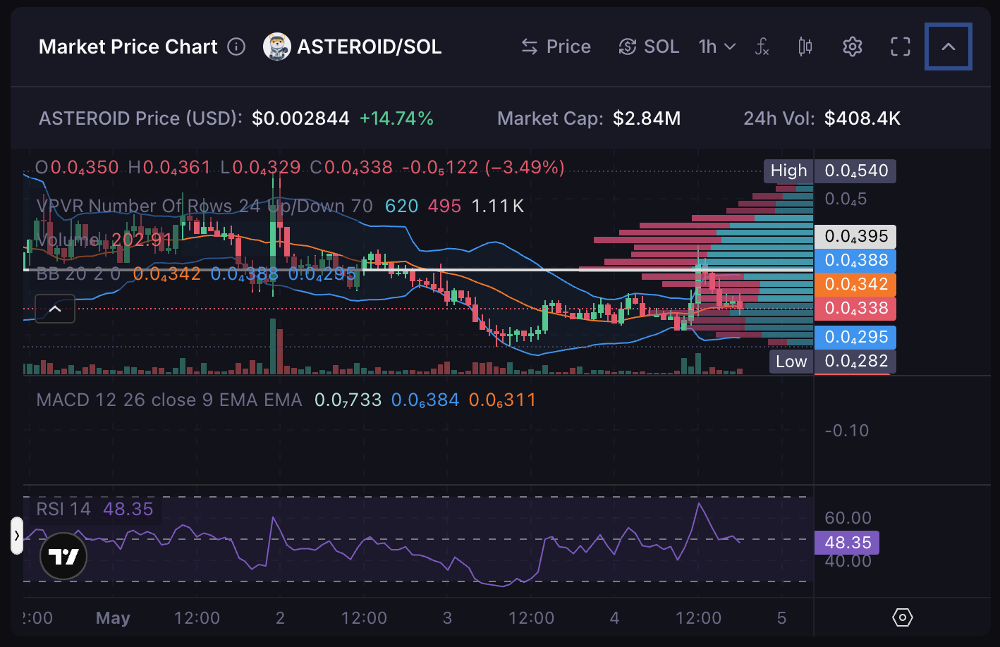
</div>

<div className="flex justify-center">
  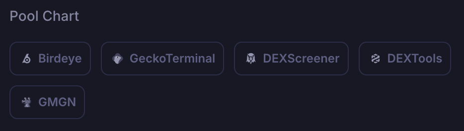
</div>


#### Supported Trading Platforms

Trading platforms and bots including Axiom, Banana Gun, BONKbot, Fluxbot, Jupiter, MetaSolanaBot, Photon, and Trojan have integrated Meteora’s liquidity pools. Buttons link to each platform. For pools without SOL as the quote token, BONKbot, Photon, and Axiom are not listed.

<div className="flex justify-center">
  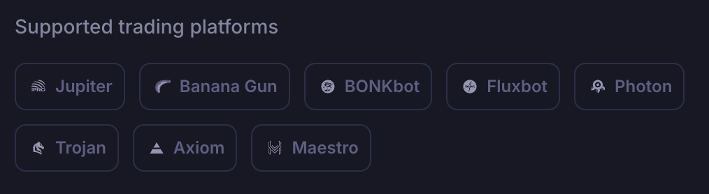
</div>

#### Total Positions

When you create a new DAMM v2 pool or add liquidity to a pool, your liquidity is tracked in a position account represented by a unique liquidity position NFT in your wallet. Adding more liquidity to the same position increases that position's unlocked liquidity.

DAMM v2 supports multiple liquidity positions in the same pool. If someone sends you their liquidity position NFT for the same pool, you hold 2 positions: your original and the one sent to you. The number of positions in the UI equals the number of unique position NFTs in your wallet.

The UI shows details for one liquidity position at a time.

#### Total Deposits

Total $ value of all your deposits in all your liquidity positions.

#### Position Value

$ value of your deposits in the selected liquidity position.

#### Fees From Position

$ value of the accumulated claimable fees for the selected liquidity position. In Base + Quote and Quote fee modes, LP fees accumulate separately and have to be manually claimed by the LP. In Quote + Compounding mode, only the non-compounded portion is claimable because the configured compounding portion is added back into pool liquidity.

## How to Add Liquidity

Open the “Deposit” tab.

### Enter Deposit Amount

Under “Enter deposit amount”, enter the amount of Base token or Quote token to deposit. The corresponding USD value is shown below your input.

<div className="flex justify-center">
  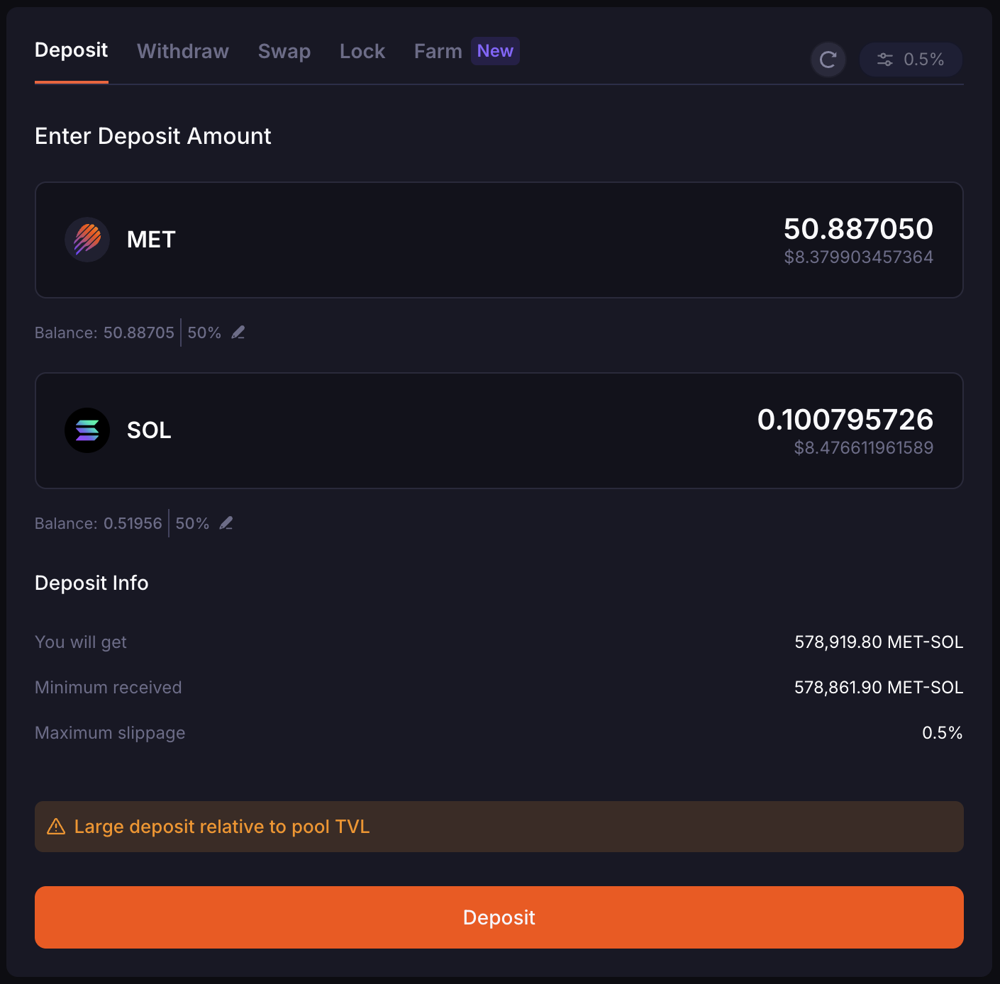
</div>

When you enter an amount for either the Base or Quote Token, Meteora automatically fills in the approximate amount of the other token based on the current liquidity allocation ratio.

For example, if the SOL in the pool comprises 44.93% of liquidity, while USDC comprises 55.07%:

When you enter 2 USDC, the SOL input field will automatically state approximately ~0.109525293 SOL, which is equivalent to (2 / 55.07) x 44.93 = ~$1.63). The amount used may differ slightly from the expected token ratio because the token ratio within the active price bin is constantly changing as swaps occur.

The “Max” and custom “%” buttons next to the Base and Quote token fields enter your entire balance of that token, or a percentage of it (e.g. 99%).

Once both fields are filled, check your deposit details under “Deposit info” before you confirm:
- The estimated amount you will get
- The Minimum Received
- The Maximum Slippage %, which you can preset

Once you have verified that the details are acceptable, click the “Deposit” button.

<div className="flex justify-center">
  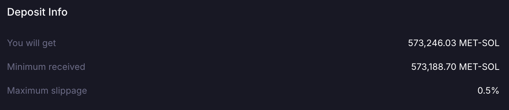
</div>

### Setting Liquidity Slippage

You can adjust how much change to the pool price you're willing to accept and still add liquidity. If the pool price changes a lot while adding liquidity, your transaction may fail. Increase this slippage to improve your success rate.

<div className="flex justify-center">
  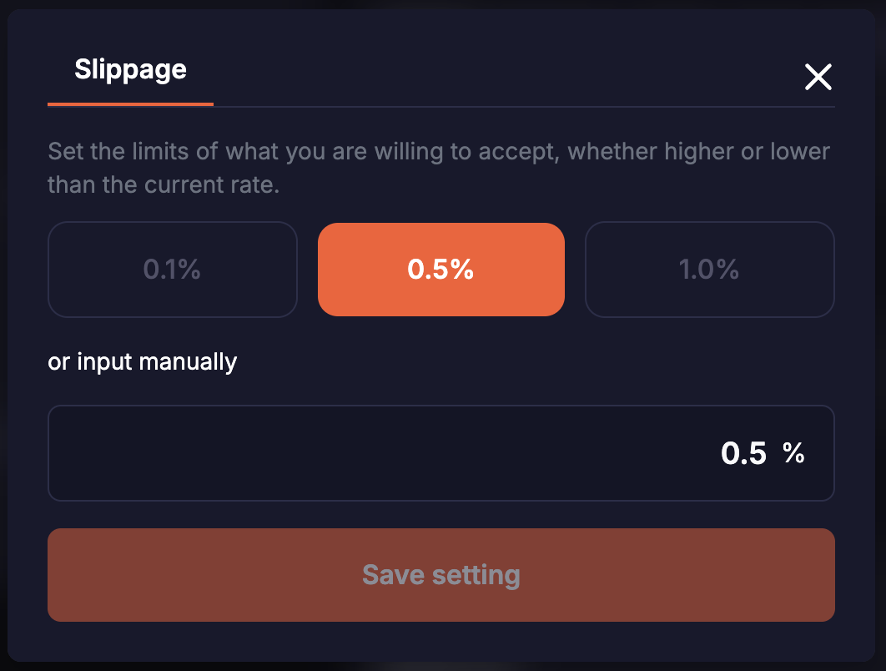
</div>

## How to Withdraw Liquidity

On the pool detail page, open the “Withdraw” tab and enter the amount of unlocked liquidity to withdraw from the selected position.

The “Withdraw Info” section summarizes how many Base and Quote tokens you receive:
- The estimated amount you will get
- The Minimum Received
- The Maximum Slippage %, which you can preset

Once you have verified that the details are acceptable, click the orange “Withdraw” button. 

<div className="flex justify-center">
  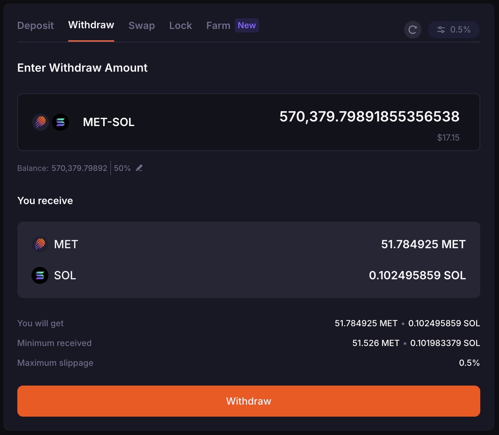
</div>

## How to Lock Liquidity

If you have never added and locked liquidity on Meteora before, “My locks” would show “No locks found".

<div className="flex justify-center">
  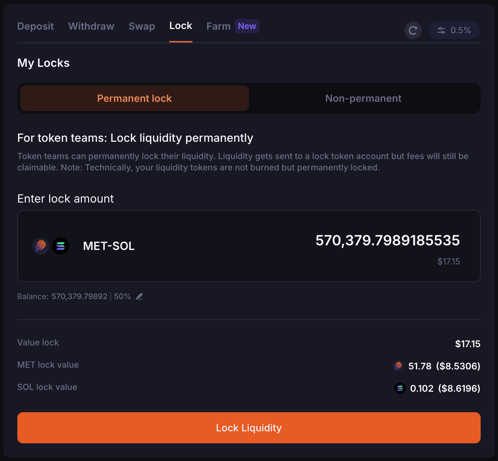
</div>
### Permanent Lock Liquidity

Token teams can permanently lock their liquidity on Meteora. Permanent locking moves liquidity from the position's unlocked liquidity into its permanently locked liquidity state, while fees remain claimable.

Open the “Permanent Lock” tab and enter the amount of unlocked liquidity to lock permanently. The tab shows the total value you are locking, plus the individual token amounts and their $ value.

Click “Lock Liquidity”. A pop-up asks you to confirm by typing “permanently lock my liquidity never to get it back”.

<Note>Once you permanently lock liquidity, you can no longer access or withdraw the underlying assets.</Note>

### Non-Permanent Lock Liquidity

LPs also have the option to lock their liquidity in a “Non-permanent” manner, also known as a lock with vesting. This means unlocked liquidity is moved into vested liquidity and released back to unlocked liquidity based on the configured vesting schedule.

Select the “Non-permanent” tab and enter the amount of unlocked liquidity to lock. Then set:
- Vesting Start Date
- Vesting Duration (Minute)
- Cliff (Optional) (Minute)
- Unlock Schedule (Minutely)

Click “Lock Liquidity”.

<div className="flex justify-center">
  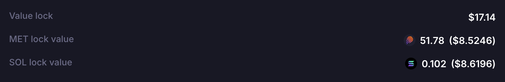
</div>

## FAQ

### Using DAMM v2 on the Meteora UI

#### 1. When you deposit tokens into the pool, how is the liquidity amount calculated?

When you deposit token amounts on the Meteora UI, it calculates the liquidity amount for the selected position before sending the transaction to the program.

Example:
- From token B: amount_b = liquidity_delta (pool.current_sqrt_price - pool.min_sqrt_price)
- So you can reverse: liquidity_delta = amount_b / (pool.current_sqrt_price - pool.min_sqrt_price)

#### 2. How is the fee collected when the pool creator selects fee collection mode as Quote only?

Regarding how DAMM v2 collects fee only using the Quote token ("Token B"):
- If a user swaps from A -> B, fee is charged on B; protocol takes some of the user's B
- If a user swaps from B -> A, fee is charged on B before the swap is calculated; protocol takes some of the user's B before it gets swapped to A

### Liquidity Position NFT

#### 1. What does the position state of the NFT manage?

The position state manages unlocked liquidity, permanently locked liquidity, vested liquidity, pending fees, and pending rewards.

In a single position you can:
- Permanently lock part of the liquidity
- Create multiple vesting schedules
- Add more liquidity (unlocked liquidity)

#### 2. Can I transfer a position NFT (which represents a liquidity position)?

Yes. If you already have a position in a pool and someone sends you their position NFT for the same pool, you hold 2 position NFTs (positions) for that pool.

### Farming

DAMM v2 has a built-in farming mechanism within the program. DAMM v1 uses a separate farming program.

For DAMM v2, each pool can initialize up to 2 reward tokens. Each initialized reward has its own reward vault, reward duration, reward rate, and funder.

When the `initialize_reward` program endpoint is used, a reward vault for the specific pool and reward index is created, and the initiator can specify the reward token and reward duration.

Rewards are shared with liquidity providers over the farming duration and can be claimed from each eligible position.

<div className="flex justify-center">
  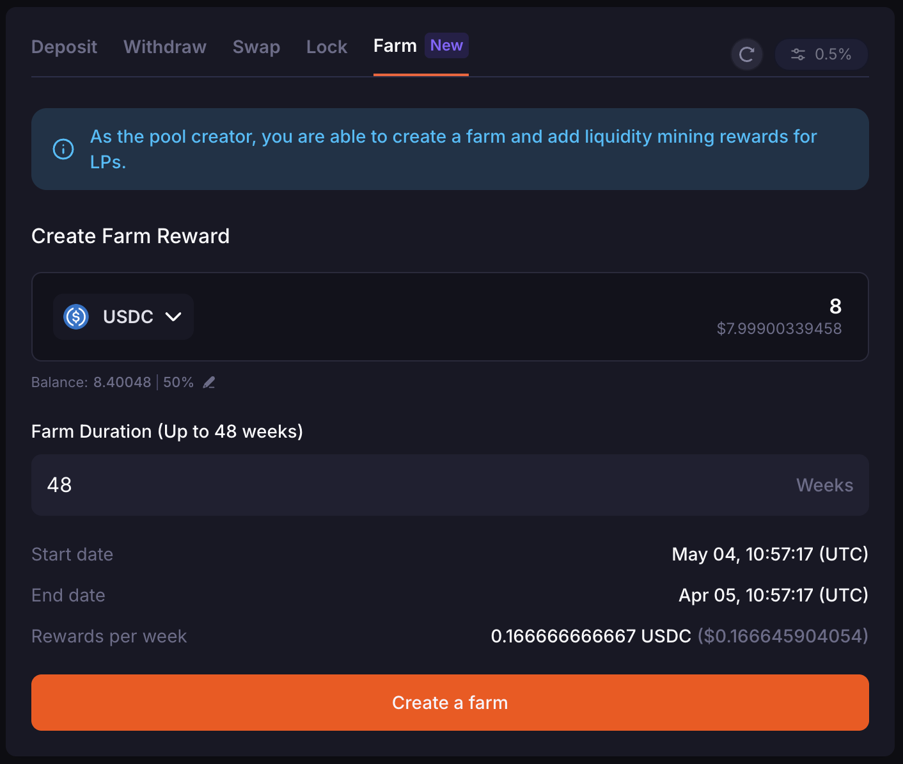
</div>