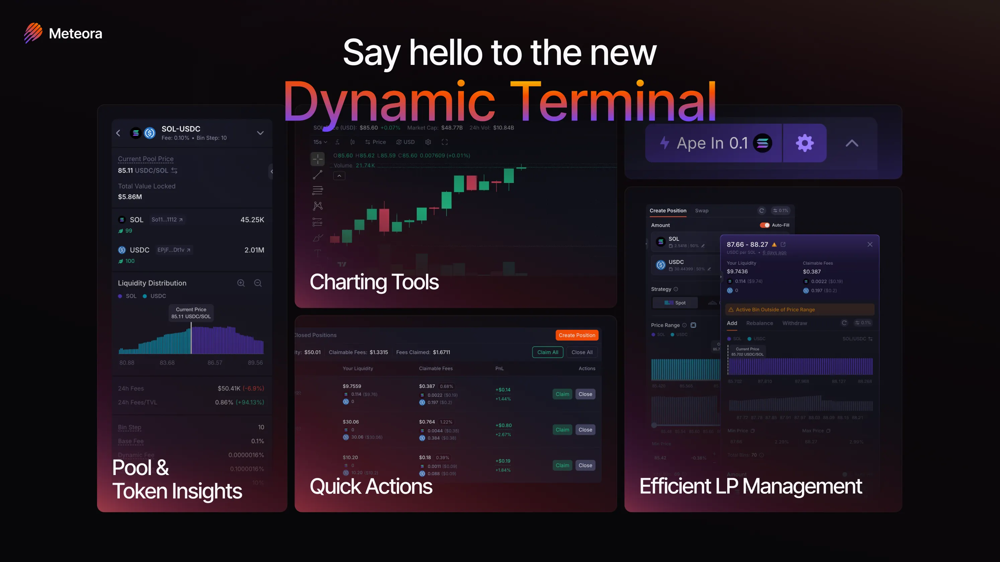

Meteora's **Dynamic Terminal** is the DLMM pool interface. It combines charting, pool and token data, position management, and quick actions in one workspace.

Dynamic Terminal for DLMM is live on [meteora.ag](https://meteora.ag). DAMM v2 support is coming soon.

  

---

## Layout Overview

The Dynamic Terminal is organized into four main areas:

| Area | What's There |
|------|-------------|
| **Left panel** | Pool stats, token info, and risk data |
| **Center top** | TradingView price chart |
| **Center bottom** | Your open positions with real-time P&L |
| **Right panel** | Position creation and management controls |

Each panel is resizable and collapsible.

---

## 1. Pool and Token Insights Panel (Left)

Use the left panel to evaluate a pool before committing capital.

**Pool statistics:**
- Base Fee, Bin Step, Dynamic Fee
- TVL and token ratio
- Liquidity distribution chart
- 24h Volume, Fees, and Fees/TVL

**Token info and risk metrics:**
- Token contract address and [Jupiter Organic Score](https://www.jup.ag)
- Links to Solscan, RugCheck, and Bubblemaps
- Token Age, Market Cap, FDV, Holders
- % of supply held by Top 10 Holders and Top 10 Dev Wallets
- Freeze Authority and Mint Authority status
- Total Supply
- Price change % in 5m / 1h / 12h / 24h

**Pool performance:**
- Historical fee performance
- Links to popular LP community tools

<video autoPlay muted loop playsInline preload="none" src="/user-guides/how-to-use-dlmm/assets/left-panel.mp4" />

<Tip>You can resize or collapse the left panel with one click.</Tip>

#### Pool Stats Explained

- **Bin Step**: the price difference between consecutive bins. A smaller step gives a more continuous price range. A larger step gives higher fee options with wider price jumps. Use smaller steps for stable pairs, larger for volatile ones.
- **Base Fee**: minimum trading fees earned when swaps occur through your position
- **Dynamic Fee**: includes the Base Fee and rises with real-time price volatility
- **Max Fee**: maximum trading fees earned on swaps
- **Protocol Fee**: portion of the total swap fee that goes to the protocol (10% for standard DLMM pools, 20% for Launch Pools)
- **24h Fee / TVL %**: fees collected in the past 24h divided by current TVL, as a percentage

---

## 2. TradingView Price Chart

The Dynamic Terminal includes a built-in [TradingView](https://www.tradingview.com) price chart.

<video autoPlay muted loop playsInline preload="none" src="/user-guides/how-to-use-dlmm/assets/price-chart.mp4" />

**What's included:**
- **Technical indicators**: moving averages, RSI, Bollinger Bands, volume profiles, and more
- **Drawing tools**: support and resistance levels, trend lines, and price targets
- **Multiple timeframes**: 1-minute candles to weekly
- **Persistent layout**: chart settings and annotations are saved automatically
- **Collapsible**: hide the chart when you don't need it and bring it back in one click

**Using the chart for range decisions:**

- **Set ranges**: anchor your min/max price to key technical levels
- **Time your entries**: enter when price is consolidating near your target range
- **Adjust positions**: use chart context to decide whether to rebalance, hold, or exit
- **Limit impermanent loss**: check volatility before committing capital to a range

*Charts powered by [TradingView](https://www.tradingview.com).*

---

## 3. Current Pool Price and Sync

The Current Pool Price is at the top of the position creation panel. It may not match the market price, especially for newly created pools with low liquidity.

<Note>Meteora uses Jupiter's price API as a market price reference. Before adding liquidity, compare the pool price with other markets to confirm it's in sync.</Note>

### Sync with Jupiter's Price

If the pool price is out of sync, use the **"Sync with Jupiter's price"** button before depositing. This is available for pools where:
- There is 0 liquidity between the active bin and the Jupiter price bin, or
- The liquidity is in a bin close enough to the Jupiter price bin

If there's liquidity in the bins between the active and market price that isn't close enough to sync automatically, you can either wait for arbitrage trades to bring it in sync, or make a few tiny manual swaps through the pool in the appropriate direction.

---

## 4. How to Add Liquidity

### Create Position

Click the **Create Position** button on the right panel to open a concentrated liquidity position.

<video autoPlay muted loop playsInline preload="none" src="/user-guides/how-to-use-dlmm/assets/concentrated-liquidity-position.mp4" />

#### Enter Deposit Amount

Enter the amount of Base Token or Quote Token to deposit. With **Auto-Fill** enabled (default), entering an amount for either token automatically fills the approximate equivalent for the other based on the current exchange rate.

Use the **Max** button to enter your full balance, or the custom **%** button to enter a set proportion.

#### Set Liquidity Slippage

Adjust how much price movement you're willing to accept while adding liquidity. Increase slippage if transactions are failing due to price movement.

#### Choose a Volatility Strategy

- **Spot**: uniform distribution across the range. Good default if unsure.
- **Curve**: concentrated around the current active price, less toward the edges. Suits stable pairs or low-volatility tokens.
- **Bid-Ask**: inverse of Curve, with more liquidity at the edges of your range. Suits volatile pairs or a single-sided DCA in/out strategy.

#### Set the Price Range

By default, your position spans 69 bins with the active price centered in your range. Adjust three ways:

1. **Drag the slider**: narrow the range (up to 69 bins)
2. **Enter Min/Max price directly**: widen up to 1,400 bins
3. **Set Min % / Max %**: set how far each boundary is from the active bin as a percentage; use the **+/−** per-bin buttons for fine-tuning

**Reading the liquidity chart:**
- **Purple bins** = Base token (e.g. SOL)
- **Cyan blue bins** = Quote token (e.g. USDC)
- **Grey bins** = Existing liquidity already in the pool. Hover over a bin for its price and token breakdown.

A narrower range is more capital efficient and can capture more fees, but is more likely to go out of range. A wider range captures fewer fees per dollar but tolerates more price movement.

#### Single-Sided Liquidity

To deposit only one token, toggle off **Auto-Fill** and enter an amount in only one field.

**Example:** You bought SOL at 236.6 USDC and want to gradually sell it at 240–280 USDC. Turn off Auto-Fill, enter only your SOL amount, set a range of 240–280, and use Bid-Ask strategy. Your SOL gets allocated across that range and progressively swaps to USDC as price moves through it.

#### Cost Details

Before confirming, review the SOL rent required:
- **Refundable**: position creation rent and extension rent, returned when you close the position
- **Non-Refundable**: SOL for creating new bin arrays

Click **"Show cost details"** for the full breakdown.

#### Confirm

When everything looks right, click **Add Liquidity** to execute.

---

### Ape In

The **Ape In** button swaps and creates a position from a single token in one transaction, using your preferred settings.

---

## 5. Your Positions (Bottom Panel)

All your open positions are listed at the bottom of the Dynamic Terminal with real-time performance data.

<video autoPlay muted loop playsInline preload="none" src="/user-guides/how-to-use-dlmm/assets/position-list.mp4" />

| Metric | Description |
|--------|-------------|
| **Date & Time** | When the position was opened |
| **Your Liquidity** | Current value of deposited tokens |
| **Claimable Fees** | Accumulated fees ready to claim |
| **P&L** | Profit & Loss in $ and % |
| **24h Fee / TVL %** | Estimated short-term fee generation rate |

<Note>For the account model behind positions, see [DLMM Dynamic Positions](/core-products/dlmm/dynamic-positions).</Note>

#### Earning Fees

LPs earn fees whenever swaps occur within their active price range. Fees do not auto-compound. They accumulate and must be claimed manually.

#### Out of Range

If the active price moves outside your range, your position goes inactive and stops earning fees. You can either:
- Wait for price to return to your range
- Rebalance: withdraw and re-center your position around the current price

---

## 6. Quick Actions

Batch controls to manage all positions at once:

- **Claim All Fees**: collect fees from every position in one transaction
- **Close All Positions**: exit all positions simultaneously

Individual controls are also available per position.

---

## 7. Position Management Panel (Right)

Select any position to open the dedicated management panel on the right side. Resizable and collapsible.

<video autoPlay muted loop playsInline preload="none" src="/user-guides/how-to-use-dlmm/assets/manage-position.mp4" />

- **Add Liquidity**: add more capital within the same price range
- **Rebalance**: re-center your range around the current price in one click
- **Remove Liquidity**: withdraw partial or full liquidity
- **Withdraw and Close**: exit the position and reclaim rent
- **Zap Out**: withdraw and convert everything to your preferred token in one step (available for positions with ≤ 250 bins)

<Note>You cannot withdraw single-sided from the active bin. You must withdraw both tokens.</Note>

---

## 8. Customizable Layout

- **Left panel**: resize or hide the pool/token insights panel
- **Right panel**: resize or hide the position management panel
- **Chart**: resize or hide the TradingView price chart

<video autoPlay muted loop playsInline preload="none" src="/user-guides/how-to-use-dlmm/assets/customize-layout.mp4" />

---

## Video Walkthrough

<CardGroup cols={1}>
  <Card 
    title="Dynamic Terminal Video Walkthrough" 
    icon="film" 
    iconType="solid"
    href="https://x.com/dannxbt/status/2029168965671661755"
    target="_blank"
  >
    Dann's walkthrough of the DLMM Dynamic Terminal, covering features and key workflows.
  </Card>
</CardGroup>

---

## Community Tools and Integrations

**Analytics:** Birdeye, GeckoTerminal, DEXScreener, DEXTools, and GMGN all have dedicated pool pages, linked from the pool page.

**Trading platforms:** Axiom, Banana Gun, BONKbot, Fluxbot, Jupiter, MetaSolanaBot, Photon, and Trojan are integrated. For pools without SOL as the quote token, BONKbot, Photon, and Axiom may not appear.

**Community-built LP tools:** [lparmy.com/community-tools](https://www.lparmy.com/community-tools)

---

## Learn More

- [LP Army Bootcamp](https://lparmy.notion.site/lp-army-bootcamp): strategies for DLMM LPing
- [LP Army](https://lparmy.com): community
