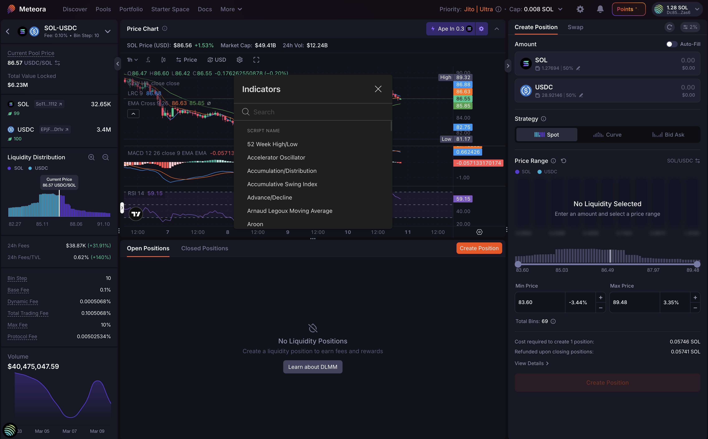

Meteora's Dynamic Terminal includes a built-in [TradingView](https://www.tradingview.com) chart, so you can analyze price and manage your liquidity position on the same page.

<video autoPlay muted loop playsInline preload="none" src="/user-guides/how-to-use-dlmm/assets/price-chart.mp4" />

---

## Why TradingView for Liquidity Providers?

Your price range determines:

- How much trading volume passes through your position
- How often you earn fees vs. sitting out of range
- Your exposure to impermanent loss

TradingView is built into the Dynamic Terminal, on the same page where you create and manage positions.

---

## What's Included

### Advanced Charting

- **100+ technical indicators**: moving averages, RSI, MACD, Bollinger Bands, volume profiles, and more
- **Multiple chart types**: candlestick, bar, line, area, Heikin Ashi, and more
- **Multiple timeframes**: 1-minute candles to weekly charts
- **Zoom controls**: zoom in on a breakout or out to the full range

### Drawing Tools

- **Trend lines and channels**: identify directional momentum
- **Support and resistance levels**: mark the price zones that inform your min and max range
- **Fibonacci retracements**: spot potential reversion levels for range placement
- **Text notes and labels**: annotate directly on the chart

### Persistent Layout

Indicators, drawn levels, and timeframe preferences are saved automatically and persist across sessions.

### Collapsible Panel

Hide the chart with one click when you don't need it, and bring it back the same way.

---

## How to Access TradingView Charts

The TradingView chart needs no setup.

1. Go to [meteora.ag](https://meteora.ag)
2. Select a DLMM pool from the pool list
3. The Dynamic Terminal opens with the TradingView chart in the center panel
4. Use the toolbar at the top of the chart to switch timeframes, add indicators, or use drawing tools

<Tip>Drag the edge of the chart panel up or down to resize it.</Tip>

---

## How LPs Use TradingView to LP Better

### Setting Ranges

Anchor your min and max price to levels on the chart:

- Use support levels as your min price, where price is likely to find buyers
- Use resistance levels as your max price, where price may struggle to push past
- Use Fibonacci retracements to identify likely reversion zones for range-bound strategies

### Timing Your Entries

Entering while price trends strongly against your range puts you out of range immediately. Use the chart to:

- Look for consolidation zones near your target range, where tighter price action means more time in range
- Check momentum indicators before committing capital to a concentrated range
- Wait for volatility to settle before opening positions in high-activity periods

### Monitoring While Active

While your position is open, use the chart to:

- Watch for breakouts that may push price out of your range
- Decide whether to rebalance, hold, or exit
- Check volume to gauge whether trading activity through your range is likely to continue

### Reducing Impermanent Loss

Impermanent loss increases when price moves far outside your range. To limit it:

- Avoid entering ranges that are already extended and likely to revert
- Set wider ranges in high-volatility conditions to stay in range longer
- Exit before a clear trend pushes price far outside your position

---

## Device Availability

The TradingView chart in the Dynamic Terminal is available on desktop and tablet.

---

## Get Started

The Dynamic Terminal with TradingView charts is live at [meteora.ag](https://meteora.ag).

- [How to use DLMM Dynamic Terminal](/user-guides/how-to-use-dlmm/dynamic-terminal): guide to the Dynamic Terminal interface
- [LP Army Bootcamp](https://lparmy.notion.site/lp-army-bootcamp): strategies for using chart analysis in your LP workflow
- [Join the LP Army](https://lparmy.com): connect with the community

---

## Top 5 Indicators for LPs

<CardGroup cols={1}>
  <Card
    title="Top 5 Indicators for LPs"
    icon="chart-bar"
    iconType="solid"
    href="https://x.com/0xkappayield/status/2035305438066217117"
  >
    Post by @kappatin on five indicators to watch when providing concentrated liquidity.
  </Card>
</CardGroup>

---

*Charts powered by [TradingView](https://www.tradingview.com).*
