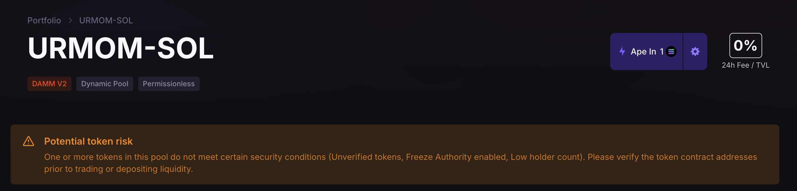
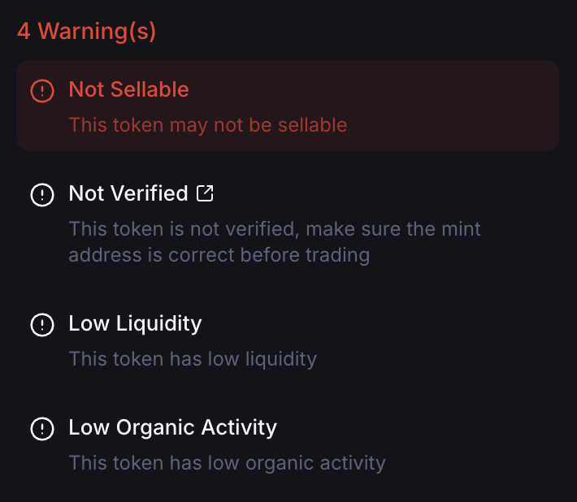
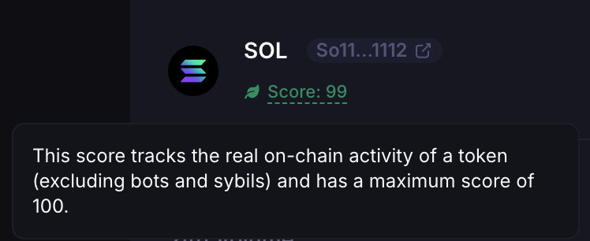

## How to Check if a Token Is Safe to LP In

### Potential Token Risk Warning

Pools with suspicious or risky tokens show a “Potential token risk” warning at the top of the pool detail page.

  

### Rugcheck

Before buying a token, paste its address into https://rugcheck.xyz/ to check for risks.

Some tokens have a “Freeze Authority”, which lets the token minter or creator freeze buying, selling, or transfers by users. Ask the token project about it and be cautious when trading the token.

### JupShield

The pool list page and each pool detail page integrate JupShield by Jupiter. JupShield combines Jupiter's scam-mitigation tooling with third-party services like RugCheck and Blockaid to flag potentially risky tokens and liquidity pools. Flagged tokens include those involved in rugpulls, with suspicious mint activity, with Freeze Authority enabled, or with low liquidity. The warnings appear on the page before you buy the token or add liquidity.

  

### Jupiter Organic Score

Meteora also shows Jupiter’s Organic Score, which measures the authentic engagement and on-chain activity of a token. Raw volume and liquidity figures can be faked or inflated by bots. This score focuses on real user activity. It considers:
- Holder count
- Trading volume (from real wallets, not bots)
- Liquidity trends
- Other heuristics for detecting organic token growth

  

<Tip>Before you trade or add liquidity for a token, do your own due diligence on Rugcheck, JupShield, and Jupiter Organic Score.</Tip>

### Compromised Wallets

If your wallet is compromised, transfer your assets to a new wallet immediately and LP with the new wallet.

Be wary of scams, phishing links, and downloading programs. Team members never DM you directly or ask you to join another Discord. Never give or show your wallet’s private key to anyone.

Once multiple malicious parties have access to a wallet, it is very hard to verify the original owner for any points, airdrop, or rewards system.