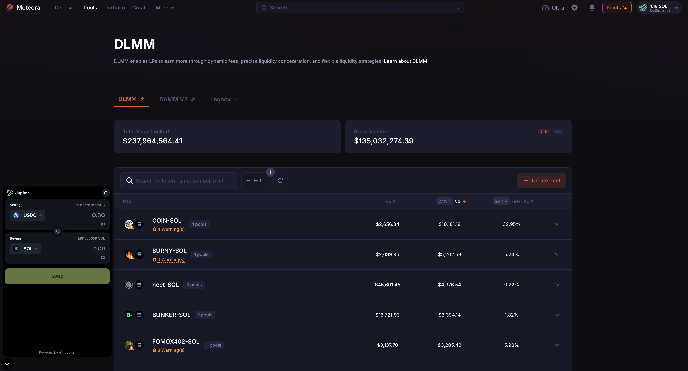
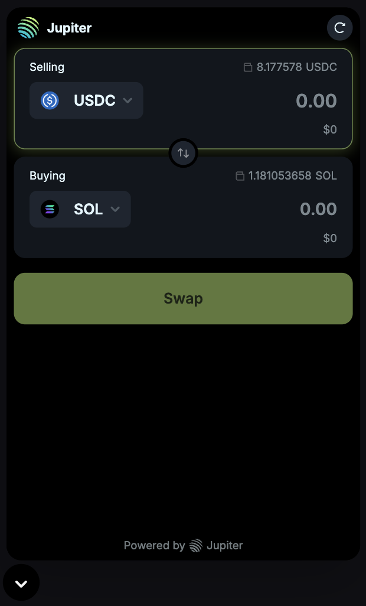
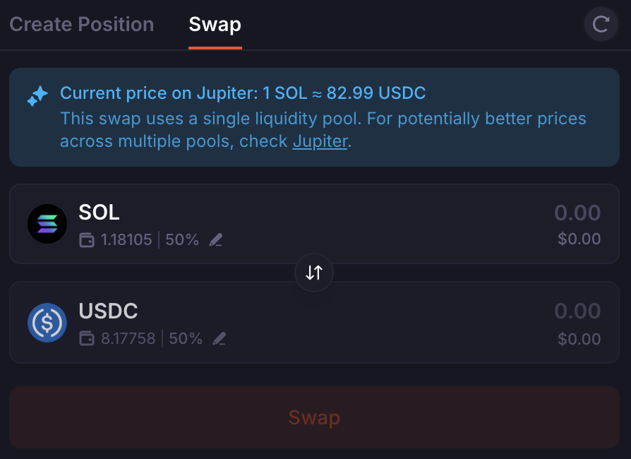

If you lack one or both of the tokens required to add liquidity to a pool, you can swap on Meteora in two ways.

## Jupiter Terminal

    

Meteora integrates [Jupiter](https://jup.ag/), a DEX aggregator, through Jupiter Terminal, an open-source, lite version of Jupiter that adds a swap flow to a site.

Select the Jupiter Terminal icon at the bottom left of the screen to open the pop-up. Your wallet connects automatically if you're already connected on Meteora. Select your input and output tokens, then execute the swap.

    

## Swapping Within the Pool

If you hold one token of a pool's pair, you can swap part of it for the other token using the pool's own liquidity. DLMM, DAMM v2, and DAMM v1 pools all have a "Swap" tab.

For example, to add liquidity to a SOL/USDC pool with only SOL, open the "Swap" tab on the pool page and swap part of your SOL for USDC at the current pool price. Before swapping, check that the pool has enough liquidity and that the pool price matches the market price.

Also check your settings (transaction fees, slippage) and the "Swap info" section before you execute the transaction.

    

### How Price Impact Is Calculated

Price Impact is the % difference between the value of your input amount and the value of your output amount.

<Note>
    On the Meteora user interface, Price Impact %:
    - Does not take slippage into account for the swap output amount, so you'll have to set slippage rate to 0 before calculating if you want a more precise %.
    - Does not take into account that the dollar value in the swap input box is sourced from Jupiter's price API, so it may not always be 100% accurate. For example: sometimes USDC will be worth $0.9999
    - Does not take into account the Swap fee that's charged on the swap.
</Note>